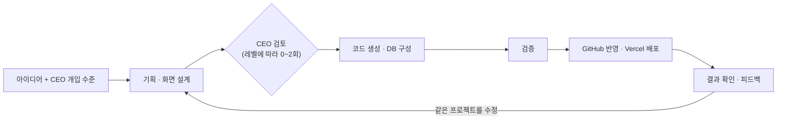

# MVP 팩토리

CEO가 되어 가상의 사무실 공간에 있는 멀티 에이전트와 프로젝트를 기획/코딩/배포하는 서비스를 위한 개발 기반입니다.

**현재 상태: 화면 코드, API 전체, 데모 워커가 있고, 실제 AI 생성·코드 실행·외부 연동·배포는 아직 구현되지 않았습니다.** 초기 데모 코드는 삭제하고 문서 기준으로 새로 작성하고 있습니다.

## 제품 목표

다음은 목표 제품의 흐름이며, 현재 데모의 구현 완료 범위를 뜻하지 않습니다.

사용자가 **아이디어**와 **자신이 얼마나 관여할지(CEO 개입 수준)** 를 입력하면, 가상의 제품팀(PM·기획자·디자이너·개발자 에이전트)이 기획부터 검증까지 진행한다. 결과물은 사용자의 GitHub 저장소와 Vercel에 배포된 작은 Next.js 웹앱이다. 데이터 저장이 필요하면 DB도 자동으로 만든다. 배포 뒤에는 피드백을 줘서 같은 프로젝트를 고쳐 다시 배포할 수 있다.

사용자는 고정 디자인의 픽셀아트 사무실에서 팀이 회의하며 일하는 모습을 지켜본다. 사용자 꾸미기·사무실 확장·배치 편집 기능은 제공하지 않는다.



## 현재 상태

- **서버:** `src/app/api`의 API(구현 현황은 [API.md](docs/API.md) §14), 업무 계층(`src/domain`, `src/application`, `src/infrastructure`, `src/server`), DB 스키마와 마이그레이션(`prisma/schema/`), 화면·서버 공용 타입(`src/contracts`)이 있습니다.
- **화면:** `src/app`, `src/components`, `src/hooks`, `src/services`는 초기 데모 때의 화면이며 새 API 계약에 맞춰 다시 만들어야 합니다.
- **워커:** `npm run worker`가 데모 실행을 진행합니다(CEO 레벨별 검토, 회의 기록, 재시작 복구). 산출물은 입력한 아이디어로 만든 예시이며 실제 AI가 만든 것이 아닙니다. 자세한 동작은 [API.md](docs/API.md) §15입니다.
- **실제 실행(부분, 모의 모델로만 검증):** `.env`에 `LLM_API_KEY`·`LLM_MODEL`이 있으면 워커가 REAL Run을 처리합니다. OpenAI가 범위·기획·화면·회의 발언을 만들고, 로그인된 Codex CLI가 코드 작성·수정을 담당합니다. Docker 샌드박스에서 설치·빌드·테스트하며 실패하면 한도 안에서 Codex에 수정을 요청합니다. 합격한 소스는 `.data/source-snapshots`에 보존합니다. 모델 호출은 Run의 한도와 사용량에 기록됩니다. **실제 OpenAI(gpt-5.4)로 기획부터 빌드·테스트 통과까지 한 번 확인했습니다(테스트 DB).** 마무리 단계는 GitHub 반영(`src/application/github.ts`)과 Vercel 배포(`src/application/vercel.ts`, `src/application/release.ts`)를 거칩니다. 대상 계정과 저장소 공개 범위는 공통 설정에서 읽고, 외부 작업 원장으로 중복 생성을 막습니다. GitHub는 실제 계정에서 저장소 생성과 커밋을 확인했고, Vercel도 실제 계정에서 배포·운영 주소 접속·중복 방지를 확인했습니다. 운영 주소가 200으로 열려야 Run이 성공하며, 요구사항별 검증(APP-AC)이 없어 결과 화면의 제품 상태는 미검증으로 남습니다. 데이터 저장이 필요한 앱은 공용 Supabase 프로젝트 안의 앱 전용 스키마를 쓰며(선언형 데이터 계획 → 검토된 SQL 컴파일러, RLS), 이 부분은 로컬 PostgreSQL로만 검증했고 실제 Supabase에서는 아직 확인하지 않았습니다. 사용하려면 `docker pull node:22-slim`이 필요합니다.
- **없는 것:** 외부 연동(GitHub, Vercel, Supabase), 요구사항 단위 검증(APP-AC), 실제 모델 호출 검증.
- **미연결:** LLM, 생성 앱 Supabase DB, GitHub, Vercel.
- **작업 계획:** [TASKS.md](TASKS.md)와 `tasks/` 폴더, 목록은 `npm run tasks`로 봅니다.

## 기술 스택 (확정)

Next.js App Router, TypeScript, Tailwind CSS, PostgreSQL과 Prisma, LangGraph와 PostgreSQL 체크포인트, 별도 Node.js 워커. 하나의 Next.js 패키지(`src/`)에서 웹과 워커를 함께 관리합니다. 폴더 구성은 [ARCHITECTURE.md](docs/ARCHITECTURE.md) §17을 따릅니다.

운영 DB에 저장되는 정보와 생성 앱 자체의 업무 데이터 DB는 다릅니다. 외부 리소스 주소나 식별자를 가짜로 만들지 않습니다.

## 시작하기

Node.js 22와 npm이 필요합니다.

```bash
npm ci
cp .env.example .env # .env 파일이 아직 없을 때만 실행
npm run dev
```

브라우저에서 http://127.0.0.1:3000 을 엽니다. 웹 서버는 로컬에만 바인딩됩니다. 이 앱에는 로그인이 없으므로 인터넷이나 다른 사람에게 노출하면 안 됩니다.

서버와 워커를 쓰려면 DB가 필요합니다. 각각 별도 터미널에서 실행합니다.

```bash
docker compose up -d --wait   # PostgreSQL (127.0.0.1에만 바인딩, 신뢰할 수 있는 개인 개발 환경에서만 사용)
npx prisma generate
npx prisma migrate deploy
npm run dev
npm run worker                # 데모 워커. 꺼져 있으면 실행은 대기 상태로 남습니다.
```

개발 DB에 삭제한 초기 코드의 옛 테이블이 남아 있으면 `migrate deploy`가 충돌하므로, DB를 초기화하기 전에 확인하세요. 워커는 한 번에 하나만 실행되며, 체크포인트 테이블은 처음 시작할 때 LangGraph가 만듭니다(DB 사용자에게 테이블 생성 권한이 필요).

## 검증

```bash
npm run typecheck
npm run lint
npm run format:check
npm run build
npm test
```

DB를 쓰는 테스트(`api`, `api-office`, `worker`, `external-operations`)는 **개발 DB가 아니라 테스트 전용 DB**(`mvpfactory_test`)에서 실행됩니다. 테스트가 열린 Run 예약과 대기 중인 Job을 지우고 프로젝트를 만들기 때문입니다. 테스트 DB 이름에 `test`가 없으면 테스트가 시작하지 않습니다. 처음 한 번 만들어 두세요.

```bash
docker exec mvpfactory-db-1 psql -U postgres -c 'CREATE DATABASE mvpfactory_test'
DATABASE_URL="<DATABASE_URL에서 DB 이름만 mvpfactory_test로 바꾼 주소>" npx prisma migrate deploy
```

주소를 따로 지정하려면 `.env`에 `TEST_DATABASE_URL`을 넣습니다(없으면 `DATABASE_URL`의 DB 이름 뒤에 `_test`를 붙여 씁니다). 개발 DB의 워커가 켜져 있어도 테스트와 충돌하지 않습니다. 스키마를 바꾸면 테스트 DB에도 마이그레이션을 적용해야 합니다.

## 코드 품질 및 구조

- ESLint의 Next.js Core Web Vitals와 TypeScript 규칙으로 코드 품질을 검사합니다. Prettier와 충돌하는 ESLint 서식 규칙은 비활성화합니다.
- Prettier 설정을 공통 서식 기준으로 사용합니다. `npm run format`으로 서식을 적용하고 `npm run format:check`로 확인합니다. 생성 파일과 잠금 파일은 서식 검사에서 제외합니다.
- 사람과 AI 모두 변경 후 `npm run lint`, `npm run format:check`, `npm run typecheck`를 실행하고, 동작에 영향을 주는 변경은 관련 테스트와 빌드도 확인합니다.
- 서버 코드는 Controller(Route Handler), Application(유스케이스), Domain(업무 규칙), Infrastructure(저장·외부 연동)로 나눕니다. 자세한 규칙은 [AGENTS.md](AGENTS.md) §3을 따릅니다.
- 내부 소스 import는 `@/` alias를 사용합니다.
- `src/app` 페이지는 라우팅과 훅 연결에 집중합니다. 프로젝트 목록, 생성 폼, 상세 화면처럼 크거나 재사용되는 뷰는 `src/components`에 둡니다. 뷰에는 필요한 타입 데이터와 콜백을 명시적으로 전달하고 데이터 접근을 맡기지 않습니다.
- `src/hooks`는 클라이언트 상태, 생명주기, 이벤트 흐름을 관리하고 HTTP 요청·응답은 `src/services`를 호출합니다. 뷰 컴포넌트는 서비스나 `fetch`를 직접 호출하지 않아 입력과 부수 효과를 분리하고 교체 가능하게 유지합니다.
- 각 컴포넌트는 진행 상황, 결정 요약, 산출물 표시처럼 하나의 뷰 책임에 집중합니다. 페이지를 의미 있게 단순화하거나 여러 곳에서 재사용할 때 추출하고, 한 줄 표현을 이름만 바꾸는 래퍼나 불필요한 추상화는 만들지 않습니다.
- UI 추출 시 시맨틱 HTML과 접근성을 보존합니다. 레이블과 입력 연결, 상태·오류의 읽을 수 있는 안내 및 `alert` 역할, 콜백 기반 동작을 유지합니다. 서버 비즈니스 로직은 서버 모듈에 두고 클라이언트에서 중복 구현하지 않습니다.

## 사용자와 접근 범위

이번 MVP는 로그인이 없는 단일 사용자 작업 공간입니다. 사용자별 접근 격리는 제공하지 않으며, 인증은 후속 범위입니다. 공급자 비밀 키는 `.env`에만 두고 `.env.example`에는 키 이름만 적습니다. 실제 LLM, 격리된 앱 코드 실행, Supabase 프로젝트·스키마 생성, GitHub 저장소 생성·push, Vercel 배포, 같은 프로젝트의 수정·재배포는 아직 구현되지 않았습니다.

사무실 화면 제안과 두 상태의 시안은 [UI_SPEC.md](docs/UI_SPEC.md)에서 확인합니다. 아직 사용자 승인 전인 시각 초안입니다.

## 어떤 문서부터 읽을까

| 읽는 사람              | 추천 순서                                                                |
| ---------------------- | ------------------------------------------------------------------------ |
| 처음 보는 사람         | 이 문서 → PRD의 "한눈에 보기"와 §1, §5, §6 → 아래 용어 사전              |
| 기획·제품 담당         | PRD 전체 → UX_PRINCIPLES → DESIGN_SYSTEM                                 |
| 프런트엔드·디자인 담당 | PRD §7(REQ-015·016), §8 → UX_PRINCIPLES → DESIGN_SYSTEM → ANIMATION_SPEC |
| 백엔드·워커 담당       | PRD §6, §9 → ARCHITECTURE §1~§8 → WORKFLOW §3~§9                         |
| 코딩 에이전트          | 루트 `AGENTS.md` → 작업과 관련된 REQ/AC → 해당 문서의 관련 절            |

긴 문서(PRD, ARCHITECTURE, WORKFLOW)는 처음에 **"한눈에 보기"** 와 목차가 있다. 전체를 순서대로 읽을 필요는 없다.

## 문서 지도

| 문서                                          | 한 줄 설명                                                                  | 상태                |
| --------------------------------------------- | --------------------------------------------------------------------------- | ------------------- |
| [MVP_FACTORY_PRD.md](docs/MVP_FACTORY_PRD.md) | 무엇을 만들고 어디까지가 범위인가. 요구사항(REQ)과 수락 조건(AC), 출시 기준 | v0.2 구현 기준 초안 |
| [ARCHITECTURE.md](docs/ARCHITECTURE.md)       | 어떤 구성 요소로 만들고, 무엇을 반드시 지켜야 하는가                        | v0.1 제안           |
| [WORKFLOW.md](docs/WORKFLOW.md)               | 실행이 어떤 단계와 상태를 거치고, 실패하면 어떻게 이어가는가                | v0.1                |
| [UX_PRINCIPLES.md](docs/UX_PRINCIPLES.md)     | 제품의 분위기, 문구 톤, 접근성 원칙                                         | v0.1 제안 초안      |
| [DESIGN_SYSTEM.md](docs/DESIGN_SYSTEM.md)     | 색·글꼴·간격·컴포넌트 규칙                                                  | v0.1 제안 초안      |
| [ANIMATION_SPEC.md](docs/ANIMATION_SPEC.md)   | 회의 애니메이션과 캐릭터·사무실 연출                                        | v0.1 제안 초안      |
| [CONTRIBUTING.md](docs/CONTRIBUTING.md)       | 저장소 구조, 개발 명령, 커밋·PR 규칙                                        | 사용 중             |
| 루트 [AGENTS.md](AGENTS.md)                   | 코드 작성 규칙(MVC·DDD, hook, import, 테스트)                               | v0.1                |
| 루트 [TASKS.md](TASKS.md), [tasks/](tasks/)   | 작업 관리 규칙과 작업 파일(작업당 파일 하나, `npm run tasks`로 목록 확인)   | 사용 중             |
| [API.md](docs/API.md)                         | 화면과 서버가 함께 쓰는 호출 계약(요청·응답·오류·SSE)                       | v0.1 초안           |
| [DB_SCHEMA.md](docs/DB_SCHEMA.md)             | 팩토리 DB의 테이블·제약·트랜잭션 경계                                       | v0.1 초안           |
| `TEST_PLAN.md`                                | 검증 절차                                                                   | **아직 없음**       |

## 문서가 충돌할 때

1. **제품 범위와 요구사항**은 PRD가 기준이다.
2. **기술 구조**는 ARCHITECTURE, **실행 절차와 상태**는 WORKFLOW가 기준이다.
3. **시각·문구·연출**은 UX_PRINCIPLES, DESIGN_SYSTEM, ANIMATION_SPEC을 따르되, REQ/AC와 충돌하면 PRD가 우선한다.
4. **코드 작성 방식**은 `AGENTS.md`가 기준이다.
5. 충돌을 발견하면 한쪽에 임의로 맞추지 말고, 어느 문서의 어느 부분이 충돌하는지 적어서 알린다.

## 문서 읽을 때 알아둘 표기

- **REQ-001, AC-001-1**: PRD의 요구사항 번호와 수락 조건 번호. "이 기능이 되었다"의 기준이다.
- **DEC-001**: 설계 결정 번호. PRD §2의 확정 내용과 §16의 남은 결정 사항을 함께 확인한다.
- **제안 / 기본안**: 확정이 아니라 권장하는 선택이다. 바꾸려면 이유를 적고 관련 문서를 함께 고친다.
- **확정**: 사용자가 직접 정한 요구사항이다. PRD §2에 구분해 두었다.
- **"현재 구현 현황: 미확인"**: 문서는 목표 동작을 정의한다. 코드가 이미 그렇게 동작한다는 뜻이 아니다.

## 용어 사전

### 제품 용어

| 용어               | 뜻                                                                                                                    |
| ------------------ | --------------------------------------------------------------------------------------------------------------------- |
| 프로젝트 (Project) | 사용자가 만들려는 하나의 제품. 수정을 거듭해도 같은 프로젝트다                                                        |
| 실행 (Run)         | 프로젝트에 대한 한 번의 목표. 최초 생성 1회, 피드백 수정 1회가 각각 하나의 Run이다                                    |
| 사양 (ProductSpec) | 기능·화면·데이터·완료 조건을 정리한 문서. 개발과 검증의 기준이 된다                                                   |
| CEO                | 사용자 자신. 팀의 질문에 답하고 방향을 결정하는 역할                                                                  |
| CEO 개입 수준      | 위임형(L1, 중간 검토 없음) · 핵심 결정형(L2, 구현 전 1회 검토, 기본값) · 공동 설계형(L3, 기능과 화면을 따로 2회 검토) |
| 결정 (Decision)    | 팀이 CEO에게 하는 검토 요청 하나와 그 응답                                                                            |
| 공통 설정          | GitHub·Vercel·DB 계정과 기본 대상·한도를 미리 등록해 두는 곳. 새 프로젝트가 이를 재사용한다                           |
| 작업 공간          | 로그인 없이 쓰는 단일 사용자 공간. 프로젝트와 공통 설정, 가상 회사 설정이 속한다                                      |
| 지원 범위          | 첫 MVP가 만들 수 있는 앱의 범위. 작은 개인용 웹 도구, 화면 1~3개, 로그인·회원가입·OAuth 제외                     |
| 가상 회사          | 캐릭터, 사무실, 회의 장면으로 팀의 작업을 보여 주는 화면                                                              |

### 상태와 완료

| 용어             | 뜻                                                                        |
| ---------------- | ------------------------------------------------------------------------- |
| 빌드 통과        | 코드가 빌드되었다는 뜻일 뿐이다                                           |
| 배포 성공        | 해당 버전이 배포되어 접근할 수 있다는 뜻이다. 기능이 맞다는 보장은 아니다 |
| 제품 완료        | 합의한 필수 기능·데이터·접근·배포 조건을 모두 실제로 확인했다는 뜻이다    |
| 데모 실행 (DEMO) | 개발 중 흐름 확인용 모의 실행. 실제 완료로 세지 않는다                    |
| 차단 (BLOCKED)   | 권한·설정·한도 등 조건이 맞지 않아 멈춘 상태                              |

### 구조와 실행

| 용어              | 뜻                                                                         |
| ----------------- | -------------------------------------------------------------------------- |
| 웹/API            | 요청을 받고 상태를 돌려주는 서버. 긴 작업은 직접 하지 않는다               |
| 워커              | 오래 걸리는 작업을 실제로 수행하는 별도 프로세스                           |
| 에이전트          | PM·기획자·디자이너·개발자 역할. 워커 안의 역할 모듈이며 별도 서버가 아니다 |
| Job               | 워커에게 "시작·재개·복구하라"고 전하는 명령 하나                           |
| 노드 (Node)       | 워크플로우의 한 단계(W00~W19). 입력을 받아 산출물을 만든다                 |
| 체크포인트        | "어디까지 진행했는지" 저장해 둔 책갈피. 재시작 뒤 이어가는 데 쓴다         |
| interrupt         | 워크플로우를 멈추고 CEO 응답을 기다리게 하는 LangGraph 기능                |
| 샌드박스          | 생성된 코드를 설치·빌드·실행하는 격리 환경. 관리 권한을 갖지 않는다        |
| 산출물 (Artifact) | 사양, 화면 계획, 소스 스냅샷, 검증 보고서 같은 단계별 결과물               |
| 활성 실행 예약    | 작업 공간당 동시에 열린 Run을 하나로 제한하는 장치                         |

### 안전장치

| 용어                  | 뜻                                                                                       |
| --------------------- | ---------------------------------------------------------------------------------------- |
| 외부 작업 원장        | GitHub·Supabase·Vercel에 하려는 일과 결과를 적어 두는 장부                               |
| operationKey          | 외부 작업의 목적을 가리키는 고정 키. 다시 시도해도 같은 키를 써서 중복 생성을 막는다     |
| 결과 불명확 (UNKNOWN) | 요청은 보냈지만 성공 여부를 모르는 상태. 새로 만들지 않고 먼저 조회한다                  |
| claimEpoch            | Job 소유권이 바뀔 때마다 오르는 번호. 오래된 워커의 늦은 결과를 막는다                   |
| 선언형 스키마 계획    | AI가 SQL을 직접 쓰지 않고 "이런 테이블·필드"를 선언하면, 검토된 코드가 SQL로 바꾸는 방식 |
| RLS                   | DB가 행 단위로 접근을 제한하는 기능(Row Level Security)                                  |
| 후보 배포 → 게시      | 배포를 먼저 후보로 만들어 검증한 뒤, 사용자에게 공개하는 2단계 방식                      |

### 생성 앱 Supabase 토큰

`SUPABASE_ACCESS_APP_TOKEN`은 생성 앱 DB의 연결 확인·실행 준비 검사·관리 API 호출에서 공통으로 사용한다. `SUPABASE_PROJECT_REF`는 생성 앱 데이터가 저장되는 Supabase 프로젝트를 지정한다. 기존 `SUPABASE_ACCESS_TOKEN`으로 자동 대체하지 않는다. 팩토리 자체 DB 연결은 `DATABASE_URL`을 사용한다. 토큰을 바꾼 뒤 웹 서버와 워커를 재시작하고 설정에서 Supabase 연결 확인을 다시 실행한다.

### Codex 개발자 실행

생성 앱의 로그인·회원가입·OAuth는 현재 지원하지 않습니다. 인증 없이 사용할 수 있는 앱만 생성합니다. 기획자는 `인증필요`를 boolean으로 선언하며 true이면 개발 전에 중단합니다. 비공개 데이터 요구를 공개 데이터로 바꾸지 않습니다. 이 검사는 모델의 필요성 판단에 의존하며, 실제 생성 소스에 인증이 전혀 없음을 증명하는 검사는 아닙니다. 기존 배포 앱은 자동 변경하지 않습니다.

생성 앱 DB의 현재 접근 계획은 비인증 방문자용입니다. `access`는 `read`, `insert`, `update`, `delete`에 boolean을 사용하며 생략된 동작은 거부합니다. 모든 동작이 명시적으로 false인 계획은 형식 오류로 재시도하지 않고 인증·사용자별 정책 구현이 필요하다고 안내합니다. 비공개 데이터를 공개로 전환하거나 localStorage로 대신하지 않습니다.

코드 작성·수정은 `codex exec`로 실행합니다. OpenAI Chat Completions는 PM·기획·설계·회의에만 연결됩니다. Codex가 없거나 실패하면 OpenAI 코드 생성으로 대체하지 않습니다.

- 워커를 실행하는 OS 계정에서 Codex CLI 0.171.0 이상을 설치하고 `codex login`, `codex login status`로 로그인 상태를 확인합니다. 기존 ChatGPT 로그인을 재사용하며 팩토리 API 키를 넘기지 않습니다.
- 필요하면 `.env`에 `CODEX_CLI_PATH`와 `CODEX_MODEL`을 지정합니다. 비어 있으면 PATH의 `codex`와 CLI 기본 모델을 사용합니다. 사용자 config.toml·규칙·외부 MCP·플러그인은 로드하지 않습니다. 팩토리가 제공하는 앱 폴더 전용 파일 도구만 연결합니다.
- Codex는 임시 앱 작업 폴더에 파일 도구로 직접 파일을 작성합니다. 이 도구는 해당 폴더 내부 소스의 읽기·쓰기·삭제만 허용하며 경로 이탈·링크·환경 파일·에이전트 설정을 거부합니다. 제한된 파일 접근 프로필과 승인 불허 정책을 사용하며 셸·브라우저·커넥터 도구는 끕니다. 설치·빌드·테스트는 기존 Docker 컨테이너에서 수행하고 실패 근거를 다음 Codex 수정 요청에 전달합니다. 생성 앱에는 localStorage/sessionStorage 저장을 허용하지 않습니다.
- CLI 호출 하나를 개발 작업 1회로 모델 호출 한도에 포함하고 완료 이벤트의 토큰 사용량을 기록합니다. CLI 내부의 개별 모델 호출 수와 ChatGPT 구독 비용은 추정하지 않으며 OpenAI API 단가도 적용하지 않습니다. 따라서 비용 한도는 Codex 구독 사용량의 금액 상한이 아닙니다. 시간 제한과 자동 수정 횟수는 별도로 적용합니다.
- 합격한 파일은 기존 소스 스냅샷·배포 흐름으로 전달됩니다. 임시 작업 폴더는 성공·실패 후 삭제됩니다. 현재 형식 재시도는 저장된 소스/단계 기준이며 Codex 대화 세션을 resume하지 않습니다.
- 변경 후 기존 워커를 종료하고 `npm run worker`로 재시작해야 적용됩니다.

실제 CLI와 Docker 연결만 검사하려면 `node --import tsx scripts/verify-codex.ts`를 실행합니다. **Codex 사용량이 발생**하며 팩토리 DB·GitHub·Vercel은 변경하지 않습니다. 선택 환경변수를 읽으려면 `node --env-file=.env --import tsx scripts/verify-codex.ts`를 사용합니다.

Codex 연결 실검증(2026-11-21): ChatGPT 로그인된 CLI 0.171.0으로 계산기 소스 7개 작성 → Docker 설치·Next.js 빌드·Vitest 4개 통과. 실제 Codex 수정과 외부 게시까지의 전체 실행은 별도 미검증입니다.
