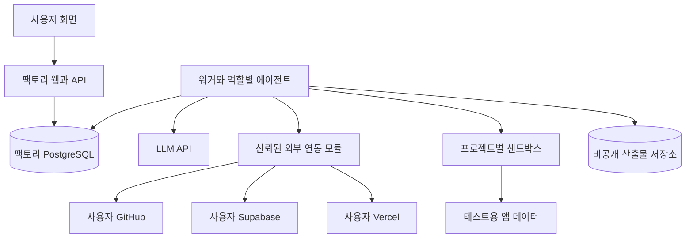
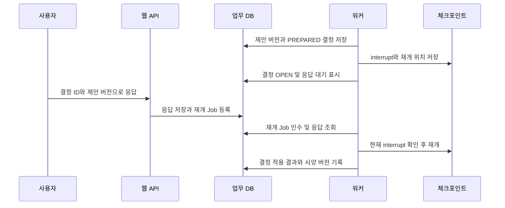

# MVP 팩토리 아키텍처

| 항목           | 내용                                                            |
| -------------- | --------------------------------------------------------------- |
| 파일           | ARCHITECTURE.md                                                 |
| 문서 버전      | 0.1                                                             |
| 작성일         | 2026년 11월 21일                                                |
| 기준 문서      | MVP_FACTORY_PRD.md v0.2                                         |
| 문서 상태      | 구현을 위한 제안 아키텍처                                       |
| 현재 구현 현황 | 저장소·의존성·실행 결과 미확인                                  |
| 적용 대상      | MVP 팩토리 자체와 팩토리가 생성하는 Next.js 앱의 실행·배포 경계 |

**한눈에 보기**

- **구조:** 웹/API, 워커, PostgreSQL, 생성 코드용 샌드박스 네 부분이다. 에이전트는 워커 안의 역할 모듈이며 별도 서버가 아니다.
- **가장 중요한 규칙:** 웹 요청 안에서 앱 생성을 끝내지 않고, CEO 응답을 기다리는 동안 워커를 붙잡지 않는다. 진행 상황과 재개 정보는 DB에 저장한다.
- **외부 작업의 안전:** GitHub·DB·Vercel 변경은 장부(원장)에 먼저 적고, 결과가 불확실하면 새로 만들지 않고 먼저 조회한다.
- **완료 판정:** 에이전트의 말이 아니라 시스템이 실제 검증 결과로 한다. 빌드 통과, 배포 성공, 제품 완료는 서로 다르다.
- **이 문서의 성격:** 구현 확인 결과가 아니라 목표 구조다. 기술 선택은 "추천 기본안"이며 현재 코드에 이미 있다는 뜻이 아니다.
- **처음 읽는다면:** §1(핵심 원칙) → §3(구성 요소) → §7(작업 큐와 재시작) → §8(CEO 결정) → §12(검증·배포). 나머지는 필요할 때 찾아본다.

**목차**

- [1. 핵심 설계](#1-핵심-설계)
- [2. 범위와 기술 기본안](#2-범위와-기술-기본안)
- [3. 구성 요소와 신뢰 경계](#3-구성-요소와-신뢰-경계)
- [4. 팩토리 데이터와 생성 앱 데이터](#4-팩토리-데이터와-생성-앱-데이터)
- [5. 핵심 데이터와 식별자](#5-핵심-데이터와-식별자)
- [6. 워크플로우와 에이전트](#6-워크플로우와-에이전트)
- [7. 작업 큐, 체크포인트, 재시작](#7-작업-큐-체크포인트-재시작)
- [8. CEO 결정, 일시정지, 재개](#8-ceo-결정-일시정지-재개)
- [9. 외부 연동과 중복 방지](#9-외부-연동과-중복-방지)
- [10. 생성 앱의 DB 자동 구성](#10-생성-앱의-db-자동-구성)
- [11. 생성 코드 실행과 소스 보존](#11-생성-코드-실행과-소스-보존)
- [12. 검증과 Vercel 배포](#12-검증과-vercel-배포)
- [13. 피드백 수정과 마지막 정상 결과](#13-피드백-수정과-마지막-정상-결과)
- [14. 상태, 오류, 사용량](#14-상태-오류-사용량)
- [15. 접근 범위와 비밀값 보호](#15-접근-범위와-비밀값-보호)
- [16. 팩토리 UI와 API 경계](#16-팩토리-ui와-api-경계)
- [17. 코드 구성과 변경 경계](#17-코드-구성과-변경-경계)
- [18. 구현 순서와 기존 코드 적용](#18-구현-순서와-기존-코드-적용)
- [19. 아키텍처 검증과 PRD 대응](#19-아키텍처-검증과-prd-대응)
- [20. 주요 결정과 남은 확인](#20-주요-결정과-남은-확인)
- [21. 근거와 참고 문서](#21-근거와-참고-문서)

이 문서는 기존 코드를 확인한 결과가 아니다. PRD를 구현하기 위한 기본 구조와 반드시 지켜야 할 동작을 정의한다. 기존 코드는 품질 문제로 폐기하고 이 문서 기준으로 새로 작성한다(사용자 결정). 새 코드는 이 구조와 AGENTS.md 규칙을 처음부터 따른다.

사용자가 확정한 제품 요구사항과 이 문서의 기술 제안을 구분한다. 생성 앱의 Next.js 사용, 사용자 GitHub·Vercel 연동, 시작 시 CEO 개입 수준 선택, 필요한 DB 자동 연결은 제품 요구사항이다. 팩토리의 Next.js·LangGraph·Prisma·Supabase·Vercel Sandbox 사용은 아래의 추천 기본안이며 현재 코드에 이미 도입되어 있다고 전제하지 않는다.

## 1. 핵심 설계

팩토리는 **웹/API, 장시간 작업을 수행하는 워커, 업무 상태를 저장하는 PostgreSQL, 생성 코드를 실행하는 격리 환경**으로 구성한다. 에이전트는 워커 안의 역할 모듈로 시작한다. 역할마다 별도 서버나 별도 모델을 만들지 않는다.

첫 버전은 하나의 코드베이스, 웹 실행 단위 하나, 워커 실행 단위 하나로 운영한다. 생성 앱의 코드 실행만 프로젝트별 샌드박스로 격리한다. CEO 응답 대기와 실패 후 재개에 필요한 정보는 프로세스 메모리 밖에 보존한다.

### 1.1 반드시 지켜야 할 원칙

1. 웹 요청은 작업을 접수하고 상태를 반환한다. 한 HTTP 요청 안에서 앱 생성 전체를 끝내려고 하지 않는다.
2. 에이전트의 설명과 실제 외부 작업 결과를 구분한다. 저장소·DB·배포 완료는 공급자 응답과 조회 결과로 판단한다.
3. 재시도는 같은 실행을 이어가고, 피드백으로 목표가 바뀌면 새 실행을 만든다.
4. CEO 응답 대기 중 워커를 점유하지 않는다. 답변이 저장되면 같은 실행을 재개한다.
5. 외부 요청이 성공했는지 불명확하면 실제 상태를 확인한다. 확인 없이 같은 리소스를 다시 만들지 않는다.
6. 생성 코드는 팩토리 관리 권한과 분리된 환경에서 실행한다.
7. 검증 결과는 특정 요구사항·소스·DB 변경·배포 버전에 연결한다.
8. 수정 작업은 같은 저장소·DB·배포 프로젝트를 재사용하고 기존 데이터를 보존한다.
9. 빌드 통과, 배포 성공, 제품 완료를 별도로 기록한다.
10. 모의 실행은 개발 도구이며 실제 MVP 완료 증거로 집계하지 않는다.

## 2. 범위와 기술 기본안

### 2.1 첫 버전의 구현 경계

지원 대상은 PRD의 작은 개인용 웹 도구다. 생성 앱은 주요 화면 1~3개, 기본 CRUD·검색·필터·계산, 필요한 데이터 저장을 중심으로 한다. 이번 MVP는 팩토리와 생성 앱 모두 로그인·회원가입을 구현하지 않는다. 이 화면 수는 팩토리 자체의 화면 수 제한이 아니다.

초기에는 새 프로젝트 생성과 팩토리가 만든 프로젝트의 수정만 지원한다. 임의의 기존 저장소 가져오기, 여러 DB 공급자, 복잡한 조직 권한·결제, 로그인·다중 사용자 인증, 임의 외부 API 연결, 에이전트 병렬 경쟁은 범위 밖이다. 캐릭터 꾸미기·사무실 확장·회의 애니메이션은 PRD REQ-015·016에 따라 범위에 포함한다(16절).

### 2.2 추천 스택

| 영역             | 첫 버전 기본안                                          | 선택 이유와 경계                                                                                                             |
| ---------------- | ------------------------------------------------------- | ---------------------------------------------------------------------------------------------------------------------------- |
| 팩토리 웹/API    | Next.js App Router + TypeScript                         | 사용자 화면과 짧은 API 처리 통합                                                                                             |
| 워커             | 별도 Node.js + TypeScript 프로세스                      | 장시간 실행, 재시도, CEO 응답 후 재개 담당                                                                                   |
| 워크플로우       | LangGraph                                               | 단계 실행과 체크포인트·중단·재개에 사용. 업무 권한과 외부 작업 원장은 별도 구현                                              |
| 팩토리 DB        | PostgreSQL, 운영 기본 후보는 별도 Supabase 프로젝트     | 사용자·실행·결정·작업 큐·리소스 참조 저장                                                                                    |
| 업무 데이터 접근 | Prisma                                                  | 팩토리 업무 테이블과 마이그레이션 관리                                                                                       |
| 팩토리 접근      | 로그인 없음. 단일 사용자 작업 공간                      | 이번 MVP는 로컬·비공개 환경 전제. 인증 도입은 후속 범위(15절)                                                                |
| 산출물 저장      | 비공개 객체 저장소, 기본 후보는 팩토리 Supabase Storage | 코드 스냅샷·검증 보고서·큰 로그 보관                                                                                         |
| AI 실행          | API 직접 호출 또는 기존 코딩 도구 연결(비교 후 결정)    | 같은 모델에 역할별 지침·문맥·도구를 다르게 부여                                                                              |
| 생성 코드 실행   | 관리형 샌드박스, 우선 검토 후보는 Vercel Sandbox        | 생성 코드·패키지 설치·빌드·브라우저 확인 격리                                                                                |
| 생성 앱          | Next.js + TypeScript, DB가 필요하면 Supabase            | 지원 범위를 좁힌 검증된 템플릿 사용                                                                                          |
| 팩토리 웹 배포   | Vercel 후보                                             | 팩토리 웹의 호스팅 선택이며 생성 앱 배포 요구와 별개. SSE의 장시간 연결 제한을 확인해야 하며, 로컬과 비공개 서버 운영이 우선 |
| 워커 배포        | 장시간 프로세스를 운영할 수 있는 컨테이너 호스트        | 초기 워커 1개. 공급자는 비용·운영 환경 확인 후 선택                                                                          |
| 작업 전달        | PostgreSQL 작업 테이블                                  | 초기에는 Redis·별도 메시지 브로커를 추가하지 않음                                                                            |
| 실시간 전달      | SSE + PostgreSQL LISTEN/NOTIFY                          | 워커가 이벤트를 DB에 저장하고 신호를 보내면 웹 서버가 SSE로 화면에 전달. 상세는 §16                                          |

LangGraph의 체크포인트와 interrupt를 이용할 수 있지만, 이것만으로 업무 DB 변경과 외부 API 호출이 하나의 트랜잭션이 되는 것은 아니다. 복구 규칙은 7~9절에서 별도로 정의한다. [S1][S2]

Vercel Sandbox는 생성 코드 실행을 위한 격리 환경 후보다. 실제 도입 전 실행 시간·네트워크·스토리지·브라우저 도구·비용 조건을 검증한다. 관리형 환경 선택만으로 권한 설계가 완성된다고 보지 않는다. [S4]

정확한 패키지 버전은 기존 저장소와 공급자 호환성을 확인한 뒤 lockfile로 고정한다. 문서 작성일의 최신 버전으로 무조건 교체하지 않는다.

### 2.3 확정된 운영·설정 경계

- 팩토리는 로컬 실행으로 시작하고 이후 비공개 서버로 확장한다. 생성 앱은 배포 후 누구나 로그인 없이 접속하는 것이 기본이다.
- 공급자 비밀 키는 `.env`에 보관한다. 앱 설정 화면은 기본 계정·대상·공개 범위·실행 한도를 관리하며 비밀 키 입력·조회 기능을 제공하지 않는다.
- 회사·캐릭터·사무실 확장·배치는 작업 공간 공통 설정이다. 프로젝트 전환으로 초기화하지 않으며 프로젝트별 실행·결정·생성 앱 데이터와 분리한다.
- PM·기획자·디자이너·개발자 4명을 유지한다. 아이소메트릭 사무실과 클릭 시 열리는 업무 패널을 사용한다. 모든 제공 아이템·확장은 처음부터 사용 가능하며 첫 버전에는 소리가 없다.
- 프로젝트 정리는 보관 처리로 수행하며 외부 리소스를 삭제하지 않는다. 외부 삭제는 별도 명령과 영향 확인을 거친다.
- AI 실행은 공급자 API와 기존 코딩 도구 연계를 비교한 뒤 선택한다. 특정 공급자·모델·호출 방식과 비용·시간·재시도 상한은 아직 확정하지 않는다.

## 3. 구성 요소와 신뢰 경계

그림의 외부 연동 모듈은 별도 마이크로서비스가 아니라 워커 내부의 제한된 코드 모듈이다. 샌드박스에서 공급자 관리 API로 직접 접근하는 경로는 제공하지 않는다.

| 구성 요소       | 책임                                                                      | 보유하지 않는 권한                                  |
| --------------- | ------------------------------------------------------------------------- | --------------------------------------------------- |
| 사용자 화면     | 아이디어·설정 입력, 진행 관전, CEO 응답, 결과·피드백 표시                 | DB 직접 관리, 실행 단계 강제 변경, 공급자 토큰 조회 |
| 웹/API          | 프로젝트·실행 소속 확인, 요청 검증, 업무 데이터 저장, 작업 등록·상태 조회 | 생성 코드 실행, 전체 워크플로우를 요청 안에서 수행  |
| 워커            | 작업 인수, 워크플로우 실행, 한도 관리, 복구·검증·배포 조정                | 사용자 동의 범위를 임의 확대                        |
| 역할별 에이전트 | 역할에 맞는 산출물 생성, 허용된 도구 요청                                 | 스스로 승인 생성, 임의 계정 선택, 직접 완료 판정    |
| 외부 연동 모듈  | 승인 범위 확인, 공급자 호출, 결과 조회와 리소스 기록                      | 모델 출력에 따른 무제한 URL·조직·권한 사용          |
| 샌드박스        | 생성 파일 편집, 패키지 설치, 빌드·테스트·화면 실행                        | 팩토리 DB·관리 토큰·호스트 파일시스템 접근          |
| 산출물 저장소   | 버전별 파일과 증거의 지속 보관                                            | 익명 전체 조회                                      |

사용자 콘텐츠, 생성 코드, 가져온 패키지, 외부 문서의 지시는 신뢰하지 않는 입력으로 취급한다. 이 입력이 역할 프롬프트의 도구 권한이나 사용자 승인 정책을 바꿀 수 없게 한다.

## 4. 팩토리 데이터와 생성 앱 데이터

### 4.1 서로 다른 두 종류의 DB

| 구분             | 팩토리 DB                                      | 생성 앱 DB                                    |
| ---------------- | ---------------------------------------------- | --------------------------------------------- |
| 목적             | 서비스 운영과 작업의 연속성                    | 사용자가 만든 앱의 업무 데이터                |
| 예               | 프로젝트, 실행, CEO 결정, 비용, 외부 리소스 ID | 공부 기록, 할 일, 개인 메모                   |
| 소유·운영 기본안 | 팩토리 운영 계정의 별도 프로젝트               | 사용자가 연결한 Supabase 조직의 앱별 프로젝트 |
| 접근 주체        | 팩토리 웹·워커                                 | 해당 생성 앱                                  |
| 인증             | 없음(단일 사용자 작업 공간)                    | 없음(이번 MVP)                                |
| 수명             | 팩토리의 보존 정책                             | 사용자 앱의 운영·삭제 정책                    |

팩토리와 생성 앱은 계정·권한·테이블이 독립적이다. 팩토리의 관리 권한을 생성 앱이 사용하지 않는다.

DB가 필요 없는 생성 앱은 DB를 만들지 않는다. DB가 필요하다고 판단되면 이유와 데이터 계획을 기획 산출물에 기록한다. SQLite 등 추가 공급자 지원은 후속 범위다.

### 4.2 팩토리 저장 영역의 관리 주체

| 영역                          | 관리 주체                                    | 저장 내용                                                               |
| ----------------------------- | -------------------------------------------- | ----------------------------------------------------------------------- |
| factory 업무 스키마           | Prisma와 팩토리 마이그레이션                 | 작업 공간·공통 설정, 가상 회사 설정, 프로젝트, 실행, 작업, 결정, 이벤트 |
| agent_runtime 체크포인트 영역 | 선택한 LangGraph saver의 초기화·마이그레이션 | 그래프 상태와 재개 위치                                                 |
| storage 등 공급자 영역        | 공급자                                       | 객체 저장소 내부 정보                                                   |
| 객체 저장소                   | 팩토리 산출물 모듈                           | 소스 압축본, 화면 캡처, 보고서, 큰 로그                                 |

서로 다른 주체가 같은 테이블의 스키마를 변경하지 않는다. Prisma 마이그레이션이 체크포인트나 공급자 관리 테이블을 제거·재생성하지 않도록 관리 범위를 제한한다. Prisma의 스키마 분리 기능은 선택한 버전에서 확인한다. [S5]

체크포인트 saver가 별도 스키마 설정을 지원하는지는 도입 시 확인한다. 지원하지 않으면 saver 전용 관리 영역과 연결 권한을 분리하되, 라이브러리 내부 테이블을 임의 수정하지 않는다.

웹 연결, 워커 연결, 마이그레이션 연결은 각 라이브러리의 트랜잭션·세션 요구에 맞게 설정한다. 하나의 풀링 모드를 모든 용도에 일괄 적용하지 않는다.

## 5. 핵심 데이터와 식별자

아래는 책임과 불변 조건을 정의한다. 정확한 컬럼·인덱스·관계는 DB_SCHEMA.md에서 작성한다.

| 개념               | 역할과 핵심 정보                                                                                      |
| ------------------ | ----------------------------------------------------------------------------------------------------- |
| Workspace          | 단일 사용자 작업 공간. 공통 기본 계정·대상·공개 범위·실행 한도 설정                                   |
| CompanyLayout      | 가상 회사 설정. 캐릭터 외형·의상·액세서리, 사무실 확장·배치 상태                                      |
| Project            | 소속 작업 공간, 원본 아이디어, 확정 사양 참조, 외부 리소스 묶음, 마지막 정상 결과                     |
| ProductSpec        | 기능·화면·데이터·완료 조건의 버전. 변경 이유와 근거 결정 포함                                         |
| Run                | 최초 생성 또는 한 번의 수정 목표. CEO 레벨, 입력 사양, 한도, 버전 정보, 진행 상태                     |
| Job                | 워커가 수행할 시작·재개·복구 명령. 소유 워커, lease, attempt, 중복 방지 키                            |
| Decision           | 제안 버전, 질문과 선택, CEO 응답, 적용 상태, 연결된 interrupt                                         |
| Artifact           | 산출물 유형·버전·체크섬·비공개 저장 참조                                                              |
| ExternalConnection | 공급자 계정·허용 대상·권한·만료·비밀값 참조                                                           |
| ExternalOperation  | 외부 작업 의도, 안정적인 작업 키, 시도, 실제 결과와 불확실성                                          |
| ExternalResource   | 프로젝트와 외부 저장소·DB·Vercel 프로젝트의 연결                                                      |
| VerificationReport | 검증 대상 버전, 실행한 검사, 실제 결과, 미검증 항목                                                   |
| DeploymentManifest | 소스·커밋·DB 변경·환경설정 버전·배포 ID·접근 URL의 대응                                               |
| RunEvent·Usage     | 순서 있는 상태 이벤트, 호출·시간·사용량·비용 추정                                                     |
| MeetingEvent       | 실제 작업·결정에 연결된 회의 기록. 참여 역할, 주제, 발언 요약, 결정 결과. 회의 애니메이션의 재생 근거 |

### 5.1 식별자 규칙

> **쉽게 말해** projectId는 "제품", runId는 "한 번의 작업 목표"(최초 생성 또는 수정 1회)다. 같은 작업을 다시 시도하면 runId는 그대로이고, 새 피드백을 받으면 새 runId를 만든다. attemptId는 워커가 그 작업을 이어받을 때마다 바뀐다.

- projectId는 수정 실행 전체에 걸쳐 유지한다.
- runId는 하나의 생성 또는 수정 목표를 식별한다.
- attemptId는 워커가 작업을 인수하거나 다시 시도할 때 변경한다.
- threadId는 runId와 일대일 대응시키고, 같은 실행의 재개에서는 유지한다.
- 새 피드백은 새 runId·threadId를 사용하되 이전 프로젝트 사양과 정상 소스에서 시작한다.
- decisionId는 특정 검토 요청을 식별한다. 응답은 제안 버전과 함께 묶는다.
- operationKey는 실제 외부 작업의 목적을 식별한다. attemptId가 바뀌어도 같은 목적이면 유지한다.
- sourceDigest는 저장된 소스 스냅샷의 내용을 식별한다. 커밋 SHA와 별도로 대응을 기록한다.

### 5.2 데이터의 기준

> **쉽게 말해** 진짜 기록은 프로젝트·결정·외부 작업 원장이다. 체크포인트는 "어디까지 했는지" 알려 주는 책갈피이고, Run.status는 화면에 보여 주는 요약일 뿐이다. 요약만 보고 외부 작업을 다시 실행하지 않는다.

프로젝트 사양·CEO 결정·외부 작업 원장은 업무상의 사실이다. 체크포인트는 그래프가 어디서 이어져야 하는지 나타낸다. Run.status와 currentStep은 이 정보를 바탕으로 갱신하는 사용자 표시용 요약이다.

같은 PostgreSQL을 사용해도 Prisma 쓰기와 체크포인트 저장이 자동으로 같은 트랜잭션에 들어가지는 않는다. 한쪽만 저장된 상태를 정상적인 복구 대상에 포함한다. 이벤트나 화면 상태만 보고 이미 수행한 외부 작업을 다시 실행하지 않는다.

## 6. 워크플로우와 에이전트

### 6.1 기본 실행 단계

| 단계              | 주 담당          | 지속 보관하는 결과                            | 다음 단계 조건                      |
| ----------------- | ---------------- | --------------------------------------------- | ----------------------------------- |
| 입력·사전 확인    | 시스템·PM        | 입력, 지원 범위, 연결 계정·대상, 실행 한도    | 필수 권한과 지원 범위 충족          |
| 아이디어 구체화   | PM·기획자        | ProductSpec 초안, 가정, 필수 완료 조건        | 출력 형식과 필수 내용 충족          |
| 화면 설계         | 디자이너         | 화면·흐름·상태·컴포넌트 계획                  | 확정 요구사항과 연결                |
| CEO 검토          | 워크플로우       | 제안과 응답, 반영된 사양 버전                 | 선택한 레벨의 검토 완료             |
| 코드·데이터 계획  | 개발자           | 실제 파일, 의존성 잠금, 선언형 스키마 변경안  | 빌드 가능한 소스와 허용된 변경      |
| DB 구성·기능 구현 | 개발자·연동 모듈 | 생성 DB 참조, 적용 이력, 연결 설정, 구현 코드 | 필요한 데이터 경로와 접근 정책 구성 |
| 검증·제한된 수정  | 검증 모듈·개발자 | 검사 결과, 화면 확인, 수정된 소스 버전        | 필수 검사 통과 또는 한도 도달       |
| GitHub 반영·배포  | 연동 모듈        | 커밋, 배포, 환경설정 대응                     | 검증한 버전의 배포와 실제 접근 확인 |
| 완료·피드백       | 시스템·PM        | 결과 요약, 증거, 남은 제약, 후속 실행         | 완료 판정 또는 실패·차단 표시       |

레벨 3은 기능 범위 검토를 화면 설계 전에, 화면 검토를 구현 전에 수행한다. 레벨 2는 기능·화면 통합안을 구현 전에 검토한다. 레벨 1은 예정된 중간 검토 없이 진행하되 결정 이유를 남긴다.

위 단계는 모듈 경계다. 정확한 노드·분기·상태 enum은 WORKFLOW.md에서 정의한다. 디자이너와 개발자의 반복은 한도 안에서만 허용한다.

### 6.2 역할의 실체

각 에이전트는 다음 항목의 조합이다.

- 버전이 있는 역할 지침과 검토한 작업 지식.
- 현재 사양, 관련 결정, 이전 단계 산출물.
- 허용된 도구 목록과 도구별 인자 검증.
- 출력 스키마와 다음 단계로 넘기기 위한 검사.
- 모델 호출 설정과 제한된 수정 횟수.

| 역할     | 주요 출력                                           | 허용되는 도구의 예                              |
| -------- | --------------------------------------------------- | ----------------------------------------------- |
| PM       | 범위 요약, 작업 계획, CEO 결정 요청 초안, 결과 요약 | 사양·상태·산출물 읽기, 구조화된 제안 작성       |
| 기획자   | 사용자 흐름, 기능 정의, 데이터 요구, 완료 조건      | 요구사항 분석, 사양 초안 작성                   |
| 디자이너 | 화면 구성, 상태·피드백 설계, 실제 화면 검토         | 설계 산출물 작성, 제한된 미리보기·스크린샷 읽기 |
| 개발자   | 소스 변경, 선언형 스키마 계획, 오류 수정            | 샌드박스 파일·명령·빌드·테스트 도구             |

별도의 QA LLM은 첫 버전 필수가 아니다. 필수 검사는 시스템이 실행하고, 실패 증거를 개발자 에이전트에 전달한다. 에이전트의 자기평가만으로 통과시키지 않는다.

### 6.3 산출물 계약과 문맥

모든 구조화 출력은 schemaVersion, 참조한 specVersion, 산출물 내용과 근거 참조를 포함한다. 출력 스키마 검사를 통과해도 요구사항 충족 여부는 별도로 검사한다.

각 역할에는 현재 단계에 필요한 사양·결정·파일·오류만 제공한다. 모든 대화와 전체 저장소를 무조건 프롬프트에 넣지 않는다. 오래된 사양을 사용한 출력은 현재 버전과 충돌하는지 확인한 뒤 적용한다.

개발자가 임의로 기능을 제거하거나 테스트 기대값을 약화해 검사를 통과시키지 못하게 한다. 필수 완료 조건의 변경은 사양 변경으로 기록하고 해당 CEO 정책을 적용한다.

### 6.4 SKILL.md 사용

런타임 스킬은 역할별로 검토한 파일과 필요한 참조만 정적으로 등록한다. 버전·출처·허용 도구를 기록하고, 실행 중 임의의 인터넷 스킬이나 스크립트를 관리 권한으로 설치하지 않는다.

팩토리를 개발하는 Codex·Claude용 AGENTS.md와 팩토리 내부 에이전트가 읽는 런타임 스킬은 별개다. 저장소에 스킬 파일을 추가했다는 사실만으로 런타임에 적용되었다고 판단하지 않는다. 로더·역할 매핑·참조 리소스 접근을 실제로 검증한다.

## 7. 작업 큐, 체크포인트, 재시작

### 7.1 접수와 실행

1. 웹/API가 프로젝트 소속·입력·한도를 확인한다.
2. 하나의 업무 DB 트랜잭션으로 Run, 시작 Job, 접수 이벤트를 저장한다. 프로젝트 생성 요청이면 Project도 함께 저장한다.
3. 클라이언트가 같은 요청을 재전송하면 요청 중복 방지 키로 기존 결과를 반환한다.
4. 워커가 짧은 트랜잭션으로 실행할 Job을 잠그고 소유권·lease·attempt를 설정한다.
5. 트랜잭션을 종료한 뒤 모델·샌드박스·외부 API를 호출한다.
6. 단계별 산출물과 체크포인트를 지속 저장하고 상태 이벤트를 기록한다.

PostgreSQL의 FOR UPDATE SKIP LOCKED는 초기 작업 인수 방식으로 사용할 수 있다. 이는 잠긴 작업을 건너뛰는 큐 처리에 적합한 선택이며, 실행 전체의 일관성이나 외부 요청의 중복 방지를 대신하지 않는다. [S3]

초기에는 워커 하나가 실행 작업 하나를 처리한다. CEO 대기·일시정지로 현재 호출이 종료되면 대기 중인 다른 작업을 처리할 수 있다. 작업 공간당 동시에 열려 있는 실행은 하나로 제한하는 기본안을 적용하며, 동일 프로젝트의 스키마·배포 변경도 직렬화한다.

작업 공간별 활성 실행 예약은 시작·재개 접수 트랜잭션에서 조건부로 확보한다. 화면용 Run.status를 먼저 조회하는 것만으로 제한을 구현하지 않는다. 예약은 CEO 대기·일시정지·차단 중에도 유지하고 완료·실패 등 종료 상태에서 해제한다. 종료된 실행의 재시도는 예약을 다시 확보하며, 다른 실행이 예약 중이면 충돌을 반환한다.

### 7.2 소유권과 오래된 워커

> **쉽게 말해** 같은 작업을 워커 두 개가 동시에 만지지 못하게 하는 규칙이다. 시간이 지났다는 이유만으로 작업을 다른 워커에게 넘기지 않고, 이전 워커가 종료되었음을 확인한 뒤에 넘긴다. 확인할 수 없으면 복구를 멈추고 사람이 확인한다.

Job에는 소유 워커와 증가하는 claimEpoch를 기록한다. heartbeat·상태 변경·결과 저장은 현재 epoch와 일치할 때만 허용한다. 소유권을 잃은 워커는 새 도구 호출을 중단하고 늦게 도착한 결과를 적용하지 않는다.

이 검사는 이미 공급자에게 전달된 요청을 취소하지 못한다. 또한 업무 테이블의 epoch 검사만으로 LangGraph saver의 모든 체크포인트 쓰기가 차단되는 것도 아니다.

따라서 첫 버전에서는 **이전 워커가 종료되었음을 확인한 뒤 새 워커가 같은 thread를 인수한다.** 배포는 이전 인스턴스를 정지한 뒤 새 인스턴스를 시작하는 방식으로 운영한다. lease 만료만으로 같은 실행을 다른 살아 있는 워커에 즉시 넘기지 않는다.

호스트 장애 등으로 이전 인스턴스의 종료 여부를 확인할 수 없으면 복구를 차단 상태로 두고 확인한다. 나중에 병렬 워커를 도입하려면 체크포인트 저장까지 포함한 실행 직렬화 또는 fencing을 구현해야 한다.

### 7.3 재개에 필요한 정보

체크포인트에는 현재 단계, 산출물 참조, 사양 버전, 결정 참조, 외부 작업 참조를 저장한다. 큰 코드 파일과 원본 로그는 객체 저장소에 둔다.

Run에는 workflowVersion, promptVersion, skillVersion, templateVersion, model 설정을 기록한다. 버전 필드만 저장한다고 예전 실행 코드가 보존되는 것은 아니다. 배포 시 진행 중인 실행과 호환되는 워크플로우 코드를 유지하거나, 명시적으로 검증한 상태 마이그레이션을 적용한다.

버전 호환성을 확인할 수 없는 실행은 임의로 새 그래프에서 이어가지 않는다. 원인과 필요한 조치를 표시한다.

### 7.4 복구 순서

- 현재 Job 소유권과 이전 워커 종료를 확인한다.
- 체크포인트, 업무 상태, 미확정 외부 작업을 읽는다.
- 외부 작업이 불명확하면 공급자 상태를 먼저 확인한다.
- 필요한 소스 스냅샷과 마지막 확정 사양을 복원한다.
- 저장된 결정과 실제 pending interrupt를 맞춘다.
- 미완료 단계부터 같은 runId·threadId로 재개한다.

같은 실행의 Job이 끝났더라도 Run이 완료되었다는 뜻은 아니다. CEO 응답을 기다리는 실행은 현재 Job이 종료된 상태로 유지할 수 있다.

## 8. CEO 결정, 일시정지, 재개

### 8.1 검토 정책

| 레벨           | 예정된 검토 지점         | 자동으로 진행하는 범위                           |
| -------------- | ------------------------ | ------------------------------------------------ |
| L1 위임형      | 없음                     | 시작 시 위임한 범위의 기획·디자인·개발·검증·배포 |
| L2 핵심 결정형 | 기능·화면 통합안 1개     | 확정안 이후 구현·검증·배포                       |
| L3 공동 설계형 | 기능 범위, 화면 방향 2개 | 각 확정안 이후의 세부 작업                       |

기본 레벨은 L2 제안이며 Run 시작 시 고정한다. 다음 수정 Run에서는 다시 선택할 수 있다. 모든 레벨에 같은 검증·접근 보호·한도 규칙을 적용한다.

이미 허용한 같은 대상·범위의 DB 생성, 코드 반영, 배포를 매 단계 반복 승인받지 않는다. 권한 부족, 합의 범위를 벗어난 요구, 한도 변경, 파괴적인 변경이 필요할 때만 구체적인 결정을 요청한다.

### 8.2 지속 가능한 결정 처리

> **쉽게 말해** CEO의 응답은 정확히 한 번만 적용된다. 같은 응답을 다시 보내면 같은 결과를 돌려주고, 다른 응답을 보내면 충돌로 처리한다. 응답 저장과 "재개 예약"은 한 번에 함께 저장해서, 둘 중 하나만 남는 일이 없게 한다.

결정 준비와 사용자 대기는 별도 노드로 둔다. 대기 노드가 재실행되어도 리소스 생성이나 중복 질문이 발생하지 않아야 한다. LangGraph interrupt 이후의 재개에서는 노드 실행이 다시 시작될 수 있으므로, 그 이전 작업의 재실행을 고려한다. [S2]

세부 규칙은 다음과 같다.

- PREPARED 결정은 아직 응답받지 않는다. 실제 pending interrupt가 지속 저장된 뒤 OPEN으로 표시한다.
- 체크포인트 저장 후 화면 상태 갱신 전에 중단되면 복구 과정에서 기존 결정을 OPEN으로 전환한다.
- 응답은 소유자, decisionId, 제안 버전, 아직 열려 있는 결정인지 확인한다.
- 첫 응답은 OPEN에서 ANSWERED로 조건부 전환하면서 기록하고, 재개 Job 등록까지 하나의 업무 DB 트랜잭션으로 처리한다.
- 같은 응답의 재전송은 기존 결과를 반환한다. ANSWERED 이후의 상충 응답은 아직 적용 전이어도 충돌로 반환한다. 수정 제안을 다시 검토할 때는 새 제안 버전과 결정을 사용한다.
- 워커는 현재 pending interrupt가 그 결정과 대응하는지 확인한 뒤 재개한다.
- 이미 그래프가 다음 단계로 이동했다면 오래된 응답을 다음 질문의 답으로 전달하지 않는다.
- 사양 변경 적용은 decisionId와 응답 버전에 대해 중복 적용되지 않게 한다.
- 응답이 없으면 대기를 유지한다. 시간 경과를 승인으로 취급하지 않는다.

### 8.3 일시정지

일시정지는 중단 요청을 저장한 뒤 안전한 경계에서 진행한다. 이미 전송된 외부 요청이나 DB 변경을 즉시 취소했다고 표시하지 않는다. 진행 중인 요청 결과를 확인하고 산출물·체크포인트를 보존한 뒤 일시정지로 전환한다.

강제 종료가 필요했던 경우에는 외부 작업 결과를 불명확 상태로 남기고 재개 전 확인한다. 대기 시간과 실제 계산 시간을 분리해 표시한다.

## 9. 외부 연동과 중복 방지

### 9.1 기본 계정 연결과 작업 권한

이번 MVP는 로그인이 없으므로 GitHub·Vercel·DB 계정을 공통 설정에 미리 등록해 모든 프로젝트가 재사용한다. 계정이 등록되어 있다는 사실과 공급자 작업 권한을 구분한다. 외부 계정 연결은 계정 식별자뿐 아니라 실제로 가능한 작업과 허용된 대상까지 저장한다.

| 공급자   | 사전 확인 항목                                                                   |
| -------- | -------------------------------------------------------------------------------- |
| GitHub   | 대상 사용자·조직, 새 저장소 생성 가능 여부, 해당 저장소에 코드 쓰기 권한         |
| Supabase | 대상 조직, 프로젝트 생성 권한·한도, 사용할 지역·요금 조건, 관리·스키마 적용 경로 |
| Vercel   | 대상 계정·팀, 프로젝트 생성·환경변수 설정·배포·게시 권한                         |

GitHub OAuth 또는 GitHub App 중 선택한 방식이 새 저장소 생성과 후속 코드 쓰기를 모두 지원하는지 실제 계정으로 확인한다. 인증 수단별 API 권한을 같다고 가정하지 않는다. 저장소 생성 API는 대상 유형에 맞게 선택한다. [S6]

Supabase의 사용자 계정 연동은 공식 OAuth 통합과 관리 API 경로를 우선 검토한다. 프로젝트 생성 가능 여부는 사용자의 조직·권한·한도에 따라 사전 확인한다. [S7]

초기 내부 검증에서 수동 토큰을 사용한다면 내부용 설정임을 명시한다. 이를 외부 사용자용 계정 연결 완료로 집계하지 않는다.

### 9.2 신뢰된 도구 경계

에이전트는 “이 프로젝트의 DB를 준비하라”는 구조화 요청을 낸다. 실제 계정·조직·리소스 ID와 API 주소는 서버가 공통 설정에 저장된 연결 정보에서 결정한다.

외부 도구 결과에는 성공 여부, 공급자 리소스 ID, 확인 시각, 오류 종류, 재시도 가능 여부, 증거 참조를 포함한다. 비밀값을 모델 입력이나 일반 도구 출력에 넣지 않는다.

관리 권한이 필요한 도구는 자유 형식 shell이나 임의 HTTP 도구로 제공하지 않는다. 필요한 행동만 제한된 함수로 노출한다.

### 9.3 외부 작업 원장

> **쉽게 말해** 저장소나 DB 같은 외부 리소스를 만들기 전에 "무엇을 하려는지"를 장부에 먼저 적고 고유 키를 붙인다. 요청 후 응답을 못 받으면 성공이나 실패로 단정하지 않고 "모름"으로 남긴 뒤, 실제 상태를 조회해서 이어간다. 이름이 같다고 같은 리소스로 취급하지 않는다.

외부 변경 전에 ExternalOperation에 의도와 operationKey를 저장한다. 상태는 최소한 계획됨, 요청 중, 성공 확인, 실패 확인, 결과 불명확을 구분한다.

최초 공급자 계정·대상과 정규화한 요청 내용의 해시를 함께 보존한다. 같은 operationKey에 다른 대상이나 요청 내용이 들어오면 충돌로 처리하고 재전송하지 않는다. 토큰 갱신과 계정 재연결이 기존 작업의 소유 계정이나 대상을 바꾸지 않게 하며, 복구 조회에도 원래 귀속을 확인한다.

| 작업        | 안정적인 작업 키의 구성 예                     |
| ----------- | ---------------------------------------------- |
| 저장소 생성 | projectId + GitHub + 저장소 용도               |
| DB 생성     | projectId + Supabase + 앱 DB 용도              |
| DB 변경     | DB 리소스 ID + migrationVersion + checksum     |
| 코드 반영   | 저장소 ID + sourceDigest                       |
| 배포 생성   | Vercel 프로젝트 ID + commitSHA + 환경설정 버전 |
| 게시        | 배포 ID + 게시 대상                            |

공급자가 지원하는 경우에만 공급자 고유의 중복 방지 기능을 함께 사용한다. 모든 공급자가 동일한 idempotency 기능을 제공한다고 가정하지 않는다.

응답을 잃거나 타임아웃이 발생하면 성공·실패로 단정하지 않는다. 알려진 리소스 ID, 허용 계정, 요청 당시 이름·메타데이터와 조회 결과를 조합해 실제 상태를 확인한다. 이름만 같은 리소스를 자동으로 가져오지 않는다.

확인할 수 없으면 차단 상태로 두고 필요한 조치를 표시한다. 확인되지 않은 생성 요청을 새 요청으로 반복하지 않는다. 이 구조는 중복을 통제하기 위한 것이며 외부 시스템 전반의 exactly-once를 보장한다는 뜻이 아니다.

## 10. 생성 앱의 DB 자동 구성

### 10.1 기본 템플릿

DB가 필요한 앱은 검증한 Next.js·Supabase 템플릿을 사용한다. 이번 MVP의 템플릿은 로그인과 사용자별 데이터 분리를 포함하지 않는다. 로그인이나 사용자별 비공개 데이터가 핵심인 앱은 지원 범위 밖으로 안내한다(PRD AC-007-5).

앱의 일반 실행 경로는 공개 가능한 키 또는 서버 전용 환경변수로 사양에 명시한 접근 범위 안에서만 데이터를 읽고 쓴다. 테이블은 RLS를 켜 두고 앱에 필요한 접근만 정책으로 허용한다. 관리자용 secret·service-role 계열 키는 브라우저 코드와 일반 앱 데이터 경로에 넣지 않는다. 로그인 없는 앱의 구체적 접근 방식은 DEC-008에서 확정한다. [S8][S9]

앱의 읽기·쓰기 접근 범위는 사양에 명시한다. 앱 기획에서 데이터 공유·읽기·쓰기 범위를 정하고 해당 작업 실행 전에 확인한다. 모든 방문자가 같은 데이터를 읽고 쓸 수 있다고 일괄 가정하지 않는다. 사양에 없는 테이블 접근이나 데이터 삭제·초기화 권한은 허용하지 않는다.

### 10.2 자동 구성 순서

1. 확정 사양에서 테이블·필드·관계·접근 범위를 포함한 선언형 데이터 계획을 만든다.
2. 지원하는 타입과 변경만 포함하는지 시스템이 검사한다.
3. 시작 시 허용한 사용자 조직에 앱 DB를 만들고 준비 상태를 확인한다.
4. 신뢰된 스키마 컴파일러가 허용된 계획을 마이그레이션으로 변환한다.
5. 접근 정책과 마이그레이션을 적용하고 실제 상태를 확인한다.
6. 앱에 필요한 연결 설정을 구성하고 사용자 권한으로 실제 CRUD를 확인한다.
7. DB 참조·적용 이력·환경설정 버전을 보관한다.

사용자가 SQL을 직접 작성하거나 연결 문자열을 수동 복사해야만 동작하는 흐름을 자동 구성 완료로 보지 않는다. 사용자의 계정 연결과 대상·조건 선택은 별도 시작 절차다.

### 10.3 마이그레이션 통제

LLM이 작성한 임의 SQL을 관리자 권한으로 바로 실행하지 않는다. 첫 버전은 지원하는 필드·관계·기본 접근 정책을 선언형 계획으로 받고, 검토된 코드가 SQL을 만든다.

생성 앱의 스키마·접근 정책 변경은 이 경로만 사용한다. 앱의 데이터 CRUD는 사양에 명시한 앱 접근 경로로 수행하고 관리자 권한으로 수행하지 않는다. 금지 문자열 몇 개를 검사하는 방식으로 임의 SQL 실행을 허용하지 않는다.

- 마이그레이션은 버전·체크섬·대상 DB와 함께 기록한다.
- 대상 DB와 migrationVersion의 조합은 유일하고 내용은 불변이다. 같은 버전·같은 체크섬이면 실제 적용 여부를 확인해 재개하고, 같은 버전·다른 체크섬이면 충돌로 차단한다.
- 적용 전 실제 스키마와 기대 상태가 일치하는지 확인한다.
- 수정 Run은 같은 DB를 사용하고, 기존 앱과 공존 가능한 필드·테이블 추가를 우선 지원한다.
- 필드 추가 시 기존 행과 이전 앱의 쓰기가 계속 유효하도록 nullable·기본값과 필요한 데이터 보완 방법을 검증한다.
- 컬럼 삭제, 데이터 초기화, 권한 확대, 임의 함수·확장 설치는 자동 변경 범위에서 제외한다.
- 같은 프로젝트의 마이그레이션을 동시에 실행하지 않는다.
- 적용 이력과 실제 스키마를 확인해 재시도 시 같은 변경을 중복 적용하지 않는다.
- 코드 배포가 실패해도 이미 적용한 DB 변경은 따로 기록한다. 무조건 되돌리거나 DB를 새로 만들지 않는다.

스키마 변경 기록과 원본 데이터 백업은 서로 다르다. 파괴적인 변경 지원을 추가하려면 복구 수단과 확인 절차를 별도로 설계한다.

### 10.4 검증 데이터

별도 테스트 DB를 운영하지 않는 초기 구성에서는 앱 DB 안의 전용 테스트 계정과 소유 데이터만 사용한다. 테스트는 앱 접근 경로와 같은 권한으로 수행하고, 자신이 만든 식별 가능한 테스트 행만 정리한다.

관리자 키 비노출, 사양 밖 테이블·삭제 권한 차단 등 접근 범위 검사를 포함한다. 사용자별 데이터 분리는 이번 MVP의 검증 대상이 아니다. 테스트 편의를 위해 RLS를 끄거나 전체 데이터 삭제 권한을 샌드박스에 주지 않는다. 실제 운영 데이터가 있는 수정 Run에서 테스트·마이그레이션이 미치는 영향도 기록한다.

## 11. 생성 코드 실행과 소스 보존

### 11.1 샌드박스

샌드박스는 Run 또는 작업 공간 단위로 만들고, 프로젝트 경로·시간·리소스·네트워크 범위를 제한한다. 패키지 설치와 생성 코드 실행은 모두 이 안에서 수행한다.

팩토리 DB 연결 정보, 공급자 관리 토큰, 모델 API 키, 비밀값 복호화 키를 샌드박스에 넣지 않는다. 필요한 앱 테스트 자격 증명도 테스트 계정과 해당 앱 범위로 제한한다.

호스트의 작업 디렉터리·Docker socket·다른 프로젝트 파일을 공유하지 않는다. 외부 통신은 필요한 패키지 저장소와 해당 앱의 검증 대상 등으로 제한한다. 생성 코드가 선택한 임의 내부 주소에 접근하지 못하게 한다.

### 11.2 실제 개발 반복

개발자 도구는 파일 읽기·수정, 명령 실행, 빌드, 테스트, 화면 확인 결과를 반환한다. 코드 문자열을 모델이 출력한 것만으로 개발 완료 처리하지 않는다.

설치 스크립트와 빌드 스크립트도 생성 코드와 같은 신뢰 수준으로 다룬다. 도구 실행 결과는 종료 상태·시간·표준 출력 요약·증거 참조로 저장한다.

### 11.3 지속 가능한 소스

샌드박스 디스크를 유일한 소스 저장소로 사용하지 않는다. 단계 완료 전 파일 목록과 체크섬을 포함한 소스 스냅샷을 비공개 저장소에 보존하고, 그 참조를 체크포인트에 저장한다.

의존성 잠금 파일, 템플릿 버전, 마이그레이션 계획, 검증 결과도 같은 버전과 연결한다. 샌드박스가 사라지면 마지막 지속 스냅샷 또는 확인된 Git 커밋에서 복원한다.

마지막 저장 이후의 미완료 파일 작업은 재수행할 수 있다. 모든 편집이 매 순간 자동 보존된다고 약속하지 않는다.

### 11.4 GitHub 반영

검증한 스냅샷을 신뢰된 게시 모듈이 사용자 저장소에 반영한다. 관리 토큰을 생성 작업 공간에 주입해서 임의 Git hook이나 스크립트와 함께 실행하지 않는다.

Git Data API 또는 별도의 신뢰된 Git 실행 경로를 선택하고, 커밋 내용과 sourceDigest 대응을 확인한다. private 저장소를 기본 선택으로 제안한다. 코드·README·환경변수 예시는 포함하지만 실제 비밀값은 포함하지 않는다.

## 12. 검증과 Vercel 배포

### 12.1 검증 대상 고정

검증 보고서는 다음 식별 묶음에 연결한다.

| 항목                           | 확인 목적                            |
| ------------------------------ | ------------------------------------ |
| specVersion                    | 어떤 요구사항을 충족해야 하는가      |
| sourceDigest·commitSHA         | 어느 소스를 검사하고 배포했는가      |
| lockfileDigest·templateVersion | 어떤 의존성과 기본 코드를 사용했는가 |
| migrationVersion·실제 DB 참조  | 어떤 데이터 구조에 대해 검사했는가   |
| 환경설정 revision              | 어떤 설정으로 빌드·실행했는가        |
| deploymentId                   | 최종 접근 확인 대상은 무엇인가       |

환경설정 revision에는 비밀값을 평문으로 넣지 않는다. 버전과 변경 여부를 추적할 수 있는 메타데이터를 사용한다.

소스·의존성·DB·환경설정이 바뀌면 영향받는 검증을 다시 수행한다. 과거 보고서가 있다는 이유만으로 새 배포를 완료 처리하지 않는다.

### 12.2 필수 검증

- 의존성 설치, 타입 검사와 프로덕션 빌드.
- 확정한 필수 기능의 실제 동작.
- DB가 필요한 앱의 생성·조회·수정·삭제와 재접속 후 데이터 유지.
- 사양에 명시한 접근 범위 준수와 관리자 키·비밀값 비노출.
- 핵심 화면의 실제 렌더링과 주요 상태·피드백.
- GitHub 커밋과 배포 소스의 대응.
- 최종 배포 URL에서의 접근과 핵심 기능 확인.

필수 검증 하네스와 기준 시나리오는 생성 앱 코드와 별도로 관리한다. 에이전트가 자신에게 유리하게 필수 검사를 삭제하거나 결과 파일만 만들어 통과시키지 못하게 한다. 추가 생성 테스트는 보조 증거로 사용한다.

### 12.3 배포와 게시 분리

> **쉽게 말해** 배포를 먼저 "후보"로 만들어 검증하고, 통과한 후보만 사용자에게 "게시"한다. 검증 전 버전이 실수로 공개되지 않게 하기 위한 2단계다.

기본안은 검증된 소스를 GitHub에 반영한 뒤, **실제 운영 환경설정으로 배포 후보를 만들고, 확인한 후보를 게시**하는 방식이다. 저장소 push와 무관하게 검증 전 버전이 자동 게시되지 않도록 게시 주체를 하나로 유지한다.

Vercel Git 연동의 자동 배포·도메인 할당 설정과 팩토리의 직접 배포 호출이 경쟁하지 않게 한다. 같은 커밋을 두 경로에서 중복 배포하는 구성을 기본값으로 두지 않는다.

Vercel은 도메인을 바로 할당하지 않은 production 배포를 만들고 나중에 게시하는 방식을 문서화하고 있다. 이를 우선 검토하되, 실제 계정 권한과 사용 API·CLI에서 동작을 확인한다. 이 문서에서 확인하지 않은 REST 필드명을 임의로 고정하지 않는다. [S10]

Preview를 운영으로 전환하는 경우에는 환경설정과 빌드가 달라질 수 있다. Preview 검사만으로 최종 운영 배포까지 검증되었다고 처리하지 않는다. 최종 deploymentId와 실제 환경설정을 확인하고 필요한 검사를 다시 수행한다. 환경변수 변경도 이미 존재하는 배포에 소급 반영된다고 가정하지 않는다. [S11][S12]

게시 후 최종 URL에서도 간단한 접근·핵심 기능 검사를 수행한다. 도메인·접근 보호 설정이 영향을 주면 별도 실패로 표시한다.

### 12.4 완료 판정

시스템이 다음을 모두 확인했을 때만 Run을 제품 완료로 전환한다.

- 현재 사양의 필수 검사가 통과했다.
- 필요한 DB와 접근 정책이 실제로 작동한다.
- 사용자가 소유한 저장소에 해당 코드가 있다.
- 해당 버전이 사용자의 Vercel에 배포되어 목표 접근 범위에서 동작한다.
- 결과 URL·커밋·검증 근거·남은 제약을 조회할 수 있다.

배포 URL이 있어도 저장 기능이 실패하면 제품 완료가 아니다. 데모 실행에는 별도 표시와 실행 유형을 부여한다. 실제 공급자 설정이 없을 때 자동으로 데모 결과를 실제 성공처럼 반환하지 않는다.

## 13. 피드백 수정과 마지막 정상 결과

피드백은 기존 Project 아래 새 Run으로 등록한다. 새 Run은 마지막 정상 사양·소스·DB 리소스·배포 대상을 참조한다. 실패한 직전 시도의 일부 변경을 사용할 때는 적용된 내용과 충돌을 먼저 확인한다.

수정 계획에는 바뀌는 요구사항, 영향받는 파일·데이터 구조, 유지해야 할 기존 기능을 포함한다. 기준 과제의 “공부 시간 추가”는 기존 기록을 유지하면서 새 필드와 UI를 추가하고 재검증하는 방식이다.

같은 저장소와 Vercel 프로젝트에 새 버전을 반영한다. DB를 새로 만들어 기존 데이터를 비워 둔 결과는 수정 완료로 보지 않는다.

Project에는 마지막 정상 커밋·배포를 별도로 유지한다. 새 수정 Run이 실패해도 이를 덮어쓰지 않는다. 다만 새 Run에서 이미 적용된 DB 변경은 남아 있을 수 있으므로 마지막 정상 코드와 현재 DB 상태를 함께 표시한다.

소스·배포·DB가 여러 외부 시스템에 걸쳐 있으므로 전부 한 번에 되돌리는 자동 원복을 보장하지 않는다. 초기 수정은 기존 코드와 함께 동작할 수 있는 추가 변경으로 제한해 이 위험을 줄인다.

## 14. 상태, 오류, 사용량

### 14.1 사용자 상태

PRD의 대기, 진행 중, CEO 응답 대기, 일시정지, 차단, 실패, 완료를 유지한다. 구현 enum이 달라도 의미가 같아야 한다.

| 상태·오류 종류                | 처리                                                  |
| ----------------------------- | ----------------------------------------------------- |
| 일시적인 네트워크·공급자 오류 | 제한된 재시도. 외부 변경의 결과 불명확 여부 먼저 확인 |
| 출력 형식 오류                | 같은 단계에서 제한된 수정 요청                        |
| 빌드·기능 오류                | 실제 증거를 개발자에게 전달하고 제한된 수정           |
| 권한 만료·연결 해제           | 다음 외부 변경을 차단하고 재연결 안내                 |
| 지원 범위 초과                | 차이와 축소안을 제시하고 필요한 결정 요청             |
| 비용·시간·횟수 한도           | 새 작업 시작을 제한하고 현재 결과 보존                |
| 확정할 수 없는 외부 결과      | 리소스 조회 후 복구하거나 차단                        |
| 허용 시도 소진                | 실패 상태와 재개 가능 지점 표시                       |

LLM SDK, 도구, 워크플로우가 각자 무제한 재시도해 횟수가 곱해지지 않게 한다. 오류별 재시도 책임과 공통 사용량 예산을 지정한다.

### 14.2 한도와 비용

Run 시작 시 모델 호출·수정 시도·실제 작업 시간·비용 추정 상한을 저장하고 사용자에게 표시한다. 숫자 기본값은 공급자·모델·실측 결과를 확인해 설정한다.

다음 작업의 예상 사용량을 예약하고 완료 후 실제 사용량과 정산한다. 이미 전송된 요청의 청구나 공급자의 지연 집계까지 완벽하게 즉시 통제할 수 있다고 표현하지 않는다.

CEO 대기 시간은 모델 계산 시간과 분리한다. 샌드박스 대기 리소스는 해제하고 필요한 상태를 저장한다. DB·호스팅 등 계속 발생할 수 있는 외부 비용은 일회 실행 비용과 별도로 표시한다.

### 14.3 로그와 관측

로그에는 projectId, runId, step, attempt, operationKey, 모델·지침 버전, 지연·사용량·결과를 연결한다. 화면에는 필요한 상태 변화와 결정 이유를 요약한다. 모델의 비공개 내부 추론을 수집하거나 공개하는 기능을 요구하지 않는다.

비밀값·세션·전체 개인정보를 일반 로그에 남기지 않는다. 큰 원본 로그와 산출물은 접근 제어된 저장소에 두고 필요한 기간만 보존한다. 운영자가 원인을 진단할 때도 사용자·프로젝트 경계를 유지한다.

## 15. 접근 범위와 비밀값 보호

### 15.1 팩토리 접근

이번 MVP의 팩토리는 로그인 없는 단일 사용자 작업 공간이며 사용자별 접근 격리를 제공하지 않는다. 로컬 또는 비공개 환경에서만 운영한다. 공개 인터넷에 노출하는 배포는 접근 보호(인증 등)를 후속 범위로 도입한 뒤에 한다.

로그인이 없어도 서버 검증은 생략하지 않는다. 팩토리 API는 요청 본문의 ID를 그대로 믿지 않고, 실행·결정·파일·리소스 ID가 해당 프로젝트에 속하는지 서버에서 확인한다. 다른 프로젝트의 ID로 다른 프로젝트의 데이터를 조회·변경하지 못하게 한다.

브라우저에서 호출되는 변경 요청에는 허용된 출처(Origin) 검사를 적용한다. 사용자·모델이 만든 Markdown과 HTML은 실행 가능한 콘텐츠로 무조건 렌더링하지 않는다. 파일 다운로드 링크는 프로젝트 소속 확인 후 제한된 유효기간으로 발급한다.

팩토리의 업무 테이블은 공개 Data API에 무제한 노출하지 않는다. 공급자 기능을 사용한다고 업무 데이터 접근 제어가 자동 완성된다고 보지 않는다.

### 15.2 자격 증명

공급자 토큰은 암호화된 저장 또는 비밀 관리 서비스에 보관하고, 업무 데이터에는 참조와 권한 메타데이터를 둔다. 복호화 키는 같은 DB 레코드에 함께 저장하지 않는다.

비밀값은 필요한 신뢰된 서버 모듈에서만 사용한다. 모델 문맥·체크포인트·생성 저장소·공개 클라이언트 번들에 포함하지 않는다. 토큰 갱신은 연결 단위로 직렬화하고 만료·철회 상태를 확인한다.

GitHub·Supabase·Vercel 연결 해제는 이후 권한 사용을 막는 동작이다. 사용자 리소스 삭제와 동일하게 취급하지 않는다. 생성 앱이 동작하는 데 필요한 자체 설정은 그 앱의 배포 환경에 필요한 범위로 제공한다.

### 15.3 삭제와 보존

첫 버전에서 프로젝트 보관 해제·계정 연결 해제·외부 리소스 삭제를 구분한다. 외부 DB나 저장소 삭제를 일반 프로젝트 삭제의 숨은 부작용으로 만들지 않는다.

구체적인 보존 기간과 삭제·백업 정책은 운영 조건을 정한 뒤 확정한다. 진행 중 실행, 복구에 필요한 소스, 적용된 DB 변경 이력을 정리 작업이 임의 삭제하지 못하게 한다.

## 16. 팩토리 UI와 API 경계

| 화면               | 읽는 정보                                                                       | 수행하는 변경                                           |
| ------------------ | ------------------------------------------------------------------------------- | ------------------------------------------------------- |
| 프로젝트 목록·생성 | 소유 프로젝트, 연결 상태, 지원 범위                                             | 아이디어·CEO 레벨·대상·한도 설정, 실행 접수             |
| 가상 회사·진행     | 단계, 역할 상태, 산출물 요약, 순서 있는 이벤트, 회의 이벤트, 캐릭터·사무실 설정 | 일시정지·재개 요청, 캐릭터 꾸미기·사무실 확장·배치 저장 |
| CEO 결정           | 현재 제안·차이·선택·대기 사유                                                   | 버전이 있는 결정 응답                                   |
| 결과·피드백        | URL·커밋·검증·비용·실패·남은 제약                                               | 피드백으로 새 Run 생성                                  |

가상 회사 화면은 실제 상태 이벤트와 회의 이벤트를 표현한다. 애니메이션 완료나 임의 타이머를 업무 단계 완료 신호로 사용하지 않는다. 회의 장면, 캐릭터, 사무실의 시각 규칙과 연출 단계는 DESIGN_SYSTEM.md와 ANIMATION_SPEC.md를 따른다.

진행 갱신은 **SSE(Server-Sent Events)로 실시간 전달한다(확정).** 회의 장면과 CEO 결정 알림은 이벤트가 끊기지 않고 이어져야 하므로 주기적 조회 방식은 쓰지 않는다. 다만 연결 유지 여부가 작업 실행을 좌우하지 않게 한다.

- **저장이 먼저, 전달은 그다음:** 워커가 이벤트(RunEvent)를 DB에 저장한 뒤 PostgreSQL `NOTIFY`로 "새 이벤트가 있다"는 가벼운 신호만 보낸다. 웹 서버는 `LISTEN`으로 신호를 받아, 해당 Run을 구독 중인 SSE 연결에 새 이벤트를 DB에서 읽어 전달한다. 신호를 놓쳐도 DB가 기준이므로 다음 신호나 재연결 때 빠진 이벤트를 채운다.
- **이어받기:** 이벤트의 증가하는 `sequence`를 SSE의 `id`로 쓴다. 연결이 끊겼다 다시 붙으면 브라우저가 보내는 `Last-Event-ID` 이후의 이벤트를 먼저 재생(catch-up)한 뒤 실시간 전달로 넘어간다. 클라이언트는 순번으로 중복 이벤트를 제거한다.
- **같은 계약의 일반 조회:** `GET /runs/:id/events?after=<sequence>`도 함께 제공한다. 새로고침 직후 초기 복원, SSE를 쓸 수 없는 환경의 대체 경로, 테스트에 쓴다. SSE와 일반 조회는 같은 이벤트 형식을 쓴다.
- **연결 관리:** 서버는 주기적으로 하트비트(주석 줄)를 보내 끊긴 연결과 프록시 타임아웃을 감지하고, 클라이언트는 자동으로 재연결한다. 화면을 닫거나 연결이 끊겨도 실행과 CEO 대기 기록은 유지된다.
- **운영 조건:** `LISTEN`은 연결을 오래 유지해야 하므로 트랜잭션 풀링을 거치지 않는 전용 DB 연결을 쓴다(§4). SSE는 연결을 오래 유지하는 서버 환경(로컬, 이후 비공개 서버)을 전제로 하며, 서버리스 호스팅을 쓰려면 연결 시간 제한을 먼저 확인한다.
- **연출과의 관계:** 이벤트에는 `occurredAt`을 포함한다. 회의 장면은 이벤트를 받는 즉시 재생 큐에 넣고, 재생 속도는 클라이언트가 조절한다. 이벤트 전달 지연이 장면을 끊지 않도록 빠른 전달이 목적이며, 연출이 업무 단계의 완료 신호가 되지는 않는다.

API는 실행 접수, 상태·산출물 조회, 결정 응답, 일시정지·재개, 피드백 접수, 계정 연결 관리 경계를 제공한다. 정확한 경로·요청·응답·오류 코드는 API.md에서 정한다.

웹에서 임의 단계로 점프하거나 완료 상태를 직접 지정하는 일반 사용자 API는 제공하지 않는다.

## 17. 코드 구성과 변경 경계

코드는 `src/` 중심의 **단일 Next.js 패키지**로 새로 작성한다(확정). 웹과 워커는 같은 코드베이스의 서로 다른 진입점이며, 모노레포(`apps/`, `packages/`)는 도입하지 않는다. 아래 경로는 새 코드의 목표 배치다.

| 경로                 | 책임                                                                         |
| -------------------- | ---------------------------------------------------------------------------- |
| `src/app`            | Next.js 페이지·레이아웃·얇은 API Route Handler                               |
| `src/contracts`      | 화면과 서버가 함께 쓰는 API 타입·상수(React·Prisma 의존 금지). 기준은 API.md |
| `src/components`     | 기능별 표현 컴포넌트                                                         |
| `src/hooks`          | 화면 상태·이벤트·비동기 흐름                                                 |
| `src/services`       | 클라이언트 HTTP 요청과 응답 계약                                             |
| `src/domain`         | 외부 I/O에 의존하지 않는 업무 규칙                                           |
| `src/application`    | 유스케이스와 필요한 저장 계약                                                |
| `src/infrastructure` | Prisma 등 저장 계약의 구체 구현                                              |
| `src/server`         | 구체 구현을 유스케이스에 연결하는 구성 진입점                                |
| `src/lib`            | DB 클라이언트·환경설정 같은 얇은 공용 기반 코드(업무 규칙 금지)              |
| `src/worker.ts`      | 작업 인수와 실행 프로세스 진입점                                             |
| `prisma`             | 업무 DB 스키마와 마이그레이션                                                |
| `tests`              | 서비스·업무 규칙·실제 DB 워크플로우 검증                                     |
| `docs`               | 제품·구조·시각 규칙과 후속 계약                                              |

외부 연동과 에이전트의 구체 구현은 `src/infrastructure/` 아래에 공급자·기능별 폴더로 나눈다(예: `github/`, `supabase/`, `vercel/`, `sandbox/`, `agents/`, `workflow/`). 서로 다른 작업이 같은 파일을 고치지 않게 하기 위함이다. 폴더명과 파일명은 컴포넌트 PascalCase, hook `useName.ts`, 그 외 camelCase 또는 기존 관례를 따른다. 런타임 스킬과 생성 앱 템플릿 경로는 아직 정하지 않았으므로 존재하는 구조로 표시하지 않는다.

역할 모듈은 공급자 토큰 저장소에 직접 접근하지 않는다. UI는 워크플로우 내부 구현에 의존하지 않고 계약과 조회 모델을 사용한다. 공급자별 API 차이는 연동 모듈이 처리한다.

실제 도구 경계에는 작은 인터페이스를 둔다. 아직 사용하지 않는 공급자·프레임워크를 위한 범용 플러그인 시스템이나 동적 에이전트 마켓은 만들지 않는다.

## 18. 구현 순서와 기존 코드 적용

### 18.1 기존 구현 조사

Codex·Claude는 다음을 먼저 기록한다.

- 현재 실행 방법, 의존성, 데이터 저장 위치, 배포 구성.
- 실제 동작하는 기능과 모의 응답인 기능.
- PRD 요구사항별 구현 위치와 검증 근거.
- 현재 오류·누락과 이 문서의 경계에 맞지 않는 부분.
- 유지할 코드, 수정할 코드, 새로 필요한 모듈.

조사 없이 “대부분 미구현” 또는 “전면 재작성 필요”라고 판단하지 않는다. 문서와 실제 코드가 충돌하면 영향과 대안을 남기고, 요구사항을 충족하는 기존 구조를 우선 재사용한다.

### 18.2 단계별 구축

| 순서 | 목표                             | 다음 단계로 넘어가는 증거                                |
| ---- | -------------------------------- | -------------------------------------------------------- |
| 1    | 웹·DB·워커 접수 경로와 작업 저장 | 재접속·워커 재시작 후 같은 실행 조회·복구                |
| 2    | 역할별 기본 산출물과 CEO 대기    | 실제 모델 출력, 버전 있는 결정, 중복 없는 재개           |
| 3    | 샌드박스에서 기본 앱 생성·검증   | 실제 소스·빌드·화면 확인과 스냅샷 복원                   |
| 4    | DB 자동 구성과 실제 CRUD         | 사용자 DB 생성·연결·접근 범위 확인·재접속 후 데이터 유지 |
| 5    | GitHub 반영과 Vercel 배포        | 커밋·배포·최종 기능 검증 대응                            |
| 6    | 피드백 수정과 복구               | 기존 데이터 유지, 같은 리소스 재사용, 실패 후 재개       |
| 7    | 에이전트 품질 개선               | 고정한 과제에서 성공률·수정 횟수·시간·비용 비교          |

1~6단계에서도 사양 검사·비밀값 분리·복구 원칙을 적용한다. 기본 흐름 완성 이후에는 같은 과제와 측정 기준으로 역할 지침·템플릿·문맥을 개선한다.

내부 모의 연동은 각 단계 개발에 활용할 수 있다. 최종 기능 MVP 판정은 실제 모델·DB·저장소·배포로 수행한다.

## 19. 아키텍처 검증과 PRD 대응

### 19.1 반드시 확인할 실패 경계

| 검증 상황                                       | 기대 결과                                                |
| ----------------------------------------------- | -------------------------------------------------------- |
| 실행 접수 요청이 두 번 도착                     | 같은 접수 키에 실행 하나                                 |
| CEO 응답을 저장한 직후 API 중단                 | 응답과 재개 Job 모두 남아 있음                           |
| interrupt 저장 직후 업무 상태 갱신 전 워커 중단 | 기존 결정과 체크포인트를 맞춰 대기 복원                  |
| 결정 적용 후 체크포인트 저장 전 중단            | 같은 결정을 중복 적용하지 않음                           |
| 외부 리소스 생성 성공 후 응답 유실              | 조회로 기존 리소스를 찾거나 차단, 무조건 재생성하지 않음 |
| lease 만료 때 이전 워커 생존                    | 같은 thread를 동시에 실행하지 않음                       |
| 샌드박스 만료·삭제                              | 지속 저장한 소스와 사양으로 복원                         |
| 수정 중 필드 추가 후 배포 실패                  | 기존 행 유지, 적용된 DB 변경과 마지막 정상 배포 구분     |
| 다른 프로젝트의 결정·파일·리소스 ID로 접근      | 조회·변경 차단                                           |
| 검증 후 소스나 환경설정 변경                    | 이전 검증 결과를 새 버전의 증거로 사용하지 않음          |
| 실제 실행 설정 누락                             | 구체적 차단 사유, 데모 성공으로 대체하지 않음            |

모든 내부 구현을 그대로 따라 쓰는 테스트보다 이 경계의 실제 실패·복구를 검증한다. 공급자 모의 테스트와 실제 통합 검증을 구분한다.

### 19.2 요구사항 연결

| PRD 요구사항                | 주요 담당 영역                                | 핵심 증거                                             |
| --------------------------- | --------------------------------------------- | ----------------------------------------------------- |
| REQ-001 생성·지원 범위      | 웹/API, 사전 확인, ProductSpec                | 범위·설정이 저장된 실행                               |
| REQ-002 공통 계정·실행 설정 | Workspace 설정, ExternalConnection, 연동 모듈 | 실제 권한과 대상 계정 확인, 계정 재입력 없는 재사용   |
| REQ-003 CEO 검토            | Decision, interrupt, 재개 Job                 | 응답·사양·재개 이력                                   |
| REQ-004 기획 연속성         | ProductSpec, Artifact, 역할 문맥              | 결정과 산출물의 버전 연결                             |
| REQ-005 화면 설계           | 디자이너, 템플릿, 화면 검증                   | 설계와 실제 화면의 대응                               |
| REQ-006 실제 개발           | 샌드박스, 개발자 도구, 소스 저장              | 파일·빌드·실행 증거                                   |
| REQ-007 DB 자동 구성        | 스키마 컴파일러, Supabase 연동                | DB·정책·마이그레이션·CRUD                             |
| REQ-008 GitHub 제공         | 게시 모듈, ExternalResource                   | 사용자 저장소와 커밋                                  |
| REQ-009 Vercel 배포         | 배포 모듈, DeploymentManifest                 | 최종 배포와 접근 확인                                 |
| REQ-010 관전·진행           | RunEvent, 조회 API, 가상 회사 UI              | 실제 이벤트에 따른 표시                               |
| REQ-011 검증·완료           | 검증 하네스, 완료 정책                        | 현재 버전의 필수 검사                                 |
| REQ-012 피드백·데이터       | 새 Run, 변경 계획, 마지막 정상 결과           | 같은 리소스와 기존 행 유지                            |
| REQ-013 중단·재개           | Job, 체크포인트, 작업 원장                    | 프로세스·외부 실패 복구                               |
| REQ-014 실행 한도           | Usage, 예산 예약, 단계 경계                   | 한도 적용과 결과 보존                                 |
| REQ-015 캐릭터·사무실       | CompanyLayout, 가상 회사 UI                   | 꾸미기·배치 저장과 재접속 후 복원                     |
| REQ-016 회의 애니메이션     | MeetingEvent, RunEvent, 가상 회사 UI          | 실제 회의 이벤트에 연결된 장면, 건너뛰기 후 동일 상태 |

이 표는 구현 완료 선언이 아니다. TEST_PLAN.md에서 PRD의 개별 AC와 실제 테스트·실행 증거를 연결해야 한다.

## 20. 주요 결정과 남은 확인

### 20.1 이 문서의 추천 결정

| 결정                                  | 이유                                                  |
| ------------------------------------- | ----------------------------------------------------- |
| 웹과 워커 분리                        | 요청 수명과 장시간 작업·CEO 대기를 분리               |
| 한 코드베이스·단일 워커로 시작        | 배포·동시성 복잡도를 제한                             |
| PostgreSQL 업무 상태와 작업 큐        | 초기 별도 브로커 없이 지속 가능한 실행                |
| LangGraph 체크포인트와 업무 원장 분리 | 실행 위치와 실제 제품·외부 변경 사실의 책임 구분      |
| 생성 코드 샌드박스와 관리 권한 분리   | 생성 코드가 서비스 관리 권한을 갖지 않게 함           |
| Supabase 하나와 검증된 템플릿         | DB 자동 구성 범위를 작게 유지                         |
| 선언형 데이터 계획                    | 관리자 권한의 임의 SQL 실행을 피하고 수정 범위를 통제 |
| 버전별 검증과 게시 통제               | 검사한 코드와 실제 사용자 결과의 불일치 방지          |
| 전체 흐름 이후 품질 개선              | 비교 가능한 기준 앱과 실제 실패 자료 확보             |

### 20.2 구현 전후에 확인할 항목

| PRD 결정 ID | 현재 기본안                                                                    | 확인이 필요한 사항                                                                                    |
| ----------- | ------------------------------------------------------------------------------ | ----------------------------------------------------------------------------------------------------- |
| DEC-001     | **확정** Next.js·Node.js·PostgreSQL·LangGraph·Prisma, 단일 패키지              | saver·마이그레이션·풀링 호환성(스택 자체는 확정)                                                      |
| DEC-002     | API 직접 호출과 기존 코딩 도구 연결을 비교 후 결정                             | 공급자·모델, API 비용 부담, 실제 과제 품질                                                            |
| DEC-003     | 로그인 없음. 공통 기본 계정을 미리 등록해 재사용                               | 비밀 키는 .env, 비밀값을 제외한 기본 설정은 앱 화면. 각 공급자의 실제 작업 권한·토큰 갱신은 검증 필요 |
| DEC-004     | 관리형 샌드박스                                                                | 브라우저 도구, 격리·네트워크·지속 저장·실행 한도                                                      |
| DEC-005     | 사용자 조직의 앱별 Supabase                                                    | 지역·플랜·할당량·준비 시간·스키마 적용 권한                                                           |
| DEC-006     | 실행별 시간·횟수·비용 한도                                                     | 실측 기반 기본값과 비용 추정 정확도                                                                   |
| DEC-007     | 비공개 산출물·이력 보관                                                        | 보존 기간, 백업, 삭제·연결 해제 정책                                                                  |
| DEC-008     | 로그인 없는 접근 범위(RLS 켠 상태에서 사양에 명시한 접근만 허용), 게시 전 검증 | 앱 접근 방식, 공개 범위, Vercel 게시 제어 경로                                                        |

기술 확인은 해당 영역을 구체화하기 위한 작업이다. 모든 값이 정해질 때까지 독립적인 업무 로직·산출물 계약·화면 구현을 멈출 필요는 없다.

후속 WORKFLOW.md는 노드·입출력·상태 전이를, API.md는 호출 계약을, DB_SCHEMA.md는 테이블·제약·인덱스를 정의한다. 작업 분할과 파일 소유권은 TASKS.md와 `tasks/`가 정한다.

## 21. 근거와 참고 문서

기술 문서는 2026년 11월 21일 확인했다. 아래 자료는 기능과 제약의 근거이며, 이 문서의 모든 설계 선택이 공급자 권장 구성이라는 의미는 아니다. 정확한 SDK·API·요금·권한은 구현 시 사용하는 버전과 계정에서 다시 확인한다.

- [S1] [LangGraph JavaScript Persistence](https://docs.langchain.com/oss/javascript/langgraph/persistence)
- [S2] [LangGraph JavaScript Interrupts](https://docs.langchain.com/oss/javascript/langgraph/interrupts)
- [S3] [PostgreSQL SELECT와 행 잠금](https://www.postgresql.org/docs/current/sql-select.html)
- [S4] [Vercel Sandbox](https://vercel.com/docs/sandbox)
- [S5] [Prisma Multi-schema](https://www.prisma.io/docs/orm/prisma-schema/data-model/multi-schema)
- [S6] [GitHub 저장소 API](https://docs.github.com/en/rest/repos/repos#create-a-repository-for-the-authenticated-user)
- [S7] [Supabase OAuth 통합](https://supabase.com/docs/guides/integrations/build-a-supabase-oauth-integration)
- [S8] [Supabase API Keys](https://supabase.com/docs/guides/getting-started/api-keys)
- [S9] [Supabase Row Level Security](https://supabase.com/docs/guides/database/postgres/row-level-security)
- [S10] [Vercel Staged Production Deployment](https://vercel.com/changelog/stage-and-manually-promote-deployments-to-production)
- [S11] [Vercel Preview에서 Production으로 전환](https://vercel.com/docs/deployments/promote-preview-to-production)
- [S12] [Vercel Environment Variables](https://vercel.com/docs/environment-variables)

제품 요구사항의 직접 기준은 MVP_FACTORY_PRD.md v0.2와 사용자가 현재 대화에서 확정한 내용이다.
