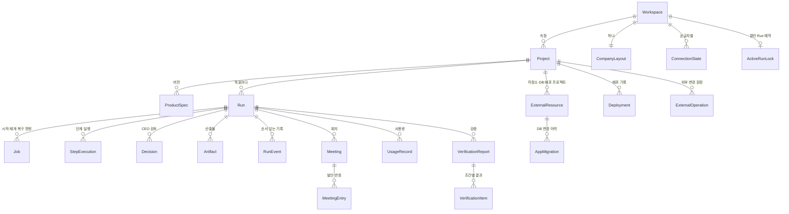

# MVP 팩토리 DB 스키마

| 항목      | 내용                                                                                   |
| --------- | -------------------------------------------------------------------------------------- |
| 파일·버전 | DB_SCHEMA.md · 0.1                                                                     |
| 작성일    | 2026년 11월 21일                                                                       |
| 상태      | **초안.** 설계를 `prisma/schema/`와 첫 마이그레이션에 반영함(개발 DB에는 아직 적용 전) |
| 기준      | API.md, WORKFLOW.md, ARCHITECTURE.md §4~§9                                             |
| 범위      | **팩토리 운영 DB**의 업무 테이블. 생성 앱의 DB와 LangGraph 체크포인트는 포함하지 않음  |

**한눈에 보기**

- **세 종류의 저장소가 있다:** ① 팩토리 업무 테이블(이 문서) ② LangGraph 체크포인트(라이브러리가 관리) ③ 생성 앱의 DB(사용자의 Supabase). 서로 다른 주체가 같은 테이블을 고치지 않는다.
- **사실의 기준은 업무 테이블이다.** `Run.status`는 화면용 요약이고, 승인·권한·외부 작업 여부는 `Decision`, `ExternalOperation` 같은 원장으로 판단한다.
- **동시성은 DB 제약으로 막는다:** 작업 공간당 열린 Run 하나(`ActiveRunLock`), 중복 요청(`IdempotencyRecord`), 이벤트 순번(`Run.lastSequence`), 결정 응답(조건부 갱신).
- **이벤트는 추가만 한다:** `RunEvent`는 수정·삭제하지 않는 기록이며 SSE와 새로고침 복원의 근거다.
- **로그인이 없다:** 사용자 테이블이 없다. 모든 데이터는 하나뿐인 `Workspace`에 속한다.
- **삭제하지 않는다:** 프로젝트 보관은 `archivedAt`으로 표시한다. 외부 리소스 삭제는 이 DB의 삭제와 무관하다.

**목차**

- [1. 원칙](#1-원칙)
- [2. 구성](#2-구성)
- [3. 관계도](#3-관계도)
- [4. 열거형](#4-열거형)
- [5. 테이블](#5-테이블)
- [6. 트랜잭션 경계](#6-트랜잭션-경계)
- [7. DB가 보장하는 불변 조건](#7-db가-보장하는-불변-조건)
- [8. 보존과 마이그레이션 정책](#8-보존과-마이그레이션-정책)
- [9. API와 테이블 대응](#9-api와-테이블-대응)
- [10. 열린 항목](#10-열린-항목)

## 1. 원칙

1. **업무 사실과 화면 요약을 구분한다.** 화면용 값(`Run.status`, `stageLabel`)을 보고 외부 작업을 다시 실행하거나 승인을 추정하지 않는다.
2. **한 번만 일어나야 하는 일은 유니크 제약으로 보장한다.** 코드의 "먼저 조회하고 없으면 만들기"만으로 막지 않는다.
3. **함께 확정되어야 하는 변경은 한 트랜잭션에 넣는다.** 목록은 §6.
4. **외부 호출 중에는 트랜잭션과 행 잠금을 유지하지 않는다.**
5. **비밀값을 저장하지 않는다.** 토큰, 연결 문자열, 비밀 키는 `.env`에만 둔다. 이 DB에는 연결 상태와 대상 이름만 남긴다.
6. **불변 기록은 고치지 않는다.** `ProductSpec`, `RunEvent`, `Artifact`, `VerificationReport`, `ExternalOperation`의 요청 내용은 만든 뒤 수정하지 않고 새 행으로 남긴다.
7. **새 컬럼은 기존 행에 호환되어야 한다.** nullable이거나 기본값을 둔다. 적용된 마이그레이션을 고치거나 지우지 않는다(AGENTS.md).

## 2. 구성

### 2.1 저장소의 구분

| 영역                       | 관리 주체                                 | 내용                                                                             |
| -------------------------- | ----------------------------------------- | -------------------------------------------------------------------------------- |
| 팩토리 업무 테이블         | Prisma와 이 저장소의 마이그레이션         | 이 문서의 모든 테이블                                                            |
| `agent_runtime` 체크포인트 | LangGraph saver(`PostgresSaver.setup()`)  | 그래프 상태와 재개 위치. 라이브러리 내부 테이블을 직접 고치지 않는다             |
| 생성 앱 DB                 | 사용자의 Supabase, 신뢰된 스키마 컴파일러 | 앱 업무 데이터. 이 DB와 연결하지 않는다                                          |
| 산출물 저장소              | 비공개 객체 저장소                        | 큰 소스 스냅샷·화면 캡처·원본 로그. 이 DB에는 참조(`storageRef`)와 체크섬만 둔다 |

체크포인트와 업무 테이블은 같은 PostgreSQL을 써도 같은 트랜잭션에 묶이지 않는다. 한쪽만 저장된 상태를 복구 대상에 포함한다(ARCHITECTURE.md §5.2).

### 2.2 Prisma 파일 배치

여러 사람이 동시에 작업해도 충돌하지 않도록 스키마를 기능별 파일로 나눈다(Prisma 다중 파일 스키마). `package.json`의 `prisma.schema`를 `prisma/schema`로 지정한다.

| 파일                                | 내용                                                                               |
| ----------------------------------- | ---------------------------------------------------------------------------------- |
| `prisma/schema/base.prisma`         | generator, datasource, `Workspace`, `ConnectionState`, 공통 열거형                 |
| `prisma/schema/projects.prisma`     | `Project`, `ProductSpec`                                                           |
| `prisma/schema/runs.prisma`         | `Run`, `ActiveRunLock`, `Job`, `StepExecution`, `UsageRecord`, `IdempotencyRecord` |
| `prisma/schema/decisions.prisma`    | `Decision`                                                                         |
| `prisma/schema/artifacts.prisma`    | `Artifact`, `SourceSnapshot`, `VerificationReport`, `VerificationItem`             |
| `prisma/schema/events.prisma`       | `RunEvent`, `Meeting`, `MeetingEntry`                                              |
| `prisma/schema/integrations.prisma` | `ExternalResource`, `ExternalOperation`, `AppMigration`, `Deployment`              |
| `prisma/schema/company.prisma`      | `CompanyLayout`                                                                    |
| `prisma/schema/ops.prisma`          | `WorkerHeartbeat`                                                                  |

마이그레이션 폴더는 스키마 폴더 **안**인 `prisma/schema/migrations`에 하나로 유지한다. 스키마를 폴더로 지정하면 Prisma가 이 위치에서 마이그레이션을 찾는다(`prisma/migrations`에 두면 "No migration found"가 된다).

업무 테이블은 PostgreSQL의 `public` 스키마에 둔다. Prisma의 다중 스키마 기능은 설치된 버전(6.12.0)에서 정식 기능이 아니므로 쓰지 않는다. 체크포인트만 `agent_runtime`으로 분리하며, 다중 스키마가 정식이 되는 버전으로 올릴 때 다시 검토한다.

**Prisma가 표현하지 못하는 제약**(CHECK)은 첫 마이그레이션 SQL 끝에 직접 적었다. 작업 공간 단일 행, 이벤트 순번 양수, 결정 응답 필수, 산출물의 본문·참조, `NOT_APPLICABLE`의 근거, 회의 참여자 1~4명, 문자열 열거형의 허용 값이다. 이 제약은 `prisma migrate diff`의 비교 대상이 아니므로 스키마를 바꿀 때 SQL을 함께 확인한다.

## 3. 관계도

## 4. 열거형

값은 `src/contracts`의 상수와 같다. 같은 이름의 값을 DB와 계약이 따로 정의하지 않도록, 값을 바꿀 때는 계약을 먼저 고친다.

| 열거형                    | 값                                                                                                              | 저장 방식                                                           |
| ------------------------- | --------------------------------------------------------------------------------------------------------------- | ------------------------------------------------------------------- |
| `CeoLevel`                | `DELEGATE` · `KEY_DECISIONS` · `COLLABORATIVE`                                                                  | DB enum                                                             |
| `RunMode`                 | `REAL` · `DEMO`                                                                                                 | DB enum                                                             |
| `RunType`                 | `INITIAL` · `REVISION`                                                                                          | DB enum                                                             |
| `RunStatus`               | `QUEUED` · `RUNNING` · `WAITING_CEO` · `PAUSED` · `BLOCKED` · `FAILED` · `SUCCEEDED`                            | DB enum                                                             |
| `BlockedReason`           | `CONNECTION_MISSING` · `PERMISSION_DENIED` · `LIMIT_REACHED` · `EXTERNAL_RESULT_UNKNOWN` · `WORKER_UNAVAILABLE` | DB enum                                                             |
| `RoleId`                  | `PM` · `PLANNER` · `DESIGNER` · `DEVELOPER`                                                                     | DB enum                                                             |
| `ArtifactAuthor`          | `RoleId` 값 + `SYSTEM`                                                                                          | DB enum                                                             |
| `JobKind`                 | `START` · `RESUME` · `RECOVER`                                                                                  | DB enum                                                             |
| `JobStatus`               | `QUEUED` · `RUNNING` · `DONE` · `FAILED`                                                                        | DB enum                                                             |
| `StepStatus`              | `PENDING` · `RUNNING` · `SUCCEEDED` · `WAITING` · `FAILED` · `SKIPPED`                                          | DB enum                                                             |
| `DecisionKind`            | `SCOPE_REVIEW` · `DESIGN_REVIEW` · `INTEGRATED_REVIEW` · `EXCEPTION`                                            | DB enum                                                             |
| `DecisionStatus`          | `PREPARED` · `OPEN` · `ANSWERED` · `APPLIED` · `SUPERSEDED`                                                     | DB enum                                                             |
| `DecisionChoice`          | `APPROVE` · `REQUEST_CHANGES` · `SELECT_OPTION`                                                                 | DB enum                                                             |
| `Provider`                | `github` · `vercel` · `supabase`                                                                                | DB enum                                                             |
| `ConnectionStatus`        | `CONNECTED` · `NOT_CONNECTED` · `INSUFFICIENT_PERMISSION` · `DISCONNECTED`                                      | DB enum                                                             |
| `RepoVisibility`          | `PRIVATE` · `PUBLIC`                                                                                            | DB enum                                                             |
| `ExternalOperationStatus` | `PLANNED` · `REQUESTED` · `SUCCEEDED` · `FAILED` · `UNKNOWN`                                                    | DB enum                                                             |
| `ExternalResourceKind`    | `REPOSITORY` · `DATABASE` · `DEPLOYMENT_PROJECT`                                                                | DB enum                                                             |
| `DeploymentStage`         | `CANDIDATE` · `PUBLISHED` · `FAILED` · `SUPERSEDED`                                                             | DB enum                                                             |
| `MeetingStatus`           | `IN_PROGRESS` · `WAITING_CEO` · `ENDED` · `FAILED` · `INTERRUPTED`                                              | DB enum                                                             |
| `MeetingEntryKind`        | `STATEMENT` · `REACTION`                                                                                        | DB enum                                                             |
| `VerificationResult`      | `PASS` · `FAIL` · `NOT_RUN` · `NOT_APPLICABLE`                                                                  | DB enum                                                             |
| 이벤트 종류               | `run.accepted` 등 18가지(API.md §6.1)                                                                           | **text.** 종류가 늘어도 마이그레이션 없이 확장하고 계약 상수로 검증 |
| 산출물 종류               | `PRODUCT_SPEC`, `SCREEN_PLAN` 등                                                                                | **text.** 같은 이유                                                 |

## 5. 테이블

표기: `PK` 기본키, `FK` 외래키, `UQ` 유니크, `?` null 허용. 시각은 모두 `timestamptz`, ID는 문자열(cuid) 기본키다. 외래키는 기본적으로 삭제 제한(`Restrict`)이며 예외는 표에 적는다.

### 5.1 작업 공간과 설정 (REQ-002)

**Workspace** — 로그인 없는 단일 사용자 작업 공간. 행은 하나다.

| 컬럼                     | 타입           | 설명                                            |
| ------------------------ | -------------- | ----------------------------------------------- |
| `id`                     | text PK        | 고정값 `default`                                |
| `repoVisibility`         | RepoVisibility | 새 저장소 기본 공개 범위. 기본 `PRIVATE`        |
| `limitMaxModelCalls`     | int?           | 실행 한도. null은 한도 없음이 아니라 **미설정** |
| `limitMaxFixAttempts`    | int?           | 〃                                              |
| `limitMaxActiveSeconds`  | int?           | 〃                                              |
| `limitMaxEstimatedCost`  | numeric(12,4)? | 〃. 통화는 §10 열린 항목                        |
| `createdAt`, `updatedAt` | timestamptz    |                                                 |

**ConnectionState** — 공급자 연결 상태의 마지막 확인 결과. 비밀값은 저장하지 않는다.

| 컬럼          | 타입             | 설명                  |
| ------------- | ---------------- | --------------------- |
| `id`          | text PK          |                       |
| `workspaceId` | FK Workspace     |                       |
| `provider`    | Provider         |                       |
| `status`      | ConnectionStatus |                       |
| `target`      | text?            | 사용자·조직·팀 이름   |
| `checkedAt`   | timestamptz?     | 마지막 실제 확인 시각 |
| `message`     | text?            | 필요한 조치           |
| `updatedAt`   | timestamptz      |                       |

제약: **UQ(`workspaceId`, `provider`)**.

### 5.2 프로젝트 (REQ-001, 004)

**Project**

| 컬럼                     | 타입           | 설명                                                  |
| ------------------------ | -------------- | ----------------------------------------------------- |
| `id`                     | text PK        | `projectId`                                           |
| `workspaceId`            | FK Workspace   |                                                       |
| `name`                   | text           | 1~100자                                               |
| `idea`                   | text           | 원본 아이디어(1~4000자). 수정하지 않는다              |
| `purpose`, `constraints` | text?          | 각 최대 1000자                                        |
| `ceoLevel`               | CeoLevel       | 다음 Run의 기본값                                     |
| `archivedAt`             | timestamptz?   | 보관 시각. 보관해도 외부 리소스는 그대로              |
| `projectGeneration`      | int default 0  | 접수된 실행 목표의 순서. 새 Run이 접수될 때 증가      |
| `confirmedSpecVersion`   | int?           | 확정된 `ProductSpec.version`                          |
| `lastGoodDeploymentId`   | FK Deployment? | 마지막 정상 배포. 수정 Run이 실패해도 덮어쓰지 않는다 |
| `createdAt`, `updatedAt` | timestamptz    |                                                       |

인덱스: (`workspaceId`, `archivedAt`, `updatedAt` desc) — 목록 조회.

**ProductSpec** — 기능·화면·데이터·완료 조건의 버전. 만든 뒤 수정하지 않는다.

| 컬럼             | 타입        | 설명                                                   |
| ---------------- | ----------- | ------------------------------------------------------ |
| `id`             | text PK     |                                                        |
| `projectId`      | FK Project  |                                                        |
| `version`        | int         | 프로젝트 안에서 1부터 증가                             |
| `schemaVersion`  | int         | `content` 형식의 버전                                  |
| `summary`        | text        | 확정 요구사항 한 줄 요약(`Project.confirmedSpec`)      |
| `content`        | jsonb       | 목적, 기능, 데이터, 접근 범위, 완료 조건, 가정, APP-AC |
| `createdByRunId` | FK Run?     |                                                        |
| `createdAt`      | timestamptz |                                                        |

제약: **UQ(`projectId`, `version`)**.

### 5.3 실행 (REQ-006, 013, 014)

**Run** — 최초 생성 또는 수정 한 번의 목표.

| 컬럼                                        | 타입                  | 설명                                                                        |
| ------------------------------------------- | --------------------- | --------------------------------------------------------------------------- |
| `id`                                        | text PK               | `runId`                                                                     |
| `projectId`                                 | FK Project            |                                                                             |
| `type`, `mode`                              | RunType, RunMode      |                                                                             |
| `status`                                    | RunStatus             | 화면용 요약. 판단의 근거로 쓰지 않는다                                      |
| `stageId`, `stageLabel`                     | text?                 | 예: `W05`, `화면 설계`                                                      |
| `ceoLevel`                                  | CeoLevel              | **Run 시작 시 고정**                                                        |
| `blockedReason`                             | BlockedReason?        |                                                                             |
| `failure`                                   | jsonb?                | `{ stage, message, retryable }`. 내부 오류·스택·SQL을 담지 않는다           |
| `pauseRequested`                            | boolean               | 정지 요청은 받았지만 아직 정지 전                                           |
| `feedback`                                  | text?                 | `REVISION`의 피드백 원문                                                    |
| `projectGeneration`                         | int                   | 접수 당시 `Project.projectGeneration`. 오래된 실패 Run의 재시도 차단에 사용 |
| `baseSpecVersion`                           | int?                  | 시작 시점의 기준 사양 버전                                                  |
| `workflowVersion`, `promptVersion`          | text                  | 실행에 쓴 버전                                                              |
| `templateVersion`                           | text?                 | 생성 앱 템플릿 버전                                                         |
| `modelConfig`                               | jsonb                 | 모델 설정. 키·토큰을 담지 않는다                                            |
| `limits`                                    | jsonb                 | 시작 시 고정한 `RunLimits` 사본                                             |
| `usageModelCalls`, `usageFixAttempts`       | int default 0         | `UsageRecord`의 합계(§6의 같은 트랜잭션에서 갱신)                           |
| `usageActiveSeconds`, `usageWaitingSeconds` | int default 0         | CEO 대기 시간과 실제 작업 시간을 분리                                       |
| `usageCostAmount`, `usageCostCurrency`      | numeric(12,4)?, text? | 추정 비용. 확정 금액이 아니다                                               |
| `lastSequence`                              | int default 0         | 마지막 `RunEvent.sequence`. 이벤트를 추가할 때 증가                         |
| `eventsRetainedFrom`                        | int default 1         | 보존된 첫 이벤트 순번. 이보다 이전을 요청하면 `EVENTS_EXPIRED`              |
| `threadId`                                  | text UQ               | 체크포인트 문맥 ID. `runId`와 일대일, 재개에도 유지                         |
| `startedAt`, `finishedAt`                   | timestamptz?          |                                                                             |
| `createdAt`                                 | timestamptz           |                                                                             |

인덱스: (`projectId`, `createdAt` desc), (`status`).

**ActiveRunLock** — 작업 공간당 열려 있는 Run을 하나로 제한하는 예약.

| 컬럼          | 타입             | 설명                                |
| ------------- | ---------------- | ----------------------------------- |
| `workspaceId` | PK, FK Workspace | **기본키가 곧 "하나뿐"을 보장한다** |
| `runId`       | FK Run, UQ       |                                     |
| `acquiredAt`  | timestamptz      |                                     |

접수 트랜잭션이 행을 삽입하고(기본키 충돌이면 `ACTIVE_RUN_EXISTS`), `SUCCEEDED`·`FAILED`가 확정될 때 삭제한다. `WAITING_CEO`·`PAUSED`·`BLOCKED` 중에는 유지한다. 실패한 Run의 재시도는 다시 삽입한다.

**Job** — 워커에게 전하는 시작·재개·복구 명령. (Job의 `DONE`은 Run의 완료가 아니다.)

| 컬럼                                   | 타입          | 설명                                                                   |
| -------------------------------------- | ------------- | ---------------------------------------------------------------------- |
| `id`                                   | text PK       | `jobId`                                                                |
| `runId`                                | FK Run        |                                                                        |
| `kind`                                 | JobKind       |                                                                        |
| `status`                               | JobStatus     |                                                                        |
| `dedupeKey`                            | text UQ       | 같은 원인의 중복 등록 방지. 예: `start:<runId>`, `resume:<decisionId>` |
| `causeJobId`                           | FK Job?       | 복구 명령이 가리키는 원인 Job. 원래 Job을 덮어쓰지 않는다              |
| `claimedBy`                            | text?         | 인수한 워커 인스턴스 ID                                                |
| `claimEpoch`                           | int default 0 | 소유권이 바뀔 때마다 증가. 오래된 소유자의 쓰기를 막는다               |
| `leaseUntil`                           | timestamptz?  | lease 만료만으로 다른 워커에 넘기지 않는다(ARCHITECTURE.md §7.2)       |
| `attempt`                              | int default 0 |                                                                        |
| `notBefore`                            | timestamptz?  | 재시도 예정 시각                                                       |
| `noOpReason`                           | text?         | 중복·오래된 재개 Job을 아무 일 없이 `DONE`으로 끝낸 이유               |
| `error`                                | text?         | 내부 진단 요약                                                         |
| `createdAt`, `startedAt`, `finishedAt` | timestamptz   |                                                                        |

인덱스: (`status`, `notBefore`, `createdAt`) — `FOR UPDATE SKIP LOCKED`로 인수.

**StepExecution** — 특정 입력에 대한 논리 노드 실행(WORKFLOW.md §2.1).

| 컬럼                      | 타입         | 설명                           |
| ------------------------- | ------------ | ------------------------------ |
| `id`                      | text PK      | `stepExecutionId`              |
| `runId`                   | FK Run       |                                |
| `nodeId`                  | text         | 예: `W05`                      |
| `inputFingerprint`        | text         | 입력 내용·버전을 정규화한 해시 |
| `attempt`                 | int          | 같은 입력의 시도 번호          |
| `status`                  | StepStatus   |                                |
| `errorClass`              | text?        | 입력·권한·충돌·외부·한도 등    |
| `errorMessage`            | text?        |                                |
| `startedAt`, `finishedAt` | timestamptz? |                                |

제약: **UQ(`runId`, `nodeId`, `inputFingerprint`, `attempt`)**.

**UsageRecord** — 사용량 원장. `Run.usage*`는 이 합계의 비정규화 값이다.

| 컬럼                         | 타입              | 설명                                         |
| ---------------------------- | ----------------- | -------------------------------------------- |
| `id`                         | text PK           |                                              |
| `runId`                      | FK Run            |                                              |
| `stepExecutionId`            | FK StepExecution? |                                              |
| `kind`                       | text              | `MODEL_CALL` · `FIX_ATTEMPT` · `ACTIVE_TIME` |
| `amount`                     | numeric           | 횟수 또는 초                                 |
| `costAmount`, `costCurrency` | numeric?, text?   | 추정 비용                                    |
| `createdAt`                  | timestamptz       |                                              |

**IdempotencyRecord** — 중복 요청 방지(API.md §1.1).

| 컬럼                             | 타입        | 설명                                                  |
| -------------------------------- | ----------- | ----------------------------------------------------- |
| `id`                             | text PK     |                                                       |
| `scope`                          | text        | 예: `POST /api/projects`                              |
| `key`                            | text        | `Idempotency-Key` 헤더 값                             |
| `requestHash`                    | text        | 정규화한 본문의 해시. 다르면 `IDEMPOTENCY_KEY_REUSED` |
| `responseStatus`, `responseBody` | int, jsonb  | 처음 응답을 그대로 재생                               |
| `createdAt`, `expiresAt`         | timestamptz |                                                       |

제약: **UQ(`scope`, `key`)**. 만료된 행은 정리한다.

### 5.4 CEO 결정 (REQ-003)

**Decision**

| 컬럼                                  | 타입            | 설명                                                               |
| ------------------------------------- | --------------- | ------------------------------------------------------------------ |
| `id`                                  | text PK         | `decisionId`                                                       |
| `runId`                               | FK Run          |                                                                    |
| `kind`                                | DecisionKind    |                                                                    |
| `round`                               | int             | 같은 검토 지점의 회차. `REQUEST_CHANGES` 뒤 재검토는 새 회차·새 행 |
| `status`                              | DecisionStatus  |                                                                    |
| `proposalVersion`                     | int             | 사용자가 본 제안을 식별. 응답과 함께 보낸다                        |
| `proposalFingerprint`                 | text            | 제안 내용 해시. 같은 내용을 새 질문으로 중복 생성하지 않는다       |
| `title`, `summary`                    | text            |                                                                    |
| `proposal`                            | jsonb           | `{ heading, items[] }[]`                                           |
| `changesFromPrevious`                 | jsonb           | 문자열 배열                                                        |
| `options`                             | jsonb           | `EXCEPTION`의 선택지 `{ id, label, description }[]`                |
| `interruptRef`                        | text?           | 연결된 LangGraph interrupt 식별자                                  |
| `responseChoice`                      | DecisionChoice? |                                                                    |
| `responseOptionId`, `responseComment` | text?           |                                                                    |
| `answeredAt`, `appliedAt`             | timestamptz?    |                                                                    |
| `supersededById`                      | FK Decision?    | 적용 전 제안이 새 제안으로 대체된 경우                             |
| `openedAt`                            | timestamptz?    | `OPEN`으로 바뀐 시각                                               |
| `createdAt`                           | timestamptz     |                                                                    |

제약·인덱스: **UQ(`runId`, `kind`, `round`)**, (`status`, `openedAt`) — 열린 결정 조회.

상태 전이는 한 방향이다: `PREPARED → OPEN → ANSWERED → APPLIED`, `PREPARED·OPEN → SUPERSEDED`. `APPLIED`와 `SUPERSEDED`는 다시 열지 않는다.

### 5.5 이벤트와 회의 (REQ-010, 016)

**RunEvent** — 추가만 하는 기록. SSE와 새로고침 복원의 근거다.

| 컬럼         | 타입        | 설명                                       |
| ------------ | ----------- | ------------------------------------------ |
| `id`         | text PK     |                                            |
| `runId`      | FK Run      |                                            |
| `sequence`   | int         | Run 안에서 1부터 증가                      |
| `type`       | text        | `run.accepted` 등                          |
| `occurredAt` | timestamptz |                                            |
| `stageId`    | text?       |                                            |
| `role`       | RoleId?     |                                            |
| `summary`    | text        | 사용자에게 보여 줄 한 줄                   |
| `refs`       | jsonb       | `{ artifactId?, decisionId?, meetingId? }` |
| `data`       | jsonb       | 종류별 추가 정보(`RunEventDataMap`)        |

제약: **UQ(`runId`, `sequence`)**. 수정·삭제하지 않는다(보존 기간 정리는 §8).

**Meeting** — 실제 작업·결정에 연결된 회의. 연결된 작업이 없는 회의는 만들지 않는다.

| 컬럼                   | 타입                      | 설명           |
| ---------------------- | ------------------------- | -------------- |
| `id`                   | text PK                   |                |
| `runId`                | FK Run                    |                |
| `decisionId`           | FK Decision?              |                |
| `topic`                | text                      |                |
| `participants`         | RoleId[]                  | 최대 4명       |
| `status`               | MeetingStatus             |                |
| `outcome`              | text?                     | 결정 결과 요약 |
| `startedAt`, `endedAt` | timestamptz, timestamptz? |                |

인덱스: (`runId`, `startedAt`).

**MeetingEntry** — 발언과 반응.

| 컬럼            | 타입                              | 설명                                       |
| --------------- | --------------------------------- | ------------------------------------------ |
| `id`            | text PK                           |                                            |
| `meetingId`     | FK Meeting, **삭제 시 함께 삭제** |                                            |
| `kind`          | MeetingEntryKind                  |                                            |
| `entryOrder`    | int                               | 회의 안에서의 순서                         |
| `eventSequence` | int                               | 이 항목을 알린 `RunEvent.sequence`         |
| `role`          | RoleId                            |                                            |
| `text`          | text?                             | 발언 요약(`STATEMENT`). 서버가 저장한 문구 |
| `reactionKind`  | text?                             | `NOD` · `THINK` · `ALERT`(`REACTION`)      |

제약: **UQ(`meetingId`, `eventSequence`)**.

### 5.6 산출물과 검증 (REQ-004, 005, 011)

**Artifact**

| 컬럼              | 타입              | 설명                                                     |
| ----------------- | ----------------- | -------------------------------------------------------- |
| `id`              | text PK           |                                                          |
| `runId`           | FK Run            |                                                          |
| `stepExecutionId` | FK StepExecution? |                                                          |
| `author`          | ArtifactAuthor    | 역할 또는 `SYSTEM`(예: 위임 확정 근거)                   |
| `type`            | text              | 예: `PRODUCT_SPEC`, `SCREEN_PLAN`, `IMPLEMENTATION_PLAN` |
| `revision`        | int default 1     | 같은 종류를 다시 만들면 증가                             |
| `title`           | text              |                                                          |
| `schemaVersion`   | int               |                                                          |
| `specVersion`     | int?              | 참조한 사양 버전                                         |
| `content`         | jsonb?            | 작은 산출물의 본문                                       |
| `storageRef`      | text?             | 큰 파일의 객체 저장소 참조                               |
| `checksum`        | text              |                                                          |
| `createdAt`       | timestamptz       |                                                          |

제약: **UQ(`runId`, `type`, `revision`)**. `content`와 `storageRef` 중 하나는 있어야 한다.

**SourceSnapshot** — 샌드박스 밖에 보존하는 소스 스냅샷.

| 컬럼              | 타입        | 설명                      |
| ----------------- | ----------- | ------------------------- |
| `id`              | text PK     |                           |
| `runId`           | FK Run      |                           |
| `sourceDigest`    | text        | 파일 목록과 체크섬의 해시 |
| `lockfileDigest`  | text?       |                           |
| `templateVersion` | text        |                           |
| `fileCount`       | int         |                           |
| `storageRef`      | text        |                           |
| `createdAt`       | timestamptz |                           |

제약: **UQ(`runId`, `sourceDigest`)**.

**VerificationReport**, **VerificationItem** — 검증 결과. 어떤 사양·소스·배포에 대한 검사인지 고정한다.

| VerificationReport 컬럼 | 타입           | 설명                        |
| ----------------------- | -------------- | --------------------------- |
| `id`                    | text PK        |                             |
| `runId`                 | FK Run         |                             |
| `specVersion`           | int            |                             |
| `sourceDigest`          | text?          |                             |
| `commitSha`             | text?          |                             |
| `deploymentId`          | FK Deployment? |                             |
| `envRevision`           | text?          | 비밀값이 아닌 환경설정 버전 |
| `harnessVersion`        | text           | 검사 하네스 버전            |
| `createdAt`             | timestamptz    |                             |

| VerificationItem 컬럼 | 타입                             | 설명                            |
| --------------------- | -------------------------------- | ------------------------------- |
| `id`                  | text PK                          |                                 |
| `reportId`            | FK Report, **삭제 시 함께 삭제** |                                 |
| `checkId`             | text                             | 예: `APP-AC-001`                |
| `description`         | text                             |                                 |
| `result`              | VerificationResult               |                                 |
| `evidence`            | text?                            | 증거 요약 또는 산출물 ID        |
| `reason`              | text?                            | `NOT_APPLICABLE`이면 근거(필수) |

제약: **UQ(`reportId`, `checkId`)**. 소스·환경·DB가 바뀌면 새 보고서를 만들고 이전 보고서는 이력으로 보존한다.

### 5.7 외부 연동 (REQ-007, 008, 009, 012)

**ExternalResource** — 프로젝트에 묶인 외부 리소스. 수정 Run은 이것을 재사용한다.

| 컬럼         | 타입                 | 설명                       |
| ------------ | -------------------- | -------------------------- |
| `id`         | text PK              |                            |
| `projectId`  | FK Project           |                            |
| `provider`   | Provider             |                            |
| `kind`       | ExternalResourceKind |                            |
| `externalId` | text                 | 공급자가 준 ID             |
| `url`        | text?                |                            |
| `meta`       | jsonb                | 조직, 지역 등. 비밀값 없음 |
| `createdAt`  | timestamptz          |                            |

제약: **UQ(`projectId`, `provider`, `kind`)** — 같은 프로젝트에 같은 종류의 리소스가 둘 생기지 않는다.

**ExternalOperation** — 외부 변경 원장(WORKFLOW.md §10.1).

| 컬럼                     | 타입                    | 설명                                                                       |
| ------------------------ | ----------------------- | -------------------------------------------------------------------------- |
| `id`                     | text PK                 |                                                                            |
| `projectId`              | FK Project              |                                                                            |
| `runId`                  | FK Run?                 |                                                                            |
| `operationKey`           | text **UQ**             | 작업의 논리 목적. 재시도해도 같다(예: 저장소 생성 = projectId+github+용도) |
| `provider`               | Provider                |                                                                            |
| `kind`                   | text                    | 예: `CREATE_REPOSITORY`, `APPLY_MIGRATION`, `CREATE_DEPLOYMENT`            |
| `status`                 | ExternalOperationStatus |                                                                            |
| `targetAccount`          | text                    | 최초 요청의 공급자 계정·대상. 이후 바꾸지 않는다                           |
| `requestHash`            | text                    | 정규화한 요청 내용의 해시                                                  |
| `externalId`             | text?                   | 확인된 리소스 ID                                                           |
| `evidence`               | jsonb?                  | 공급자 응답·조회 결과 요약                                                 |
| `attempt`                | int default 0           |                                                                            |
| `observedAt`             | timestamptz?            | 마지막으로 실제 상태를 확인한 시각                                         |
| `createdAt`, `updatedAt` | timestamptz             |                                                                            |

같은 `operationKey`에 다른 `targetAccount`나 `requestHash`가 들어오면 충돌로 처리하고 재전송하지 않는다. `UNKNOWN`은 조회로 확인하기 전까지 새로 만들지 않는다. `FAILED`여도 이미 생긴 `externalId`는 남긴다.

**AppMigration** — 생성 앱 DB에 적용한 변경 이력(앱 DB의 실제 이력과 대조해 복구한다).

| 컬럼                 | 타입                | 설명                             |
| -------------------- | ------------------- | -------------------------------- |
| `id`                 | text PK             |                                  |
| `databaseResourceId` | FK ExternalResource | `kind = DATABASE`인 행           |
| `version`            | text                | 마이그레이션 버전                |
| `checksum`           | text                | 내용 해시                        |
| `status`             | text                | `PLANNED` · `APPLIED` · `FAILED` |
| `appliedAt`          | timestamptz?        |                                  |

제약: **UQ(`databaseResourceId`, `version`)**. 같은 버전에 다른 `checksum`이 들어오면 충돌로 차단한다.

**Deployment** — 소스·커밋·DB·환경설정·배포의 대응(DeploymentManifest).

| 컬럼                   | 타입            | 설명                                    |
| ---------------------- | --------------- | --------------------------------------- |
| `id`                   | text PK         |                                         |
| `projectId`            | FK Project      |                                         |
| `runId`                | FK Run          |                                         |
| `providerDeploymentId` | text            | Vercel 배포 ID                          |
| `commitSha`            | text            |                                         |
| `sourceDigest`         | text            | `SourceSnapshot.sourceDigest`와 대응    |
| `envRevision`          | text            | 비밀값이 아닌 환경설정 버전             |
| `migrationVersion`     | text?           | 이 배포가 기대하는 DB 마이그레이션 버전 |
| `url`                  | text?           |                                         |
| `stage`                | DeploymentStage | 후보 → 게시                             |
| `createdAt`            | timestamptz     |                                         |

제약: **UQ(`projectId`, `providerDeploymentId`)**.

### 5.8 가상 회사 (REQ-015)

**CompanyLayout** — 모든 프로젝트가 공유하는 회사·캐릭터 설정. 행은 하나다.

| 컬럼          | 타입             | 설명                                       |
| ------------- | ---------------- | ------------------------------------------ |
| `workspaceId` | PK, FK Workspace |                                            |
| `version`     | int default 1    | 저장할 때마다 증가. 동시 편집 충돌 감지    |
| `characters`  | jsonb            | `Record<RoleId, CharacterAppearance>`      |
| `office`      | jsonb            | `OfficeLayout`(확장 단계, 배치, 회의 좌석) |
| `updatedAt`   | timestamptz      |                                            |

JSON으로 두는 이유는 아이템·배치 구조가 화면과 함께 자주 바뀔 가능성이 크기 때문이다. 형식은 서버가 저장 시점에 검증한다(`src/contracts/company.ts`). 아이템 카탈로그는 코드의 정적 데이터이며 테이블이 아니다.

### 5.9 운영

**WorkerHeartbeat** — `GET /api/health`의 워커 상태 판단.

| 컬럼         | 타입        | 설명                 |
| ------------ | ----------- | -------------------- |
| `instanceId` | text PK     | 워커 인스턴스 ID     |
| `lastSeenAt` | timestamptz |                      |
| `version`    | text        | 워커·워크플로우 버전 |

## 6. 트랜잭션 경계

함께 확정되어야 하는 변경이다. 각 항목은 하나의 업무 DB 트랜잭션에서 처리한다. 모델·샌드박스·공급자 호출 중에는 트랜잭션과 행 잠금을 열어 두지 않는다.

| 이름                  | 포함하는 변경                                                                                                                                       | 실패 시                                                                          |
| --------------------- | --------------------------------------------------------------------------------------------------------------------------------------------------- | -------------------------------------------------------------------------------- |
| **T1 Run 접수**       | `IdempotencyRecord` 조회·저장 → `Project.projectGeneration` 증가 → `ActiveRunLock` 삽입 → `Run` 삽입 → `Job(START)` 삽입 → `RunEvent(run.accepted)` | 잠금 충돌이면 `ACTIVE_RUN_EXISTS`. 전부 롤백                                     |
| **T2 결정 응답**      | `Decision`을 조건부 갱신(`status = OPEN`이고 `proposalVersion` 일치이고 Run이 정지 중이 아님) → `Job(RESUME)` 삽입 → `RunEvent(decision.answered)`  | 갱신 행이 0이면 조회해 충돌 종류를 판단. 응답과 재개 Job이 하나만 남는 일은 없다 |
| **T3 이벤트 추가**    | `Run.lastSequence`를 1 올리고(`UPDATE … RETURNING`) `RunEvent`를 같은 순번으로 삽입 → `pg_notify`                                                   | 순번이 비는 일이 없다. 알림은 커밋 후 전달된다                                   |
| **T4 결정 반영**      | `Decision`을 `APPLIED`로(`appliedAt IS NULL` 조건) → `ProductSpec` 새 버전 → `Project.confirmedSpecVersion` 갱신                                    | 같은 결정을 두 번 반영하지 않는다                                                |
| **T5 Run 종료**       | `Run.status` 확정 → `ActiveRunLock` 삭제 → (`SUCCEEDED`이면) `Project.lastGoodDeploymentId` 갱신 → `RunEvent`                                       | 완료 조건은 이 트랜잭션 전에 시스템이 확인한다                                   |
| **T6 회사 설정 저장** | `UPDATE CompanyLayout … WHERE version = :기대 버전`으로 `version + 1`                                                                               | 갱신 행이 0이면 `VERSION_CONFLICT`                                               |

체크포인트(LangGraph)와 업무 테이블은 별도 저장 경계다. 결정 준비 → interrupt 저장 → `OPEN` 표시 순서로 처리하고, 한쪽만 저장된 상태는 복구 때 기존 결정과 체크포인트를 맞춘다.

## 7. DB가 보장하는 불변 조건

| 불변 조건                                    | 보장 수단                                              |
| -------------------------------------------- | ------------------------------------------------------ |
| 작업 공간당 열린 Run은 하나                  | `ActiveRunLock` 기본키                                 |
| 같은 요청의 중복 접수 방지                   | `IdempotencyRecord` UQ(`scope`, `key`)                 |
| 같은 원인의 Job 중복 등록 방지               | `Job.dedupeKey` UQ                                     |
| Run 안의 이벤트 순번은 유일하고 비지 않는다  | `RunEvent` UQ(`runId`, `sequence`) + T3                |
| 같은 외부 작업 목적은 하나의 원장 행         | `ExternalOperation.operationKey` UQ                    |
| 프로젝트당 저장소·DB·배포 프로젝트는 하나씩  | `ExternalResource` UQ(`projectId`, `provider`, `kind`) |
| 같은 마이그레이션 버전은 한 번만 기록        | `AppMigration` UQ(`databaseResourceId`, `version`)     |
| 한 결정 응답은 한 번만 저장                  | T2의 조건부 갱신                                       |
| 사양 버전은 프로젝트 안에서 유일             | `ProductSpec` UQ(`projectId`, `version`)               |
| `threadId`는 Run과 일대일                    | `Run.threadId` UQ                                      |
| 마지막 정상 배포는 수정 실패로 덮이지 않는다 | T5가 `SUCCEEDED`일 때만 `lastGoodDeploymentId`를 갱신  |
| 보호가 필요한 기록은 삭제되지 않는다         | 외래키 `Restrict` 기본, 프로젝트 삭제 기능 없음        |

## 8. 보존과 마이그레이션 정책

- **삭제하지 않는다:** 프로젝트는 `archivedAt`으로 보관한다. 외부 리소스를 지우는 기능은 별도 명령이며 이 DB의 행도 남긴다. 진행 중 Run, 복구에 필요한 소스, 적용된 DB 변경 이력은 정리 작업이 지우지 않는다.
- **이벤트 보존:** 기간·개수는 정하지 않았다(열린 항목). 오래된 이벤트를 정리하면 `Run.eventsRetainedFrom`을 함께 올려 `EVENTS_EXPIRED`를 판단한다.
- **마이그레이션:**
  - 폴더 하나(`prisma/schema/migrations`)에 순서대로 쌓고, 적용된 파일을 고치거나 지우지 않는다.
  - 기존 행과 이전 코드에 호환되는 **추가 변경**(nullable·기본값 있는 컬럼, 새 테이블)을 우선한다.
  - 컬럼 삭제, 이름 변경, 타입 축소 같은 파괴적 변경은 영향을 확인하고 별도 요청 후 진행한다.
  - 개발 DB를 초기화하는 것은 사용자가 요청할 때만 한다.
- **연결 방식:** 웹, 워커, 마이그레이션은 각자의 요구에 맞는 연결을 쓴다. 이벤트 알림(`LISTEN`)은 트랜잭션 풀링을 거치지 않는 전용 연결이다(ARCHITECTURE.md §16).

## 9. API와 테이블 대응

| API 자원              | 주로 읽고 쓰는 테이블                                                                                      |
| --------------------- | ---------------------------------------------------------------------------------------------------------- |
| 프로젝트 (§3)         | `Project`, `ProductSpec`, `Run`(최근 상태)                                                                 |
| 실행 (§4)             | `Run`, `ActiveRunLock`, `Job`, `StepExecution`, `UsageRecord`, `IdempotencyRecord`, `Artifact`             |
| CEO 결정 (§5)         | `Decision`, `Job`, `RunEvent`                                                                              |
| 이벤트·SSE (§6)       | `RunEvent`, `Run.lastSequence`, `Run.eventsRetainedFrom`                                                   |
| 사무실 화면·회의 (§7) | `Run`, `Decision`, `Artifact`, `RunEvent`, `Meeting`, `MeetingEntry`                                       |
| 가상 회사 (§8)        | `CompanyLayout`                                                                                            |
| 공통 설정 (§9)        | `Workspace`, `ConnectionState`                                                                             |
| 결과·검증 (§10)       | `Deployment`, `ExternalResource`, `VerificationReport`, `VerificationItem`, `Project.lastGoodDeploymentId` |
| 시스템 (§11)          | `WorkerHeartbeat`                                                                                          |
| (API 없음, 워커 내부) | `ExternalOperation`, `AppMigration`, `SourceSnapshot`                                                      |

## 10. 열린 항목

- **이벤트 보존 기간:** `RunEvent`를 얼마나 보관할지(개수 또는 일수).
- **통화와 단위:** 비용 컬럼의 통화(`costCurrency`)를 한 가지로 고정할지.
- **PostgreSQL 스키마 분리:** 업무 테이블을 `factory` 스키마로 옮기는 시점(Prisma 다중 스키마가 정식인 버전으로 올릴 때).
- **개발 DB의 옛 테이블:** 개발 DB에는 삭제한 초기 코드의 테이블이 남아 있어 첫 마이그레이션이 충돌한다. 초기화할지는 사용자가 정한다.
- **큰 산출물의 저장소:** `storageRef`가 가리킬 객체 저장소(DEC-007과 함께 결정).
- **회사 설정 JSON의 정규화:** 아이템 단위의 조회·집계가 필요해지면 테이블로 나눈다.
- **계약과의 동기화:** 열거형 값과 JSON 형식은 `src/contracts`가 기준이다. Prisma 스키마를 만들 때 값이 일치하는지 테스트로 확인한다.

## 변경 이력

| 버전 | 날짜       | 내용      |
| ---- | ---------- | --------- |
| 0.1  | 2026-11-21 | 초안 작성 |
