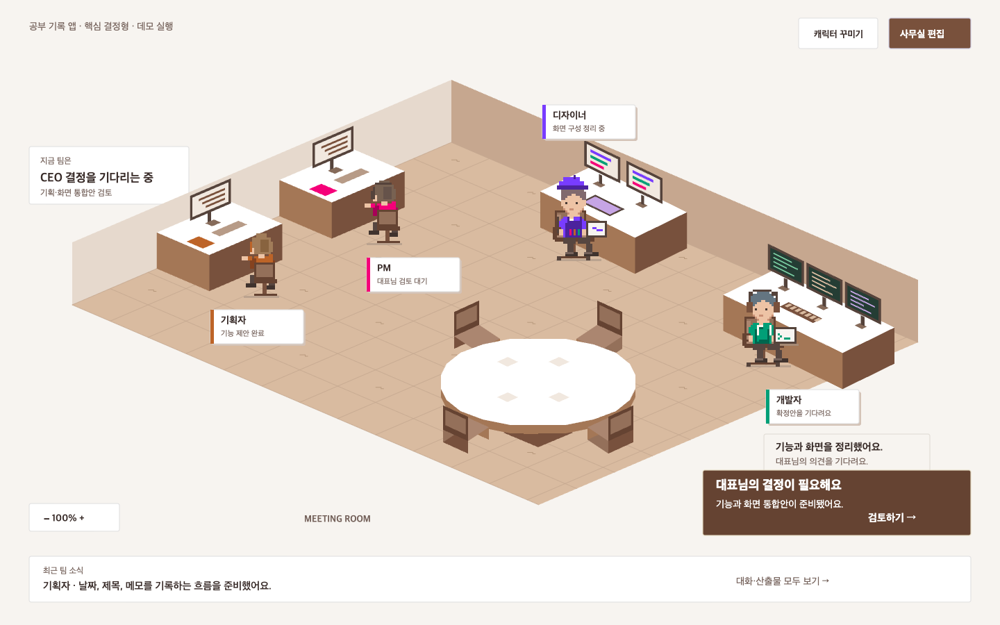
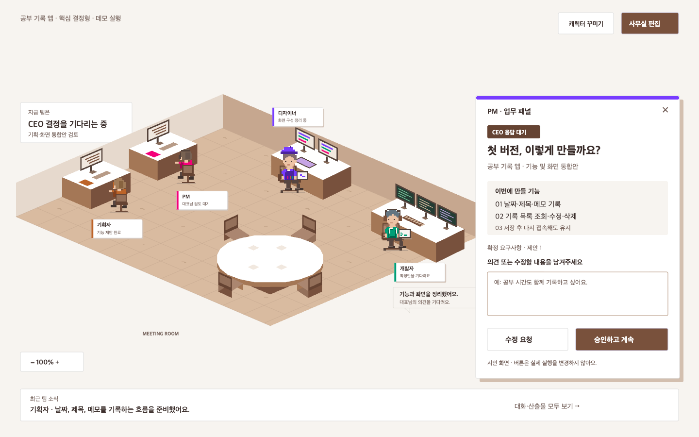
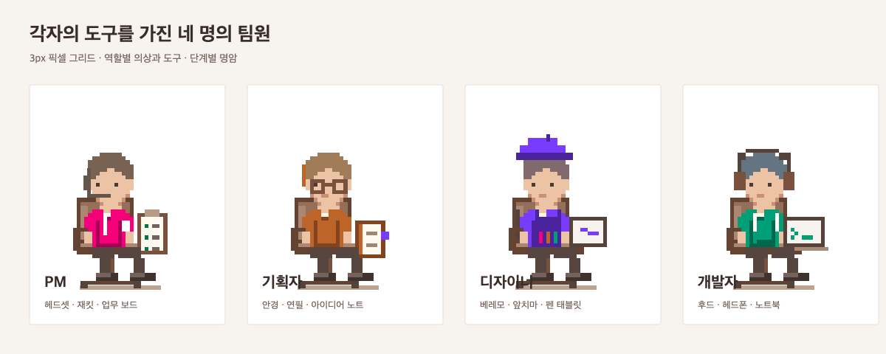

# MVP 팩토리 UI 명세

버전: 0.2 · 작성일: 2026-11-21 · 상태: **디자인 방향 확정 · 기존 이미지 일부 갱신 필요**

## 1. 목적과 기준

REQ-010·015·016의 가상 회사 경험과 REQ-003의 CEO 결정 화면을 구체화한다. PRD §2.1의 확정 사항과 DESIGN_SYSTEM·UX_PRINCIPLES·ANIMATION_SPEC을 따른다. 실제 앱 화면이나 구현 완료 증거가 아니다.

확정 사항은 아이소메트릭 사무실 중심 화면, 클릭 시 중앙 업무 팝업 열기, PM·기획자·디자이너·개발자 4명, 공통 회사 설정, 자유로운 꾸미기·확장, 무음이다. 이번 시안의 배치·크기·캐릭터 외형·문구는 검토할 제안이다.

## 2. 대표 시안

아래 이미지는 사무실 배치 검토용 정적 시안이다. 최신 선택인 왼쪽 세로 도구 모음·중앙 업무 팝업·모바일 전체 화면은 아직 이미지에 반영하지 않았다. 이전 오른쪽 패널 이미지를 구현 기준으로 사용하지 않고 DESIGN_SYSTEM의 확정 규칙을 따른다.

[두 화면 비교 미리보기](mockups/office-preview.html)를 브라우저에서 열면 상단 버튼으로 전환할 수 있다. 제품 화면 내부의 버튼·입력란은 시각 표현이며 실제 API를 호출하지 않는다.

### 01 기본 사무실

- 상단 헤더·로고·탐색 메뉴와 큰 제목 영역은 제거한다. 선택 프로젝트·실행 모드만 작은 문구로 남긴다. 회사 설정은 프로젝트 전환과 무관하게 유지한다.
- 왼쪽 세로 픽셀 도구 모음에 프로젝트·꾸미기·설정·알림 진입점을 둔다. 기존 오른쪽 위 꾸미기 버튼은 이 도구 모음으로 통합한다. 식물 장식은 모두 제거한다.
- 중앙: 네 명 모두 각자 의자에 앉아 있는 기본 자세와 회의 공간이 보이는 열린 사무실. 빈 바닥과 통로를 확보하고 현재 역할·상태를 이름표로 표시한다.
- 왼쪽 요약: 현재 단계와 대기 이유. 장면을 관전하지 않아도 상태를 읽을 수 있다.
- 오른쪽 아래: CEO 응답 필요 알림. 패널을 닫아도 남으며 실제 응답 반영 전에는 사라지지 않는다.
- 하단: 최근 팀 소식 한 건과 전체 대화·산출물 진입점. 긴 로그를 상시 펼치지 않는다.

### 02 중앙 업무 팝업 (이미지는 이전 오른쪽 패널 시안)

- 데스크톱은 배경 딤 위 중앙 팝업을 사용한다. 대화·작업·산출물을 탭으로 구분하고 긴 본문은 일반 글꼴로 표시한다. 모바일에서는 전체 화면 대화창으로 전환한다.
- 승인 요청 도착 시 자동으로 열며 PM 또는 CEO 알림을 눌러 다시 열 수 있다. 팝업에는 검토 제안, 대상 프로젝트, 제안 버전, 의견 입력, 수정 요청·승인을 표시한다.
- 다른 역할 클릭 시 같은 위치에 역할의 실제 작업 요약과 산출물을 표시한다. 결정 권한이 없는 작업 카드에 승인 버튼을 만들지 않는다.
- 닫기 또는 ESC는 팝업만 닫는다. 대기·승인·실행 상태를 변경하지 않으며 열었던 버튼으로 포커스를 돌린다.
- 문구와 액션은 저장된 Decision을 사용한다. 시안에 사용한 공부 기록 앱과 대사는 설명용 데이터다.

색상 피드백: 파란색 중심 팔레트에서 월넛·코코아 브라운으로 변경한다. 바닥·벽·가구·UI를 함께 맞추고, 캐릭터는 푸시아·번트 오렌지·바이올렛·에메랄드 포인트로 구분한다. 자연스러운 피부색과 검은 외곽선을 최소화하는 기준은 유지한다.

### 역할별 캐릭터 기본 외형

개발자는 모니터 3대, 디자이너는 모니터 2대를 사용하며 두 작업대는 창문 없는 뒤쪽 벽에 붙인다. PM과 기획자는 왼쪽 벽에 붙인 개인 책상에서 벽을 바라보고 앉는다. 해당 두 캐릭터는 뒷모습과 측면 소품으로 표현한다. 11시 방향의 기존 책장형 장식은 제거한다. 사무실 논리 바닥을 650×470에서 800×650으로 확장하고 개인 작업대를 외곽으로 분산한다. 중앙에는 개인 작업대와 분리한 4인용 원탁과 둘레에 배치한 브라운 좌석 4개(등받이는 바깥쪽, 착석 방향은 원탁 중심)을 두며, 책상 사이와 회의 공간 주변을 통로로 비워 둔다. 기본 화면에서는 각자 개인 자리에서 앉아 일하며, 공동 회의 공간은 비워 둔다.

개인 책상과 원탁 상판은 기존 시안보다 10px 높여 의자와 비율을 맞춘다. 의자와 바닥 접점은 유지한다.

기본 시안에서 네 역할 모두 의자에 앉는다. 등받이·좌판·굽힌 무릎과 발을 표시하고 직업별 소품을 유지한다. 실제 이동·회의 상태의 애니메이션과는 별개인 기본 대기 자세다.

최신 형태 피드백: 매끈한 곡선형 그림책 스타일을 픽셀아트로 변경한다. 캐릭터는 3px 그리드의 계단형 윤곽·단계별 명암으로 볼륨을 표현한다. 직업별 도구는 유지하고, 가구의 각진 디테일과 바닥의 픽셀 목재 질감을 추가한다. 검은 테두리를 두껍게 두르지 않으며 업무 텍스트는 읽기 쉬운 서체를 유지한다.

| 역할     | 실루엣·의상                     | 직무 소품                                    |
| -------- | ------------------------------- | -------------------------------------------- |
| PM       | 단정한 재킷·흰 칼라·명찰        | 통화용 헤드셋, 체크리스트 업무 보드          |
| 기획자   | 볼륨 있는 헤어·안경·포켓 카디건 | 귀에 꽂은 연필, 메모 탭이 달린 아이디어 노트 |
| 디자이너 | 베레모·작업 앞치마              | 스타일러스, 색상 견본과 펜 태블릿            |
| 개발자   | 후드·끈·헤드폰                  | 터미널 표시가 있는 노트북                    |

역할색뿐 아니라 의상 실루엣과 소품으로도 구분한다. 이는 기본 외형 제안이며 직무별 복장을 강제하는 꾸미기 제한은 아니다. 사용자가 외형을 바꿔도 이름표와 역할 표시는 유지한다.

## 3. 화면 동작과 상태

| 상황               | 목표 동작                                                                              |
| ------------------ | -------------------------------------------------------------------------------------- |
| 최초 로딩          | 사무실 자리 표시와 조회 중 문구. 준비되지 않은 캐릭터 상태를 작업 중으로 표시하지 않음 |
| 프로젝트 없음      | 공통 사무실은 유지하고 새 프로젝트 시작 안내 표시                                      |
| CEO 대기           | 중앙 승인 팝업 자동 표시, 닫아도 미응답 알림 유지                                      |
| 응답 전송          | 중복 제출 차단, 접수 중 표시. 성공 응답 후 서버 상태를 재조회                          |
| 응답 충돌          | 최신 제안 확인 안내, 입력 의견 보존. 자동 재승인 없음                                  |
| 조회·저장 실패     | 원인과 재시도 제공. 마지막 확인 상태와 갱신 실패를 구분                                |
| 패널 닫기·새로고침 | 실행은 유지. 서버에서 상태를 복원하며 새로고침 후 미저장 의견 복원은 별도 결정         |
| 애니메이션 줄이기  | 이동 없이 역할 위치·요약을 표시. 동일한 결정과 산출물에 접근 가능                      |

제품 구현 시 캐릭터는 이름 있는 키보드 접근 가능한 버튼으로 제공한다. 선택된 역할을 색 외의 표시로 구분하고 패널 제목으로 초점을 이동한다. 말풍선이 이름표·결정 버튼을 가리지 않도록 충돌을 처리한다.

## 4. 시안 범위와 남은 검토

- 기존 이미지는 데스크톱 두 상태다. 최신 목표는 중앙 업무 팝업이며 모바일은 업무 확인·승인 중심의 전체 화면 대화창을 제공한다. 꾸미기는 PC 전용이다.
- 캐릭터·가구는 배치 검토용 도형이다. 최종 픽셀 에셋은 별도 AI 제작·보정 후 교체한다. 아이소메트릭 방향별 캐릭터 제작은 남은 작업이다.
- 폰트는 로컬 시스템 서체이며 최종 픽셀 서체·로고·색상 승인을 뜻하지 않는다.
- 회의 애니메이션, 편집기, 자유 배치, 줌은 이 시안에서 구현하지 않았다.
- 공개 앱의 데이터 공유 정책, 실행 중 다른 프로젝트 선택, 회의 중 편집 정책은 이번 시안으로 확정하지 않는다.

후속 시안에서는 왼쪽 도구 모음·중앙 팝업·전체 픽셀 컴포넌트·모바일 업무 화면을 검토한다. 사용자 선택 10개는 DESIGN_SYSTEM에 확정 기록하며, 세부 수치와 실제 화면 검증은 남아 있다.

## 5. 검증과 원본

- SVG 원본: [기본 화면](mockups/office-default.svg), [패널 화면](mockups/office-panel.svg).
- PNG는 미리보기에서 각 상태를 브라우저로 렌더링한 검토용 이미지다.
- 미리보기의 두 상태 전환과 이미지 로드를 확인한다. 제품 기능·API·회의 애니메이션 검증과 구분한다.

## 6. 알림·모바일 동작

완료·오류는 작은 알림으로 표시하고 승인 요청은 중앙 팝업을 자동으로 연다. 오류는 사용자가 닫을 때까지 유지한다. 승인 요청의 대기열·미저장 입력 보호·반복 열기 방지는 DESIGN_SYSTEM §4를 따른다. 모바일에서는 간단한 사무실 보기와 전체 화면 대화창으로 업무 확인·승인을 제공하고 꾸미기는 PC에서 사용하도록 안내한다.
