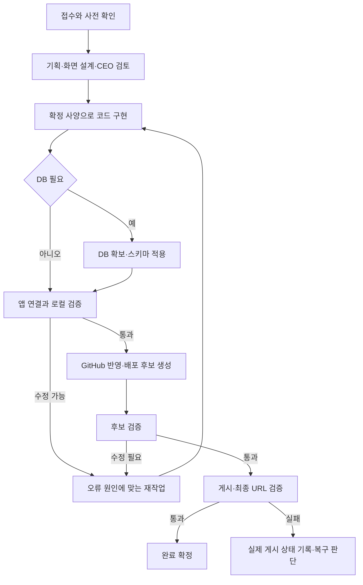

# MVP 팩토리 WORKFLOW

| 항목      | 내용                                                                 |
| --------- | -------------------------------------------------------------------- |
| 파일·버전 | WORKFLOW.md · 0.1                                                    |
| 작성일    | 2026년 11월 21일                                                     |
| 기준      | MVP_FACTORY_PRD.md v0.2, ARCHITECTURE.md, AGENTS.md                  |
| 목적      | 실행 단계, 역할별 입출력, CEO 결정, 상태 전이, 실패 복구의 구현 기준 |
| 현재 구현 | 저장소와 실행 결과 미확인. 이 문서는 목표 동작을 정의함              |

**한눈에 보기**

- **무엇을 정하나:** 아이디어 접수(W00)부터 완료 확정(W19)까지의 단계, 역할별 입출력, CEO 결정 처리, Run 상태 전이, 실패 후 복구 방법.
- **역할 분담:** 에이전트는 산출물을 만들고, 시스템이 검사·외부 작업·완료 판정을 한다. 에이전트의 "완료" 문장이나 화면 애니메이션은 판정 근거가 아니다.
- **CEO 검토:** L1은 0회, L2는 구현 전 1회, L3는 기능 범위와 화면 방향 2회. 결정은 "준비 → 대기 → 응답 저장 → 반영" 순서로 처리한다.
- **Run 상태:** 대기(QUEUED) · 진행 중(RUNNING) · CEO 응답 대기(WAITING_CEO) · 일시정지(PAUSED) · 차단(BLOCKED) · 실패(FAILED) · 완료(SUCCEEDED).
- **복구 원칙:** 같은 입력의 재시도는 같은 Run을 이어가고, 목표가 바뀌는 피드백은 새 Run으로 만든다. 외부 작업 결과가 불명확하면 먼저 조회한다.
- **처음 읽는다면:** §3(전체 흐름) → §5(노드 목록) → §6(CEO 결정) → §7(상태 전이) → §17(기준 실행 예시).

**목차**

- [1. 적용 범위와 원칙](#1-적용-범위와-원칙)
- [2. 실행 단위와 기준 정보](#2-실행-단위와-기준-정보)
- [3. 전체 흐름](#3-전체-흐름)
- [4. 역할과 산출물 계약](#4-역할과-산출물-계약)
- [5. 노드 목록과 통과 조건](#5-노드-목록과-통과-조건)
- [6. CEO 개입 수준과 결정 흐름](#6-ceo-개입-수준과-결정-흐름)
- [7. Run·Job·노드 상태](#7-runjob노드-상태)
- [8. 일시정지와 응답 경쟁](#8-일시정지와-응답-경쟁)
- [9. 실행·체크포인트·소유권 프로토콜](#9-실행체크포인트소유권-프로토콜)
- [10. DB와 외부 작업](#10-db와-외부-작업)
- [11. 코드·검증·게시·완료](#11-코드검증게시완료)
- [12. 오류 분류와 되돌아갈 단계](#12-오류-분류와-되돌아갈-단계)
- [13. 중단 지점별 복구 규칙](#13-중단-지점별-복구-규칙)
- [14. 재시도와 실행 한도](#14-재시도와-실행-한도)
- [15. 피드백 수정과 증거 무효화](#15-피드백-수정과-증거-무효화)
- [16. 진행 화면과 이벤트](#16-진행-화면과-이벤트)
- [17. 기준 실행 예시](#17-기준-실행-예시)
- [18. 구현 검증 기준](#18-구현-검증-기준)
- [19. 참고와 후속 문서 경계](#19-참고와-후속-문서-경계)

## 1. 적용 범위와 원칙

이 문서는 사용자가 아이디어와 CEO 개입 수준을 정한 시점부터 실제 앱 생성·DB 구성·GitHub 반영·Vercel 배포·완료까지의 흐름을 정의한다. 배포 후 피드백으로 같은 프로젝트를 수정하는 흐름도 포함한다.

역할별 에이전트는 산출물을 만든다. 시스템은 산출물을 검사하고, 외부 작업을 수행하고, 다음 단계와 완료 여부를 결정한다. 에이전트가 작성한 “완료” 문장이나 화면 애니메이션을 상태 전이의 근거로 삼지 않는다.

- 첫 버전은 단일 워커와 직렬 실행을 기본으로 한다. CEO 응답 대기는 작업을 지속 저장한 뒤 워커를 반환한다.
- 실제 실행과 DEMO 실행을 구분한다. 실제 API 설정이 없으면 차단하고 모의 성공으로 대체하지 않는다.
- 사양·화면·코드·검증·배포는 버전으로 연결한다.
- 입력이 같은 재시도와 입력이 바뀐 재작업을 구분한다.
- 외부 작업의 결과가 불명확하면 먼저 조회한다. 생성 요청부터 다시 보내지 않는다.
- 구현은 AGENTS.md의 MVC·DDD·SOLID와 custom hook 규칙을 따른다. 그래프 노드에 HTTP 처리·도메인 규칙·공급자 SDK를 한꺼번에 넣지 않는다.

아래 상태명과 필드명은 구현 계약의 기본안이다. 실제 저장소 이름에 맞춰 대응할 수 있으나 의미와 불변 조건은 유지한다. 구체적인 API 경로와 DB 컬럼·인덱스는 API.md와 DB_SCHEMA.md에서 정한다.

## 2. 실행 단위와 기준 정보

### 2.1 식별자

| 항목                       | 의미                               | 재시도·수정 시 처리                            |
| -------------------------- | ---------------------------------- | ---------------------------------------------- |
| projectId                  | 사용자가 만든 하나의 제품          | 모든 수정에서 유지                             |
| runId                      | 최초 생성 또는 한 번의 수정 목표   | 재시도는 유지, 새 피드백 목표는 새로 생성      |
| threadId                   | 그래프 체크포인트의 실행 문맥      | runId와 일대일 대응, 재개 시 유지              |
| jobId                      | 시작·재개·복구를 전달하는 명령     | 원인별 중복 방지 키로 중복 등록 방지           |
| workerAttemptId·claimEpoch | 워커 인수와 소유권                 | 재인수 시 새 값, 오래된 소유자의 변경 차단     |
| stepExecutionId            | 특정 입력에 대한 논리 노드 실행    | runId + nodeId + inputFingerprint로 식별       |
| nodeAttempt                | 같은 노드 입력의 실제 시도         | 재시도 시 증가, 누적 사용량 유지               |
| decisionId·proposalVersion | 특정 검토 요청과 제안              | 변경 제안은 새 버전·새 결정                    |
| operationKey               | 외부 변경의 논리 목적              | 같은 변경을 재확인할 때 유지                   |
| projectGeneration          | 프로젝트에 접수된 실행 목표의 순서 | 새 Run 접수 시 증가, 과거 Run 재시도 충돌 검사 |

projectGeneration은 마지막 정상 배포 버전과 다르다. 실패한 이후 새 목표가 접수되었는지도 구분하기 위한 값이다.

### 2.2 Run 시작 시 고정할 정보

- 실행 유형: INITIAL 또는 REVISION, 실제 실행 또는 DEMO.
- 원본 아이디어·피드백, 소속 작업 공간, CEO 레벨.
- 허용된 GitHub·Supabase·Vercel 계정과 대상, 저장소 공개 범위.
- 예산 정책과 작업·재시도 한도.
- workflow·역할 지침·skill·template·모델 설정 버전.
- 수정이면 기준 사양·소스·커밋·정상 배포와 현재 확인한 DB 상태.
- projectGeneration과 요청 중복 방지 키.

CEO 레벨은 Run 중간에 바꾸지 않는다. 다음 수정 Run에서 다시 선택할 수 있다. 권한·한도 변경이 필요하면 변경 이력과 새 정책 버전을 기록한다.

### 2.3 그래프 상태에 둘 정보

그래프에는 현재 단계, 사양·화면·소스의 버전 참조, 결정 참조, 리소스·검증 참조, 복구 위치를 둔다. 큰 파일·원본 로그·비밀값 전체를 넣지 않는다.

업무 사실은 Project·Run·Decision·ExternalOperation 등에 저장한다. 체크포인트는 실행 위치를 보존하고, 이벤트는 화면과 이력을 위한 기록이다. 이벤트 텍스트나 Run.status만으로 승인·권한·외부 변경 여부를 판정하지 않는다.

### 2.4 공통 설정과 사용자 결정 반영

- 실행은 앱 설정 화면에 저장한 기본 계정·공개 범위·한도를 사용하고 비밀 키는 서버의 `.env`에서 읽는다. 프로젝트마다 계정을 재입력하지 않는다.
- 생성 앱은 로그인·회원가입·OAuth 없이 이용하도록 만든다. 인증 필수 요청은 개발 전에 중단한다. 데이터 공유·읽기·쓰기 범위는 기획 산출물에 기록하고 해당 작업 실행 전에 확인한다. 이미 확인한 동일 범위를 반복 질문하지 않는다.
- PM·기획자·디자이너·개발자 4명을 고정한다. 회사·캐릭터 설정은 모든 프로젝트가 공유하며 프로젝트 전환에도 유지한다.
- 제공 아이템·확장은 처음부터 자유롭게 사용한다. 활동 점수나 프로젝트 완료를 해금 조건으로 만들지 않는다.
- 보관 처리는 외부 저장소·DB·배포를 유지한다. 외부 삭제 작업과 구분한다.
- AI 연결 방식과 구체적 실행 상한은 비용·연결 가능성 비교 후 결정한다. 미정 상한을 무제한으로 해석하지 않는다.

## 3. 전체 흐름

그림은 정상 흐름과 주요 수정 분기를 보여준다. 권한 부족·한도 도달·결과 불명확·일시정지는 어느 단계에서도 별도 상태로 빠질 수 있다. 돌아갈 정확한 노드는 12절의 오류 분류를 따른다.

## 4. 역할과 산출물 계약

### 4.1 역할별 입출력

| 담당             | 주요 입력                                           | 지속 저장할 출력                                                                          | 다음 단계로 넘기는 조건                                     |
| ---------------- | --------------------------------------------------- | ----------------------------------------------------------------------------------------- | ----------------------------------------------------------- |
| PM               | 아이디어·제약·CEO 레벨, 수정이면 피드백과 기준 결과 | IntakeBrief, 지원 범위, 가정, 작업 계획, 결정 요청 초안                                   | 사용자 확정 사항과 가정 구분, 지원 불가 핵심 요구 누락 없음 |
| 기획자           | IntakeBrief, 기존 사양·결정                         | ProductSpec 초안, 기능·데이터·접근 범위·완료 조건. 인증 필요 여부를 명시하고 필요 시 중단 | 필수 기능마다 관찰 가능한 수락 조건 존재                    |
| 디자이너         | 같은 버전의 ProductSpec, 관련 결정                  | ScreenPlan, 화면·동작·상태·접근성 계획                                                    | 핵심 기능의 입력·행동·결과 확인 경로 연결                   |
| 개발자           | 확정 ProductSpec·ScreenPlan, 기준 소스·실제 스키마  | ImplementationPlan, SchemaPlan, 실제 소스·변경 목록·검사 자료                             | 허용된 변경, 실제 파일, 지속 저장된 스냅샷                  |
| 시스템 검증      | 확정 사양, 대상 소스·DB·환경설정                    | VerificationReport, 화면·기능·접근 검사 증거                                              | 지정된 대상에서 실제 검사 수행                              |
| 신뢰된 연동 모듈 | 허용 대상, 검증한 변경·소스                         | 외부 작업 원장, 리소스 참조, DeploymentManifest                                           | 공급자 응답과 실제 상태 조회로 확인                         |
| PM 결과 요약     | 보고서·Manifest·실제 게시 상태                      | CompletionSummary                                                                         | 저장된 사실과 일치. 요약 생성 자체는 완료 판정이 아님       |

PM·기획자·디자이너·개발자는 같은 기본 모델을 사용해도 된다. 출력 내용·문맥·도구 권한으로 역할을 구분한다. 시스템 검증과 외부 연동을 별도 LLM 역할로 만들 필요는 없다.

### 4.2 생성 앱 요구사항 추적

팩토리 자체 PRD의 REQ-001~016와 생성 앱의 요구사항 ID를 구분한다.

- APP-REQ-001: 생성 앱의 개별 기능.
- APP-AC-001: 해당 기능을 확인할 수 있는 수락 조건.
- SCREEN-001: 기능이 제공되는 화면 또는 흐름.
- CHECK-001: 실제 검사와 증거.

ProductSpec에는 목적, 대상 사용자, 포함·제외 범위, 필수 기능, APP-AC, DB 필요성, 접근 범위(인증 없음, 인증 필수 요청은 지원 범위 밖), 가정을 포함한다. ScreenPlan·구현 작업·검증 항목은 해당 APP-REQ·APP-AC를 참조한다.

DB가 필요한 앱의 저장 요구를 localStorage나 하드코딩 데이터로 바꿔 충족했다고 기록하지 않는다.

### 4.3 노드 공통 계약

| 구분      | 필수 정보                                                    |
| --------- | ------------------------------------------------------------ |
| 입력 문맥 | projectId, runId, nodeId, projectGeneration, specVersion     |
| 입력 참조 | inputArtifactRefs, inputFingerprint, 필요한 결정·리소스 참조 |
| 실행 문맥 | workflowVersion, 역할·도구 버전, 현재 소유권, 남은 예산      |
| 출력      | outputArtifactRefs, outputSchemaVersion, evidenceRefs        |
| 결과      | SUCCEEDED·WAITING·BLOCKED·FAILED·SKIPPED와 원인              |
| 오류      | errorClass, 실패 위치, 자동 재시도 가능 여부, 필요한 조치    |

inputFingerprint는 실제 입력 내용과 버전을 정규화해 만든다. 사양·화면·기준 소스·오류 보고서·관련 지침이 바뀌면 새 논리 노드 실행이 된다.

형식 검사, 요구사항 연결, 권한·변경 범위 검사, 지속 저장을 통과해야 노드를 성공으로 기록한다. 모델 출력의 success 필드를 그대로 신뢰하지 않는다.

유효한 출력이 이미 저장되어 있고 입력이 같으면 재개 시 재사용할 수 있다. 오류 보고서를 받고 코드를 수정하는 경우에는 오류 참조와 기준 소스가 달라지므로 새 입력으로 추적한다.

## 5. 노드 목록과 통과 조건

### 5.1 접수·기획·설계

| ID·노드             | 담당           | 입력과 지속 출력                               | 통과·분기                                                                  |
| ------------------- | -------------- | ---------------------------------------------- | -------------------------------------------------------------------------- |
| W00 accept_run      | 웹 Application | 아이디어·설정 → Project/Run/활성 예약/시작 Job | 프로젝트 소속·입력·동시 실행 조건 충족. 접수만 수행                        |
| W01 preflight       | 시스템         | 고정 설정 → 연결·권한·버전·예산 확인 결과      | GitHub·Vercel 등 필수 조건 확인. 필요한 DB 권한은 DB 필요성 확정 후 재확인 |
| W02 intake          | PM             | 입력·기준 결과 → IntakeBrief                   | 지원 가능 범위 확인. 핵심 요구 축소가 필요하면 예외 결정                   |
| W03 plan_product    | 기획자         | Brief·기존 사양 → ProductSpec 초안             | 기능·데이터·접근 범위·수락 조건의 일관성                                   |
| W04 review_scope    | 공통 결정 모듈 | 범위 제안 → 범위 결정                          | L3은 대기·응답 적용. L1·L2는 정책에 따른 SKIPPED                           |
| W05 design_screens  | 디자이너       | 현재 ProductSpec → ScreenPlan                  | 요구사항과 화면·상태 대응                                                  |
| W06 review_proposal | 공통 결정 모듈 | 기획·화면 제안 → 검토 결정                     | L2는 통합 검토, L3은 화면 검토, L1은 SKIPPED                               |
| W07 freeze_spec     | 시스템         | 제안·결정·정책 → 확정 사양 묶음                | 필요한 검토와 지원 범위 충족. 이후 역할이 같은 버전을 사용                 |

W07은 검토한 내용의 참조를 고정한다. 승인 이후 기능을 추가하거나 제거한 새 내용을 확정 사양에 몰래 넣지 않는다. L1은 위임 정책에 따른 확정 근거를 남기며 CEO가 답변한 것처럼 Decision을 만들지 않는다.

**현재 구현(REAL 실행, 2026-11-22):**

- W03·W05 문서는 ID로 연결한다. 기능 `APP-REQ-###`(사용자 흐름·데이터 사용 동작 포함), 완료 조건 `APP-AC-###`(확인하는 기능 ID), 화면 `SCR-###`(다루는 기능 ID·행동·정상/빈/오류 상태). 산출물에는 사람이 읽는 항목과 구조(`구조` 키)를 함께 저장하며 항목은 구조에서 만든다(`src/domain/product-documents.ts`).
- 결정적 연결 규칙: 기능마다 완료 조건, 완료 조건·화면은 있는 기능만 가리킴, 모든 기능을 다루는 화면, 기능의 데이터 동작은 데이터 계획이 허용한 동작만, 쓰지 않는 테이블 없음. 생성 시 어기면 형식 오류로 한 번 고치게 한다.
- 문서 검토(`src/application/document-review.ts`): W05 뒤에는 항상, W03 뒤에는 L3 범위 검토가 있을 때만 팀 검토 회의를 연다. 회의가 찾은 문제와 연결 규칙 위반은 담당 역할이 **현재 문서를 고친다**(기존 ID 유지). 회의는 최대 2회, 대표가 승인한 기획은 팀이 고치지 않고 미해결로 남겨 다음 CEO 제안에 함께 보인다. 한도 안에 연결 규칙을 맞추지 못하면 개발로 넘기지 않고 실패한다. 결과는 `DOCUMENT_REVIEW` 산출물과 회의 기록으로 남는다.
- W05 디자이너는 저장소에 버전을 고정한 Impeccable 디자인 지침(`resources/generation-guides/impeccable`, 4.10.0, Apache-2.0)의 핵심 원칙·모드·shape 브리프·Operate 지침을 따라 브리프(모드, 대상, 과업, 방향, 레이아웃, 피할 것, 가정)와 화면별 주 행동·정상/빈/불러오는 중/오류 상태를 쓴다. 지침을 읽지 못하거나 버전이 다르면 워커가 시작하지 않는다. 사용한 지침 버전은 화면 설계와 생성 앱 `docs/DESIGN.md`에 남는다. 지침은 설계 문서에만 적용되며, 실제 화면이 지침대로 구현됐는지는 브라우저 검증 전까지 확인하지 않는다.
- 대표의 수정 요청으로 W03·W05를 다시 실행할 때도 처음부터 다시 쓰지 않고 현재 문서를 요청에 맞춰 고친다.
- W08 이후(소스 생성·자동 수정·배포)는 작업 중 산출물이 아니라 W07의 확정 사양(`ProductSpec`)만 읽는다. 개발자는 생성과 자동 수정 모두 같은 확정본을 받고, 확정 사양에서 만든 `docs/PRD.md`·`DESIGN.md`·`IMPLEMENTATION.md`·`VERIFICATION.md`가 작업 폴더와 생성 앱 저장소에 들어간다. 개발자가 문서를 바꿔도 확정본으로 되돌린다.
- APP-AC의 브라우저 검증은 아직 없다. `VERIFICATION.md`의 결과는 모두 "검증 전"이며 제품 완료로 보지 않는다.

### 5.2 구현·검증·배포

| ID·노드                 | 담당                      | 지속 출력                                                  | 통과·분기                                                |
| ----------------------- | ------------------------- | ---------------------------------------------------------- | -------------------------------------------------------- |
| W08 plan_implementation | 개발자·시스템 검사        | ImplementationPlan, 선언형 SchemaPlan, 수정이면 ChangePlan | 지원하는 구현·DB 변경만 포함                             |
| W09 implement_source    | 개발자·샌드박스           | 실제 Next.js 소스, lockfile, 소스 스냅샷                   | 파일·필수 구현·저장 확인. 관리 비밀값 없음               |
| W10 ensure_database     | 연동 모듈                 | 새 DB 또는 기존 DB 참조, 준비 상태                         | DB 필요하면 실제 준비 확인. 불필요하면 근거 있는 SKIPPED |
| W11 apply_schema        | 신뢰된 컴파일러·연동 모듈 | 마이그레이션·접근 정책·적용 이력                           | 버전·체크섬·실제 스키마 확인. DB 불필요 시 SKIPPED       |
| W12 configure_app       | 시스템·개발자             | 환경설정 revision, 앱 연결, 접근 범위 설정                 | 현재 소스가 허용된 앱 DB·접근 범위와 연결                |
| W13 verify_local        | 시스템 검증·디자이너      | 빌드·기능·화면·DB·접근 범위 보고서                         | 배포 전 필수 검사 통과                                   |
| W14 publish_source      | GitHub 연동               | 사용자 저장소, sourceDigest와 commitSHA 대응               | 검증한 소스가 실제 커밋과 일치                           |
| W15 create_candidate    | Vercel 연동               | 프로젝트·환경설정·candidate deploymentId                   | 실제 후보 준비 확인. 게시 전 상태 유지                   |
| W16 verify_candidate    | 시스템 검증               | 후보 URL의 환경·접근 범위·기능 검사                        | 해당 deploymentId의 필수 배포 검증 통과                  |
| W17 publish_candidate   | Vercel 연동               | 실제 게시 결과와 배포 ID                                   | 허용된 게시 대상이 후보를 가리키는지 확인                |
| W18 verify_final_url    | 시스템 검증               | 최종 URL·도메인·핵심 기능 확인                             | 최종 접근 범위에서 동작                                  |
| W19 finalize_run        | 업무 Use Case             | 완료 상태·Manifest·마지막 정상 결과·요약                   | 모든 완료 조건과 버전 일치, 원자적 업무 완료 처리        |

W09에서 연결 전까지 할 수 있는 코드 구현을 진행하고, W12에서 실제 앱 설정을 연결한다. 연결·검증 과정에서 코드를 바꾸면 새 소스 스냅샷을 저장하고 필요한 검사를 다시 수행한다.

W14·W15는 수정 Run에서 기존 저장소·Vercel 프로젝트를 재사용한다. W10은 같은 앱 DB를 사용한다. 새 리소스를 만드는지 여부는 노드 호출 횟수가 아니라 Project의 리소스 바인딩으로 판단한다.

## 6. CEO 개입 수준과 결정 흐름

### 6.1 예정된 검토

| 레벨           | 실행 순서                                     | 구현 진입 조건                              |
| -------------- | --------------------------------------------- | ------------------------------------------- |
| L1 위임형      | 기획 → 화면 설계 → 정책에 따른 확정           | 명시적 사용자 요구·지원 범위·위임 범위 충족 |
| L2 핵심 결정형 | 기획 → 화면 설계 → 통합안 검토                | 기능·화면 통합안 승인                       |
| L3 공동 설계형 | 기획 → 기능 범위 검토 → 화면 설계 → 화면 검토 | 범위 승인과 해당 범위의 화면 승인           |

예정된 지점 수는 L1 0개, L2 1개, L3 2개다. 같은 지점에서 수정 제안을 다시 검토할 수 있다. 기본 레벨은 PRD의 L2 제안을 따른다.

모든 레벨에서 지원 범위를 벗어난 변경, 권한·대상 변경, 한도 변경 등 별도 판단이 필요하면 예외 결정이나 차단을 사용한다. 이미 허용한 같은 대상·범위의 DB·코드·배포 작업은 반복 승인받지 않는다.

### 6.2 결정 계약

> **쉽게 말해** 결정은 PREPARED(질문 준비) → OPEN(답을 기다리는 중) → ANSWERED(답이 저장됨) → APPLIED(사양에 반영됨) 순서로 진행한다. 반영된 결정을 다시 열지 않고, 수정이 필요하면 새 결정을 만든다.

결정에는 decisionId, decisionType, proposalVersion, 검토한 내용의 fingerprint, 제안·변경점·선택지, 연결된 interrupt 식별자, 응답과 적용 결과를 저장한다.

| 상태       | 의미                                     | 허용되는 다음 상태              |
| ---------- | ---------------------------------------- | ------------------------------- |
| PREPARED   | 질문과 제안 저장, interrupt 지속 저장 전 | OPEN 또는 SUPERSEDED            |
| OPEN       | 현재 유효한 질문, 응답 가능              | ANSWERED 또는 SUPERSEDED        |
| ANSWERED   | 첫 유효 응답을 저장함                    | APPLIED                         |
| APPLIED    | 응답이 사양·다음 단계에 적용됨           | 종료, 다시 OPEN으로 바꾸지 않음 |
| SUPERSEDED | 적용 전 제안이 새 제안으로 대체됨        | 종료, 응답 접수 불가            |

일반 검토 응답은 APPROVE와 REQUEST_CHANGES를 제공한다. “보류”는 임의 승인이나 거절 응답을 만들지 않고 일시정지 명령으로 처리한다. 예외 결정은 제안에 명시한 선택 ID와 필요한 입력만 허용한다.

이미 ANSWERED인 결정은 새 요청이 왔다고 SUPERSEDED로 덮어쓰지 않는다. 저장된 응답을 한 번 적용하고, 필요한 후속 변경을 새 결정·버전으로 기록한다.

### 6.3 준비·대기·응답·적용

1. prepare_review는 현재 Run·검토 지점·검토 회차의 PREPARED/OPEN 결정만 준비 재시도에 재사용한다. 없으면 제안 fingerprint와 새 proposalVersion·decisionId로 PREPARED를 저장한다.
2. wait_review가 현재 결정을 참조해 interrupt를 만든다.
3. pending interrupt가 지속 저장된 뒤 Decision을 OPEN, Run을 WAITING_CEO로 표시한다.
4. 현재 Job 호출을 종료하고 샌드박스 등 불필요한 대기 리소스를 해제한다.
5. API가 프로젝트 소속·제안 버전·OPEN 상태·일시정지 여부를 확인한다.
6. 한 업무 DB 트랜잭션으로 OPEN → ANSWERED, 응답 저장, 재개 Job 등록을 처리한다.
7. 워커가 현재 pending interrupt와 decisionId를 맞춘 뒤 저장된 응답으로 재개한다.
8. apply_review는 응답의 적용 결과, 사양·승인 참조와 후속 분기, APPLIED 전환을 한 업무 DB 트랜잭션으로 확정한다. 후속 LLM 재기획은 별도 노드에서 수행한다.

REQUEST_CHANGES 이후의 재검토는 내용이 같아도 새 검토 회차·proposalVersion·decisionId를 사용한다. 이전 APPLIED 결정을 새 질문으로 재사용하지 않는다. 변경 요청을 반영하지 않은 산출물은 다시 질문하기 전에 검사한다.

LangGraph의 interrupt 재개는 같은 thread 문맥을 사용하며, 해당 노드의 앞부분이 다시 실행될 수 있다. 따라서 질문 준비·외부 변경·대기를 분리하고 재실행에 안전하게 만든다. [S1]

같은 결정·같은 응답의 재전송은 기존 결과를 반환한다. ANSWERED 이후 다른 응답은 적용 전이어도 충돌이다. 이미 다음 질문으로 진행한 실행에 오래된 응답을 전달하지 않는다.

### 6.4 수정 요청과 승인 재사용

| 요청의 영향                             | 돌아갈 위치    | 다시 필요한 검토                           |
| --------------------------------------- | -------------- | ------------------------------------------ |
| 기능·DB 필요성·접근 범위·공개 범위 변경 | W03            | L2 통합 검토, L3 범위와 영향받은 화면 검토 |
| 승인 범위 안의 화면 구성 변경           | W05            | L2 통합 검토, L3 화면 검토                 |
| 승인 내용을 유지하는 구현 수정          | W08 또는 W09   | 예정된 검토를 반복하지 않음                |
| 위임 범위 밖 변경                       | 관련 계획 단계 | 레벨과 무관하게 구체적인 예외 결정         |

L3 범위 결정은 검토한 범위의 fingerprint에 연결한다. 화면 변경이 범위를 바꾸지 않으면 기존 범위 결정을 재사용할 수 있다. 기능·데이터·접근 범위가 바뀌면 기존 승인을 새 내용에 붙이지 않는다.

## 7. Run·Job·노드 상태

### 7.1 Run 상태 전이

Run.status는 아래 업무 사실을 요약한다. 상태 필드만 바꿔 실제 권한·결정·작업 조건을 우회하지 않는다.

| 현재 상태   | 사건과 조건                                        | 다음 상태                   |
| ----------- | -------------------------------------------------- | --------------------------- |
| 없음        | 접수·활성 예약·Job 저장 성공                       | QUEUED                      |
| QUEUED      | 워커 소유권 확보, 실행 가능 조건 확인              | RUNNING                     |
| QUEUED      | 일시정지 요청, 실행 중 작업 없음                   | PAUSED                      |
| QUEUED      | 인수 전 권한·버전·한도 등 필수 조건 부족           | BLOCKED                     |
| RUNNING     | OPEN 결정과 pending interrupt가 저장됨             | WAITING_CEO                 |
| RUNNING     | 요청한 안전 정지 완료                              | PAUSED                      |
| RUNNING     | 권한·설정·한도·외부 결과 확인 등 조건 부족         | BLOCKED                     |
| RUNNING     | 허용된 복구·수정으로 현재 목표 달성 불가           | FAILED                      |
| RUNNING     | W19의 완료 조건과 업무 트랜잭션 충족               | SUCCEEDED                   |
| RUNNING     | 이전 워커 종료 확인, 복구 Job과 소유권 재확보 준비 | QUEUED                      |
| WAITING_CEO | 유효 응답과 재개 Job 저장                          | QUEUED                      |
| WAITING_CEO | 일시정지 명령, 진행 중 작업 없음                   | PAUSED                      |
| PAUSED      | 명시적 재개, 미해결 차단 있음                      | BLOCKED                     |
| PAUSED      | 명시적 재개, 아직 응답 없는 질문 있음              | WAITING_CEO                 |
| PAUSED      | 명시적 재개, 실행 조건 충족                        | QUEUED                      |
| BLOCKED     | 원인 해소·재확인, 질문이 남음                      | WAITING_CEO                 |
| BLOCKED     | 원인 해소·재확인, 재개 Job 준비                    | QUEUED                      |
| BLOCKED     | 사용자 일시정지 요청                               | PAUSED                      |
| FAILED      | 명시적 재시도, 예산·기준 버전·활성 예약 확인       | QUEUED                      |
| SUCCEEDED   | 기능 변경·피드백                                   | 기존 상태 유지, 새 Run 접수 |

실제 외부 변경 결과가 불명확한 상태는 조정할 BLOCKED 사유로 유지한다. 이를 단순 FAILED로 끝내고 곧바로 새 생성 작업을 허용하지 않는다.

### 7.2 Job과 노드

> **쉽게 말해** Job은 워커에게 보내는 "일을 시작해라"라는 쪽지 한 장이고, Run은 작업 전체의 상태다. 쪽지 처리가 끝나도(Job DONE) Run은 CEO 응답을 기다리는 중(WAITING_CEO)일 수 있다. 둘을 같은 것으로 보지 않는다.

| 대상        | 상태                                                 | 의미                                    |
| ----------- | ---------------------------------------------------- | --------------------------------------- |
| Job         | QUEUED → RUNNING → DONE 또는 FAILED                  | 시작·재개·복구 명령 한 번의 전달과 처리 |
| Node        | PENDING → RUNNING → SUCCEEDED·WAITING·FAILED·SKIPPED | 특정 입력에 대한 단계 수행              |
| Node의 차단 | WAITING + reason=BLOCKED                             | 실행 조건 회복을 기다리는 상태          |

Job의 QUEUED는 아직 실행되지 않았다는 뜻이다. 실제 인수에는 pause 요청 없음, 필요한 응답 존재, retry 예정 시각, 실행 소유권 등 별도 조건이 필요하다.

CEO interrupt를 저장해 Job이 DONE이어도 Run은 WAITING_CEO다. 전송 중복이나 오래된 재개 Job은 noOpReason을 남기고 DONE으로 끝낼 수 있다. Job 실패와 Run 실패를 자동으로 동일시하지 않는다.

WAITING 노드는 조건 회복 후 RUNNING으로 이어간다. FAILED 노드의 같은 입력 재시도는 새 nodeAttempt로 PENDING에서 다시 시작한다. 입력이 달라지면 새 stepExecutionId를 사용하고 이전 결과를 보존한다. FAILED Job의 복구는 원래 Job을 성공으로 덮어쓰지 않고, 원인 Job을 참조하는 새 복구 명령으로 등록한다.

SKIPPED는 DB 불필요, 해당 레벨에 없는 검토처럼 정책이 허용한 경우만 사용한다. 필수 검증을 실행할 수 없거나 실패한 상황을 SKIPPED로 바꾸지 않는다.

### 7.3 활성 실행 예약

작업 공간당 열려 있는 Run 하나라는 기본안을 DB의 조건부 예약으로 적용한다. 같은 프로젝트의 스키마·게시 변경도 직렬화한다.

예약은 WAITING_CEO·PAUSED·BLOCKED 중 유지하고 SUCCEEDED·FAILED 확정 시 해제한다. 실패 재시도는 예약을 다시 확보한다. 현재 활성 Run이 있으면 다른 실행 접수·재시도는 충돌이다.

과거 FAILED Run의 projectGeneration이 현재 Project와 다르면 재시도를 차단한다. 최신 결과를 기준으로 새 수정 Run을 만들어야 한다. 실패한 과거 목표가 최신 사양·소스·게시를 덮어쓰지 못하게 한다.

## 8. 일시정지와 응답 경쟁

### 8.1 정지 경계

pause 요청 수신과 실제 PAUSED 진입을 구분한다. 실행 중이면 pauseRequested를 저장하고 다음 안전 경계에서 정지한다.

안전 경계는 모델·외부 도구 호출 사이, 산출물 지속 저장 이후, 검증 단계 사이이다. 이미 보낸 외부 요청을 즉시 취소했다고 표시하지 않는다. 응답 또는 결과 불명확 상태를 기록한 뒤 멈춘다.

정지 시 체크포인트·미해결 작업·대기 결정·재개 위치를 보존하고 현재 Job을 정리한다. 사용자가 정지했어도 이미 적용된 DB 변경과 게시 결과는 그대로 추적한다.

### 8.2 CEO 응답과 동시에 발생하는 경우

첫 버전의 기본 정책은 다음과 같다.

- pauseRequested이거나 PAUSED인 Run의 새 CEO 응답은 저장하지 않고 RUN_PAUSED 충돌로 반환한다.
- 응답 없는 결정이 있는 Run을 재개하면 WAITING_CEO로 돌아간다. 사용자가 다시 응답할 수 있게 한다.
- 응답이 먼저 저장되고 pause가 뒤따르면 응답은 유지한다. 등록된 재개 Job은 pause가 해제될 때까지 인수하지 않는다.
- 이미 재개 Job을 인수했다면 새 외부 변경 전에 pause를 확인하고 안전 경계에서 정지한다.
- 재개 시 저장된 응답이 있으면 같은 응답을 다시 입력받지 않는다.

응답·pause·Job 인수가 경쟁하는 경우 업무 상태에 대한 조건부 갱신과 일관된 잠금 순서로 처리한다. UI의 버튼 비활성화만으로 이 경쟁을 해결하지 않는다.

BLOCKED 사유가 있는 Run을 정지했다가 재개해도 사유가 자동 해소되지는 않는다. 필요한 조건을 다시 확인한다.

## 9. 실행·체크포인트·소유권 프로토콜

### 9.1 Job 접수와 인수

1. API는 프로젝트 소속·중복 요청·활성 예약을 확인한다.
2. Project/Run 변경, 필요한 예약, Job, 접수 이벤트를 업무 DB 트랜잭션으로 저장한다.
3. 워커는 짧은 트랜잭션으로 인수 가능한 Job을 선택하고 lease·claimEpoch를 설정한다.
4. 트랜잭션을 종료한 뒤 모델·도구·공급자를 호출한다.
5. heartbeat·결과 적용·상태 갱신은 현재 소유권과 projectGeneration을 확인한다.

lease 만료만으로 같은 thread를 다른 살아 있는 워커에 넘기지 않는다. 단일 워커 재시작·배포는 이전 프로세스가 정지되었음을 확인한 뒤 수행한다. 확인할 수 없으면 복구를 차단한다.

업무 DB의 epoch 검사만으로 체크포인트 저장 전체가 자동 보호되지는 않는다. 이후 병렬 워커를 도입하려면 체크포인트까지 포함한 직렬화·fencing을 별도로 구현한다.

### 9.2 노드 성공 처리

- 입력 fingerprint와 이미 저장된 유효 결과를 확인한다.
- 필요한 작업을 수행하고 형식·의미·허용 범위를 검사한다.
- 산출물을 지속 저장한 뒤 체크섬과 참조를 업무 기록에 연결한다.
- 해당 참조를 그래프 상태에 반영하고 체크포인트 지속 저장을 확인한다.
- 사용자 표시 상태와 이벤트를 실제 결과에 맞춘다.

업무 기록과 체크포인트는 별도 저장 경계다. 한쪽만 저장된 경우 기존 산출물·결정을 찾아 복구한다. 프로세스 메모리에서 다음 단계로 갔다는 사실만으로 지속 저장 완료를 보고하지 않는다. [S2]

외부 도구를 호출한 노드는 10절의 작업 원장을 함께 따른다. 소스 스냅샷이 없는 체크포인트만으로 샌드박스를 완전히 복원할 수 있다고 가정하지 않는다.

### 9.3 재개 전 확인

재개는 같은 thread의 현재 체크포인트에서 시작한다. 일반 기술 실패 복구와 pending interrupt 재개를 구분한다. 저장된 interrupt가 없는 복구에는 사용자 응답을 만들어 전달하지 않는다.

LangGraph 기본안에서는 CEO 대기와 일시정지·차단을 위한 제어 대기를 분리한다. CEO 대기에는 decisionId와 검증된 응답을 사용한다. 제어 대기는 별도 suspensionId, 원인, 다음 단계 참조를 저장한 wait_control 노드로 구현하고, 조건 회복을 확인한 서버의 CONTROL_CONTINUE 신호로만 재개한다. 이 신호는 CEO 승인이나 Decision 응답이 아니다.

wait_control은 외부 변경을 수행하지 않고 저장된 suspension을 항상 같은 방식으로 기다린다. 재개 전에 pause 플래그가 해제되었다는 이유로 이미 저장된 interrupt 호출을 생략하거나 순서를 바꾸지 않는다. 현재 gate 종류·식별자와 맞지 않는 재개 명령은 적용하지 않는다.

workflowVersion과 진행 중 실행의 상태 구조가 호환되는지 확인한다. 호환되지 않는 새 그래프에서 임의의 중간 노드로 점프하지 않는다. 지원되는 이전 코드나 검증한 상태 마이그레이션이 없으면 차단한다.

## 10. DB와 외부 작업

### 10.1 외부 변경 상태

> **쉽게 말해** UNKNOWN은 "요청을 보냈는데 결과를 모르는" 상태다. 이때는 새로 만들지 않고 먼저 공급자에게 실제 상태를 조회한다. 실패(FAILED)여도 이미 만들어진 리소스 정보는 남겨 둔다.

| 상태      | 의미                                                   | 다음 행동                                        |
| --------- | ------------------------------------------------------ | ------------------------------------------------ |
| PLANNED   | 허용 대상·요청 내용·작업 키 저장                       | 소유권·한도 확인 후 요청                         |
| REQUESTED | 공급자에게 요청 전달, 결과 확정 전                     | 응답 또는 실제 상태 관찰                         |
| SUCCEEDED | 의도한 변경을 확인함                                   | 리소스·증거 저장, 다음 단계                      |
| FAILED    | 작업 목표의 실패를 확인함. 부작용 없음은 의미하지 않음 | 부분 결과 보존 후 실패한 하위 단계의 재시도·차단 |
| UNKNOWN   | 요청 전달 후 결과를 확정할 수 없음                     | 조회·조정, 확인 전 재생성 금지                   |

RECONCILING은 UNKNOWN 등을 조회하는 활동이며, 조회 중이라는 이유만으로 결과를 성공으로 바꾸지 않는다. 공급자가 리소스를 생성 중인 상태라면 알려진 리소스 ID를 보존하고 그 준비 상태를 확인한다.

생성된 리소스 ID와 부분 적용 결과는 FAILED에도 보존한다. DB 생성 후 연결 실패는 기존 DB의 연결 단계에서, 배포 생성 후 빌드 실패는 해당 소스·배포 문제에서 복구한다. 프로젝트를 새로 만드는 것으로 대체하지 않는다. 새 배포 후보가 필요한 경우에도 이전 시도·리소스와 원인을 보존한다.

작업 원장은 operationKey, 원래 공급자 계정·대상, 정규화한 요청 해시를 보존한다. 같은 키에 다른 내용은 충돌이다. 이름만 같은 리소스를 기존 요청의 결과라고 단정하지 않는다.

공급자 고유의 중복 방지 기능은 실제 지원하는 경우에 사용한다. 전체 흐름의 exactly-once를 보장한다고 표현하지 않는다.

### 10.2 DB 필요·불필요 분기

needsDatabase=false가 확정 사양에 있으면 W10·W11과 DB 전용 검사를 NOT_APPLICABLE 근거와 함께 생략한다. 인증이 필요한 앱은 현재 지원 범위 밖이므로 개발 전에 중단한다.

needsDatabase=true인데 계정·할당량·연결이 없으면 BLOCKED다. 오류를 해결하려고 needsDatabase를 false로 바꾸거나 저장 기능을 빼지 않는다.

DB 필요성 변경은 ProductSpec 변경이므로 W03과 해당 CEO 정책으로 돌아간다.

### 10.3 생성·마이그레이션·연결

1. SchemaPlan이 지원하는 타입·관계·소유권·비파괴 변경만 포함하는지 검사한다.
2. Project에 DB 바인딩이 있으면 그 계정·DB·실제 스키마를 확인한다. 없으면 허용한 사용자 조직에 생성한다.
3. 생성 접수와 준비 완료를 구분한다. 준비 전에 스키마 적용을 성공 처리하지 않는다.
4. 신뢰된 컴파일러가 마이그레이션과 접근 정책을 만든다.
5. 대상 DB + migrationVersion의 유일성을 확인한다. 같은 버전·다른 checksum이면 차단한다.
6. 지원하는 변경은 앱 DB 안에서 스키마 변경과 적용 이력을 같은 트랜잭션으로 기록한다. 이 방식을 지원하지 않는 변경은 별도 복구 설계 없이 자동 실행하지 않는다.
7. 실제 스키마·적용 이력을 조회한 뒤 팩토리의 외부 작업 원장에 확인 결과를 반영한다.
8. 환경설정 revision을 만들고 앱 연결·접근 범위를 확인한다.

앱 DB 트랜잭션과 팩토리 DB 기록은 다른 경계다. 앱 DB 적용 후 팩토리 기록이 누락되어도 앱 DB의 이력과 실제 스키마를 확인해 복구한다.

테스트는 식별 가능한 테스트 데이터로 수행한다. 앱의 데이터 접근은 사양에 명시한 접근 경로를 사용하고 테스트를 위해 RLS 등 보호 규칙을 끄지 않는다. 사용자별 분리는 이번 MVP의 검증 대상이 아니다. [S4]

## 11. 코드·검증·게시·완료

### 11.1 검증 묶음

모든 검증은 다음 대상 정보를 가진다.

- specVersion과 적용한 APP-AC.
- sourceDigest, lockfileDigest, templateVersion.
- DB 리소스, 적용 마이그레이션과 확인한 스키마 상태.
- envRevision과 검사 대상 환경.
- 해당하면 commitSHA, deploymentId, 실제 접근 URL.
- 검사 도구·하네스 버전, 실행 시각, 결과·증거 참조.

결과는 PASS, FAIL, NOT_RUN, NOT_APPLICABLE로 구분한다. 필수이며 적용 가능한 조건에는 PASS가 필요하다. NOT_APPLICABLE에는 확정 사양에 따른 근거가 있어야 한다.

하네스와 필수 기준은 생성 코드와 분리한다. 개발자가 추가한 테스트는 보조 증거이며, 생성 코드가 필수 검사를 삭제하거나 성공 보고서만 만들어 통과할 수 없게 한다.

### 11.2 단계별 검증 목적

| 단계          | 확인할 내용                                                               |
| ------------- | ------------------------------------------------------------------------- |
| W13 로컬·통합 | 설치·타입·빌드, 필수 기능, 실제 DB CRUD·재접속, 접근 범위, 화면·오류 상태 |
| W16 배포 후보 | 실제 배포 환경설정, 서버 실행, 앱 DB 연결, 접근 범위, 핵심 기능           |
| W18 최종 URL  | 게시된 대상·도메인·핵심 사용자 흐름                                       |

모든 검사를 매번 중복 수행할 필요는 없다. 환경과 입력의 변화가 영향을 주는 검사와 각 단계의 필수 확인을 수행한다. 로컬 성공으로 배포 환경 검증을 대체하지 않는다.

### 11.3 GitHub와 배포 후보

W14는 W13을 통과한 불변 소스를 사용자 저장소에 반영한다. 생성 작업 공간에 관리 토큰을 넣거나 신뢰하지 않는 Git hook과 함께 실행하지 않는다. sourceDigest와 실제 commitSHA 대응을 확인한다.

수정 Run의 기준 브랜치·커밋이 팩토리가 예상한 값과 다르면 덮어쓰지 않는다. 외부 수정 차이를 설명하고 조정 경로로 차단한다. 첫 버전에서 범용 자동 병합까지 구현할 필요는 없다.

W15는 확인된 소스와 최종 환경설정으로 배포 후보를 만든다. 저장소 자동 게시와 직접 배포가 경쟁하지 않도록 게시 주체를 하나로 유지한다.

운영 환경설정으로 후보를 만들고 검증 후 게시하는 경로를 우선 사용한다. Vercel의 도메인 할당을 미룬 배포·게시 방식은 실제 선택한 API·CLI와 계정에서 확인한다. [S3]

공급자가 새 빌드를 만드는 전환이라면 이전 후보의 검증을 새 deploymentId에 그대로 붙이지 않는다. 변경된 환경·소스·배포를 확인하고 필요한 검증을 다시 수행한다.

### 11.4 게시 후 실패와 실제 서비스 상태

Project에서 다음 두 정보를 분리한다.

- lastKnownGoodDeployment: 최종 검증까지 통과한 마지막 배포.
- actualPublishedDeployment: 현재 게시 대상이 가리키는 것으로 실제 확인한 배포.

W17 성공 후 W18이 실패하면 마지막 정상 배포는 유지하되 실제 URL은 새 실패 후보를 가리킬 수 있다. “이전 정상 버전이 계속 서비스 중”이라고 단정하지 않는다.

실제 게시 상태·실패 증거·이미 적용된 DB 변경을 표시한다. 게시 복구나 재게시도 별도 외부 작업으로 기록하고 확인한다. 코드·DB·도메인을 한꺼번에 자동 원복한다고 약속하지 않는다.

### 11.5 완료 트랜잭션

W19 진입 시 현재 소유권, projectGeneration, 사양·소스·DB·환경설정·최종 배포의 대응과 필수 PASS를 재확인한다.

한 업무 DB 트랜잭션으로 다음을 처리한다.

1. 검증 근거와 DeploymentManifest를 연결한다.
2. Run을 SUCCEEDED로 전환한다.
3. Project의 확정 결과와 lastKnownGood 참조를 갱신한다.
4. 활성 실행 예약을 해제한다.
5. 완료 이벤트를 기록한다.

완료 처리에는 runId와 결과 fingerprint 기준의 중복 방지를 적용한다. 업무 완료 후 그래프 최종 체크포인트 저장 전에 중단되어도 완료 트랜잭션을 재적용해 중복 게시하지 않는다.

PM 설명 생성에 실패해도 검증된 결과를 가짜 실패로 바꾸지 않는다. 시스템이 저장된 URL·커밋·검증·제약으로 기본 결과 요약을 제공한다.

## 12. 오류 분류와 되돌아갈 단계

| 오류                    | 기본 행동                            | 돌아갈 위치·종료 조건                      |
| ----------------------- | ------------------------------------ | ------------------------------------------ |
| OUTPUT_SCHEMA_INVALID   | 형식 오류를 역할에 전달, 제한된 수정 | 같은 논리 노드. 시도 소진 시 FAILED        |
| REQUIREMENT_GAP         | 누락 기능과 APP-AC를 명시            | 구현이면 W08·W09, 사양 변경이면 W03        |
| BUILD_OR_CODE_FAILURE   | 실제 로그·재현 조건으로 수정         | W09 → 필요한 W12·W13                       |
| SCREEN_MISMATCH         | 확정 화면 기준과 실제 차이 전달      | 범위 유지 시 W09, 설계 변경 시 W05         |
| SCHEMA_PLAN_INVALID     | 지원 범위·데이터 영향 확인           | W08. 불가한 파괴 변경은 자동 수행하지 않음 |
| AUTH_OR_PERMISSION      | 토큰·대상·권한 조건 확인             | BLOCKED, 재연결 후 해당 단계 사전 확인     |
| PROVIDER_TRANSIENT      | 결과 확정 여부 확인 후 제한된 재시도 | 같은 외부 작업 또는 다음 조회              |
| EXTERNAL_RESULT_UNKNOWN | 같은 의도의 리소스 조회·조정         | 해당 단계 WAITING/BLOCKED, 새 생성 금지    |
| RESOURCE_DRIFT          | 기준 커밋·스키마와 실제 차이 기록    | BLOCKED, 차이 조정 전 변경 금지            |
| BUDGET_EXHAUSTED        | 새 모델·도구 호출 제한               | BLOCKED, 허용된 한도 변경 후 재개          |
| WORKER_OR_SANDBOX_LOST  | 종료·소유권·외부 상태·스냅샷 확인    | 마지막 유효 단계부터 같은 Run 재개         |
| FINAL_URL_FAILURE       | 실제 게시 상태와 원인 확인           | 설정·코드에 맞는 수정 또는 FAILED/BLOCKED  |

기능을 없애거나 검증 기대값을 낮추는 방식으로 오류를 해결하지 않는다. 사양 변경이 필요하면 그 변경을 드러내고 해당 검토를 거친다.

검증에서 수정한 소스는 새로운 sourceDigest를 가진다. 이전 Git 커밋·후보 배포·검증 결과를 새 소스의 성공 근거로 재사용하지 않는다.

## 13. 중단 지점별 복구 규칙

| 중단 시 남은 사실                              | 복구 행동                                              |
| ---------------------------------------------- | ------------------------------------------------------ |
| Run·시작 Job 저장 후 웹 응답 유실              | 같은 접수 키로 기존 Run 반환                           |
| PREPARED 결정만 존재                           | 같은 제안을 재사용해 대기 노드 실행                    |
| pending interrupt 저장, OPEN 표시 전 중단      | 같은 Decision과 연결해 OPEN·WAITING_CEO 복구           |
| ANSWERED와 재개 Job 저장, 워커 실행 전 중단    | pause와 현재 interrupt 확인 후 저장된 응답 사용        |
| APPLIED 저장, 체크포인트가 이전 단계           | 적용 기록·산출물 재사용, 같은 응답 중복 적용 금지      |
| 그래프가 다음 질문으로 이동, 오래된 Job 재도착 | 해당 응답을 전달하지 않고 no-op 종료                   |
| 소스 스냅샷 저장, 체크포인트 반영 전 중단      | 입력 fingerprint와 스냅샷 검증 후 재연결               |
| 체크포인트는 있으나 샌드박스가 사라짐          | 지속 스냅샷·lockfile·환경설정 참조로 복원              |
| DB 생성·GitHub 커밋·배포 요청 후 응답 유실     | 원래 대상·의도에 대한 실제 상태 조회                   |
| 앱 DB 변경 적용, 팩토리 기록 누락              | 적용 이력·스키마 확인 후 원장 복구                     |
| 게시 요청 후 결과 불명확                       | 실제 게시 대상 조회, 확인 전 재게시·완료 금지          |
| W19 업무 완료, 그래프 완료 저장 전 중단        | 완료 결과 재사용, 배포와 정상 결과 갱신 중복 실행 금지 |

모든 복구는 사용자의 pause 의도를 보존한다. 결정이나 Job을 복원했다는 이유로 PAUSED를 WAITING_CEO·QUEUED로 무조건 바꾸거나 자동 실행하지 않는다. 제어 대기의 suspension과 CEO 결정은 각각 현재 gate와 맞춘다.

복구의 우선순위는 소유권 확인, 불명확한 외부 변경 확인, 업무 결정·체크포인트 정합성, 소스 복원, 다음 단계 재개 순서다.

이전 워커가 살아 있을 수 있으면 같은 thread를 재인수하지 않는다. 이전 프로세스가 종료되어도 이미 전달된 외부 요청은 남아 있을 수 있으므로 별도로 확인한다.

## 14. 재시도와 실행 한도

### 14.1 소비 단위

| 항목           | 집계                                         |
| -------------- | -------------------------------------------- |
| 출력 형식 수정 | 역할·노드별 횟수와 모델 사용량               |
| 코드 수정      | repairCycle, 수정 원인과 검사 결과           |
| 외부 일시 오류 | operationKey별 요청·조회 시도                |
| 워커 복구      | workerAttempt, 복구 원인                     |
| 전체 실행      | 누적 토큰·모델 비용·도구 비용 추정·작업 시간 |

maxFormatRetries, maxRepairCycles, maxExternalRetries, maxActiveExecutionMs, maxEstimatedCost 등은 실행 시작 시 고정한 정책에서 읽는다. 구체적인 기본 숫자는 실측·공급자 조건으로 정하며 이 문서에서 임의 확정하지 않는다.

### 14.2 적용 규칙

- 한 계층이 재시도를 책임지고 하위 SDK의 재시도도 전체 시도·시간 예산에 포함한다.
- 외부 변경의 UNKNOWN은 일반 오류 재시도로 바로 보내지 않는다.
- 동일 Run의 자동·수동 재시도는 사용량을 누적한다. 재시도 버튼으로 한도를 초기화하지 않는다.
- 다음 호출 전에 예상 사용량을 예약하고 완료 후 실제 결과와 정산한다.
- 이미 전송한 요청의 청구나 지연 집계를 완벽하게 사전 차단할 수 있다고 표시하지 않는다.
- 작업 시간은 워커가 실제 실행을 진행한 시간으로 집계하며 모델·외부 호출 대기 시간을 포함한다. 큐·CEO 응답·일시정지·차단 대기와 구분한다.
- 한도 도달 시 새 작업을 시작하지 않고 현재 결과·남은 작업·원인을 보존한다.
- 한도 상향은 허용된 사용자 결정과 새 정책 버전을 남긴 뒤 적용한다.
- DB·호스팅 등의 지속 비용은 이번 실행의 일회 비용과 별도로 표시한다.

필요한 외부 상태 확인과 안전 정리에도 제한된 복구 예산을 둔다. 예산 부족을 이유로 결과 불명확 상태를 성공·실패로 꾸미지 않는다.

## 15. 피드백 수정과 증거 무효화

### 15.1 새 수정 Run

피드백은 같은 Project 아래 REVISION Run으로 접수한다. 마지막 정상 사양·소스를 기준으로 삼고, DB·게시 대상·저장소의 현재 실제 상태를 별도로 확인한다.

실패한 이전 Run에서 추가 마이그레이션이 적용되어 있을 수 있다. 마지막 정상 소스와 DB가 그때 상태로 함께 되돌아갔다고 가정하지 않는다.

ChangePlan에는 추가·수정할 요구사항, 유지할 기능, 영향받는 화면·파일·데이터, 기존 행의 처리, 필요한 검증을 포함한다. 지원 범위를 넘는 변경을 조용히 생략하지 않는다.

### 15.2 입력 변경과 재검증

| 바뀐 내용                    | 무효화·재수행 대상                                            |
| ---------------------------- | ------------------------------------------------------------- |
| 필수 기능·데이터·접근 범위   | 관련 사양·CEO 결정·설계·구현·검증·배포                        |
| 승인 범위 안의 화면 설계     | 해당 화면 구현·화면 검사, 소스 변경에 따른 빌드·배포          |
| 소스·의존성                  | 빌드·영향받는 기능 검사, 커밋·후보·최종 배포 검사             |
| SchemaPlan·실제 DB 스키마    | 마이그레이션 검사·관련 CRUD·접근·호환성 검사                  |
| 환경설정                     | 해당 설정으로 빌드·실행한 후보, 관련 연결·접근 범위·기능 검사 |
| 게시 대상·도메인             | 실제 대상 확인과 최종 URL 검사                                |
| 설명 문구·보고서 포맷만 변경 | 해당 산출물 검사. 실행 결과를 무조건 재배포하지 않음          |

무효화는 과거 증거의 삭제를 뜻하지 않는다. 기존 보고서는 이전 버전의 이력으로 보존하고 현재 결과를 뒷받침하는 증거에서 제외한다.

최신 Project 목표·기준 커밋·리소스 바인딩과 충돌하는 과거 Run은 자동 재시도하지 않는다. 현재 결과를 기준으로 새 목표를 세워야 한다.

## 16. 진행 화면과 이벤트

| 이벤트                             | 사용자에게 보여줄 정보                    |
| ---------------------------------- | ----------------------------------------- |
| run.accepted                       | 프로젝트·CEO 레벨·실행 범위·한도          |
| step.started·step.completed        | 역할·단계·실제 산출물 요약                |
| decision.opened                    | 제안·변경점·선택지·수정 입력              |
| decision.answered·decision.applied | 접수된 답과 실제 반영 상태                |
| verification.recorded              | 조건별 PASS·FAIL·NOT_RUN·해당 없음        |
| external_operation.observed        | DB·저장소·배포의 확인된 상태              |
| run.pause_requested·run.paused     | 정지 요청과 실제 정지의 구분              |
| run.blocked·run.failed             | 원인·보존 결과·필요한 행동·재개 가능 여부 |
| run.succeeded                      | URL·커밋·검증·비용·남은 제약              |

이벤트에는 runId, 증가하는 sequence, 시각(occurredAt), 단계·산출물 참조를 둔다. 클라이언트는 재접속 후 이어서 조회하고 중복 이벤트를 제거한다.

이벤트는 SSE로 화면에 실시간 전달한다. `sequence`를 SSE의 `id`로 쓰고, 재연결 때는 마지막으로 받은 순번 이후를 이어서 받는다. 같은 이벤트를 `GET /runs/:id/events?after=<sequence>`로도 조회할 수 있다(초기 복원·대체 경로). 전달 방식(SSE)과 워커 실행은 분리하며, 화면을 닫거나 연결이 끊겨도 작업과 CEO 대기 기록은 유지되어야 한다. 전달 구조는 ARCHITECTURE.md §16을 따른다.

가상 회사 화면은 실제 역할 상태와 산출물을 표현한다. 내부 추론 전문을 요구하거나 임의의 대화·타이머로 진행을 꾸미지 않는다. 사용자가 관전하지 않아도 결정과 결과를 이해할 수 있어야 한다.

### 16.1 고정 사무실과 회의 흐름

고정 디자인의 사무실에서 회의·생활 애니메이션을 제공한다. 사용자 외형 편집·사무실 확장·배치 저장은 제거했다. 회의는 REQ-016과 ANIMATION_SPEC.md를 따른다.

- 회의 이벤트는 실제 Run·Decision과 연결하며 참여 역할·주제·발언 순서·결과를 저장한다.
- 클라이언트는 중복 이벤트를 제거하고 현재 회의 상태를 복원한다. CEO 대기·실패·중단을 반영한다.
- 동작 줄이기는 표현만 바꾸며 실제 승인·완료 상태를 변경하지 않는다.

## 17. 기준 실행 예시

### 17.1 최초 생성 — 공부 기록 앱, L2

1. 사용자가 날짜·제목·메모를 저장하는 앱과 L2를 선택한다.
2. PM·기획자가 로그인 없이 쓰는 기록 CRUD와 재접속 후 조회를 필수 조건으로 정리한다.
3. 디자이너가 목록·입력·수정 흐름과 오류·빈 상태를 설계한다.
4. 통합안을 OPEN 결정으로 제시하고 대기한다. 사용자가 승인하면 같은 Run을 재개한다.
5. 개발자가 실제 소스와 SchemaPlan을 만든다.
6. 사용자의 Supabase에 DB를 구성하고 정책·연결을 적용한다.
7. 테스트 데이터로 저장·재조회·접근 범위를 확인한다.
8. 검증한 소스를 사용자 GitHub에 반영하고 후보 배포를 만든다.
9. 후보·게시 후 최종 URL을 확인한 뒤 W19에서 완료한다.

### 17.2 피드백 — 공부 시간 추가

새 REVISION Run을 만든다. 기존 사양·소스와 현재 DB를 읽고 공부 시간 필드·화면·검증을 추가하는 ChangePlan을 만든다.

기존 행이 유효하도록 nullable 또는 적절한 기본값·보완 전략을 선택한다. 같은 DB·저장소·Vercel 프로젝트를 사용하고 이전 기록과 기존 CRUD를 유지하는지 확인한다.

DB 생성 응답을 잃었던 최초 실행을 재개할 때는 기존 DB를 조회해 연결한다. 필드 추가 이후 배포가 실패한 수정 실행에서는 적용된 필드와 마지막 정상 배포, 실제 게시 상태를 함께 기록한다.

## 18. 구현 검증 기준

추가 필수 검증: 공통 기본 계정으로 두 프로젝트를 재입력 없이 생성하고 기존 리소스가 유지되는지 확인한다(REQ-002). 회의의 실제 이벤트 연동·중복 제거·재접속·건너뛰기·동작 줄이기에서 동일한 실행 상태와 결정 정보가 유지되는지 확인한다(REQ-016).

아래는 후속 TEST_PLAN.md에서 자동·통합·수동 검증으로 구체화할 필수 시나리오다.

| ID    | 시나리오                       | 기대 결과·PRD 대응                                                          |
| ----- | ------------------------------ | --------------------------------------------------------------------------- |
| WF-01 | 동일 접수 요청 중복            | Run·활성 예약 하나. REQ-001, REQ-014                                        |
| WF-02 | L1·L2·L3 생성                  | 예정 검토 지점과 사양 반영 일치. REQ-003                                    |
| WF-03 | 역할별 입력·출력 연결          | 같은 사양 버전과 APP-AC를 참조. REQ-004, REQ-005, REQ-006                   |
| WF-04 | CEO 응답·프로세스 재시작       | 결정·interrupt 복원, 응답 한 번 적용. REQ-003, REQ-013                      |
| WF-05 | pause와 CEO 응답 경쟁          | 정지 후 자동 실행·응답 유실 없음. REQ-003, REQ-013                          |
| WF-06 | DB 필요·불필요 분기            | 필요한 실제 DB만 구성, 필수 저장 기능 유지. REQ-007                         |
| WF-07 | 외부 성공 후 응답 유실         | 실제 상태 확인, 중복 생성 없음. REQ-002, REQ-007, REQ-008, REQ-009, REQ-013 |
| WF-08 | DB 적용 후 팩토리 기록 누락    | 이력·스키마로 복구, 데이터 초기화 없음. REQ-007, REQ-012, REQ-013           |
| WF-09 | 샌드박스 손실                  | 지속 소스로 복원, 실제 코드 검증. REQ-006, REQ-013                          |
| WF-10 | 후보 게시 후 최종 검사 실패    | 제품 완료 금지, 실제 게시와 정상 이력 구분. REQ-009, REQ-011                |
| WF-11 | 피드백으로 필드 추가           | 동일 리소스·기존 데이터·기능 유지. REQ-012                                  |
| WF-12 | 최신 Run 이후 과거 실패 재시도 | 오래된 목표의 덮어쓰기 차단. REQ-012, REQ-013                               |
| WF-13 | 재시도·한도 소진               | 누적 사용량 보존, 새 작업 제한. REQ-014                                     |
| WF-14 | 다른 프로젝트·잘못된 대상 접근 | 다른 프로젝트의 결정·파일·리소스 ID로 접근 차단. REQ-002, REQ-007           |
| WF-15 | 재접속과 이벤트 중복           | 실제 상태 복원, 중복 표시·가짜 완료 없음. REQ-010                           |
| WF-16 | 검증 후 소스·환경 변경         | 새 버전에 필요한 재검증, 과거 증거 오용 없음. REQ-011                       |

실제 DB·GitHub·Vercel을 사용한 최초 생성과 최소 한 번의 수정 배포가 완료 증거에 포함되어야 한다. 모의 테스트만 통과한 상태는 실제 기능 MVP 완료가 아니다.

## 19. 참고와 후속 문서 경계

- PRD: 제품 범위, CEO 정책, REQ·AC, 출시 기준.
- ARCHITECTURE.md: 구성 요소, 저장·실행·신뢰 경계, 외부 연동 원칙.
- AGENTS.md: MVC·DDD·SOLID, custom hook, import, 작업·검증 규칙.
- API.md: 명령·조회 API의 요청·응답·오류·중복 키.
- DB_SCHEMA.md: 본 문서 상태·참조·제약·예약·원장의 실제 데이터 구조.
- TEST_PLAN.md: WF 시나리오와 개별 PRD 수락 조건의 검증 절차.
- TASKS.md: 기존 코드 조사를 반영한 구현 순서·담당·파일 경계.

기술 참고는 2026년 11월 21일 기준으로 확인한 공식 문서다. 본 문서의 상태명·노드 분할·pause 정책은 프로젝트 설계 기본안이며 공급자 API가 그대로 제공한다는 뜻이 아니다.

- [S1] [LangGraph Interrupts](https://docs.langchain.com/oss/javascript/langgraph/interrupts)
- [S2] [LangGraph Persistence](https://docs.langchain.com/oss/javascript/langgraph/persistence)
- [S3] [Vercel Staged Production Deployment](https://vercel.com/changelog/stage-and-manually-promote-deployments-to-production)
- [S4] [Supabase Row Level Security](https://supabase.com/docs/guides/database/postgres/row-level-security)
